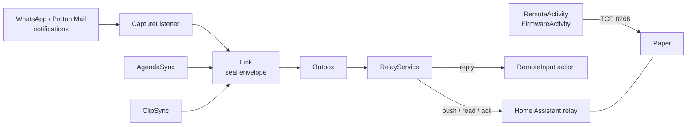

# PaperOS Companion (Android)

Companion app for the PaperOS inbox. It runs on an Android phone (tested on a Pixel 9 Pro, Android 17), reads WhatsApp and
Proton Mail notifications, and sends them end to end encrypted through Home Assistant to the PaperS3 (Home Assistant
relays ciphertext only). It also carries replies, the clipboard, the calendar, remote control and firmware updates.

Protocol: `docs/COMPANION.md`. Decision and open questions: `docs/DECISIONS.md` (D22) and the P6 cards in
`docs/ROADMAP.md`.

**Contents**

- [What it does](#what-it-does-v1-protocol-docscompanionmd) · [Components](#components) ·
  [Notifications](#notifications) · [Pairing](#pairing) · [Relay service](#relay-service)
- [Replies](#replies) · [Agenda](#agenda) · [Clipboard](#clipboard) · [Maintenance](#maintenance)
- [Look](#look) · [Launcher icon](#launcher-icon) · [Privacy and checks](#privacy-and-checks)
- [Tests](#tests) · [Build and install](#build-and-install)

---

## What it does (v1, protocol `docs/COMPANION.md`)



### Components

| Class | Role |
|---|---|
| `CaptureListener` | `NotificationListenerService`: turns notifications into `post`, `remove` and `sync` |
| `proto/` | the protocol in plain JVM code (key schedule, envelopes, QR payload, receive policy, messages, reply guards), tested byte for byte against `tests/fixtures/companion/vectors.json` |
| `KeyVault` | the phone's X25519 key, made inside the Android Keystore (TEE on the Pixel 9 Pro, API 37) per pairing; agreement runs there. Session keys are derived again in memory after a restart |
| `TokenStore` | the Home Assistant long-lived token of a dedicated non-admin user, pasted by the user, AES-256-GCM encrypted with a Keystore key in `noBackupFilesDir`. Never logged, never shown |
| `Link` | pairing state and counters (`noBackupFilesDir/pairing.json`, no secrets) |
| `ScanActivity` | scans the Paper's QR code (CameraX + ZXing, no Play services) |
| `RelayService` | foreground service: outbox, relay reads, acks, `files/status.json` |
| `AgendaSync`, `proto/Agenda` | the calendar as `agenda` runs |
| `ClipSync` | the clipboard in both directions |
| `FirmwareActivity`, `RemoteActivity` | Maintenance: firmware update and remote control |

### Notifications

- **Sources**: `com.whatsapp`, `com.whatsapp.w4b` and `ch.protonmail.android` only. Group summaries are skipped.
- **`post`**: while paired, every post or update goes to the Paper as an encrypted `post`.
  - WhatsApp: MessagingStyle messages, at most 6.
  - Proton Mail: title = sender, text = subject, big text = preview.
- **`remove`**: every removal. Click or app cancel = `read`, user swipe = `dismissed`.
- **`sync`**: the live keys after every (re)connect and hourly.
- Contents go straight into envelopes; nothing keeps titles or texts.

### Pairing

1. Scan the Paper's QR code (`ScanActivity`).
2. The hello goes to the `pairing` queue.
3. Both screens show the 6-digit code; the user taps "The codes match".
4. The app becomes active only after that **and** a valid `paired` envelope.

HTTPS only (cleartext traffic is off).

### Relay service

`RelayService` is a foreground service (type `remoteMessaging`).

- Drains the `Outbox`: pushes in counter order, back-off 30 s doubling to 15 min.
- Reads `sensor.paperos_relay_to_phone` every 3 s while pairing and every minute when paired, acks up to `rx`.
- Writes `files/status.json` (numbers only).

### Replies

Replies from the Paper go through the notification's RemoteInput action, after the guards of COMPANION.md section 7.2:

| Guard | Limit |
|---|---|
| live key | the notification is active and has a reply action |
| age | at most 6 h |
| length | 1..900 characters |
| gap | 10 s since the last send |
| rate | 20 per hour |

- `rx` is stored before the send, so never two sends per counter.
- **Replies are off until the user turns on "Allow replies from the Paper" in the app.** While off, a reply is answered
  with `result` `why: "failed"`.
- `dismiss` does nothing on the phone (v1).

### Agenda

D28, `AgendaSync`, `proto/Agenda`. One way: the Paper never changes the calendar.

- **Switch**: "Share the agenda", off by default; asks for `READ_CALENDAR`.
- **What**: the visible calendars' next 14 days, minus the ones switched off under Paper > Calendars (a new calendar is
  on), sent as `agenda` runs.
- **When**: a changed day's run a minute after the change, the whole window daily and after pairing. Switching off sends
  one empty run.
- Only fingerprints are kept (`agenda.json`).

### Clipboard

D23, `ClipSync`. Switch "Share the clipboard with the Paper" (default on, `settings.json` `clipboard`).

- **Paper to phone**: a `clip` from the Paper replaces the phone's clipboard (label `PaperOS`).
- **Phone to Paper**: only on the user's action, since Android lets an app read the clipboard only while it has focus:
  - the share sheet target "Send to Paper" (`ShareToPaperActivity`),
  - the Quick Settings tile "Clipboard to Paper" (`ClipTileService` opens `ClipToPaperActivity`, which reads on window
    focus),
  - the app's button.
- A clipboard marked sensitive is never sent.

### Maintenance

D40, COMPANION.md section 10.

- **Firmware update** (`FirmwareActivity`): sends a firmware package signed on the Mac to the Paper as `make ota` does.
  `make ota-phone` pushes `paperos.posota` to Downloads; it is picked with the system file picker. The Paper checks the
  signature.
- **Remote control** (`RemoteActivity`): the Paper's screen, and taps, holds and drags as its touch, over the home Wi-Fi
  while the Paper's wireless development is on.
  - A plain TCP socket to port 8266 (not HTTP: the cleartext switch does not apply).
  - Signed in with `HKDF-Expand(k_p2d, "PaperOS remote")`; the Paper allows the screen and touch only.
  - The address comes from the Paper's `remote` message or is typed.

### Look

The PaperOS "Ink" style (`Ink.kt`, docs/UI.md):

- the panel's 16 grays from its warm paper (`#E4E4DF`, measured on photos of the PaperS3) to its ink (`#1E1E1E`),
- Inter and Lucide icons (`res/font`, licences in `assets/licenses`),
- list rows with dividers, ink and outline buttons, the Paper's pill toggle,
- light only, edge to edge with the system-bar insets.

### Launcher icon

The PaperOS mark, ink on paper (its design: [UI.md "The PaperOS mark"](../docs/UI.md#the-paperos-mark)).

- Adaptive icon from vector drawables only: `res/mipmap-anydpi/ic_launcher.xml`, `res/drawable/ic_launcher_foreground.xml`,
  `ic_launcher_monochrome.xml` for themed icons, background `ic_launcher_background` in `res/values/colors.xml`.
- The mark is 34 x 52 of the 108 box, inside the 66 dp safe zone.

### Privacy and checks

- Backup and device transfer are off. No accessibility service.
- **Notification contents are the user's private messages: never log, print or commit them.** Check the app with numbers
  only.

```bash
adb shell run-as nl.paperos.companion cat files/counts.json
```

```bash
adb shell run-as nl.paperos.companion cat files/status.json
```

`status.json` holds `stage`, `outbox` (waiting), `pushed`, `accepted`, `dropped`, the last HTTP codes, and the shape of
the relay queues after a push (`to_paper.n`, `max_len`, `max_id`; `pairing.n`, `len`).

## Tests

JVM unit tests:

```bash
cd android && ./gradlew :app:testDebugUnitTest
```

| Where | Covers |
|---|---|
| JVM | the shared companion vectors (keys, code, hello, post, reply, rejects), receive policy, messages and their size limits, reply guards, HKDF RFC 5869, QR decode, outbox and drain |
| JVM, `RemoteTest` | also runs against a simulator on the Mac: `./gradlew :app:testDebugUnitTest -Premote.sim=localhost:8266` |
| On the phone | Keystore X25519, wrapped fallback, low-order peer, RFC 7748, ChaCha20-Poly1305, the companion vectors through Conscrypt |
| On the phone, `RemoteDeviceTest` | remote control over the real Wi-Fi against the Mac's simulator with the vectors' pairing, `-e remoteSim <mac address>:8266`. With `-e paper 1` it also checks, with this phone's real pairing, that the Paper refuses files, log, settings and restart to the phone |

On-phone tests: build both APKs, install, run with `am instrument`, then remove the test APK.

```bash
cd android && ./gradlew :app:assembleDebug :app:assembleDebugAndroidTest
```

```bash
adb install -r android/app/build/outputs/apk/debug/app-debug.apk && adb install -r android/app/build/outputs/apk/androidTest/debug/app-debug-androidTest.apk
```

```bash
adb shell am instrument -w nl.paperos.companion.test/androidx.test.runner.AndroidJUnitRunner && adb uninstall nl.paperos.companion.test
```

**Do not use `connectedAndroidTest`**: it uninstalls the app afterwards, which drops the notification-access grant and the
phone key.

To check the app works without reading contents, read `counts.json` only (see [Privacy and checks](#privacy-and-checks)).

## Build and install

Needs JDK 17 and the Android SDK (`~/Library/Android/sdk`; `local.properties` points at it and is not committed).

1. Build:

   ```bash
   cd android && ./gradlew :app:assembleDebug
   ```

2. Install:

   ```bash
   adb install -r android/app/build/outputs/apk/debug/app-debug.apk
   ```

3. Grant notification access:

   ```bash
   adb shell am start -a android.settings.ACTION_NOTIFICATION_LISTENER_SETTINGS
   ```

   Sideloaded apps on Android 13+ get "restricted settings": if the access switch is greyed out, open App info > ⋮ > Allow
   restricted settings first, then grant notification access.

4. Check the listener is bound:

   ```bash
   adb shell dumpsys notification | grep -A3 -i "nl.paperos.companion"
   ```
