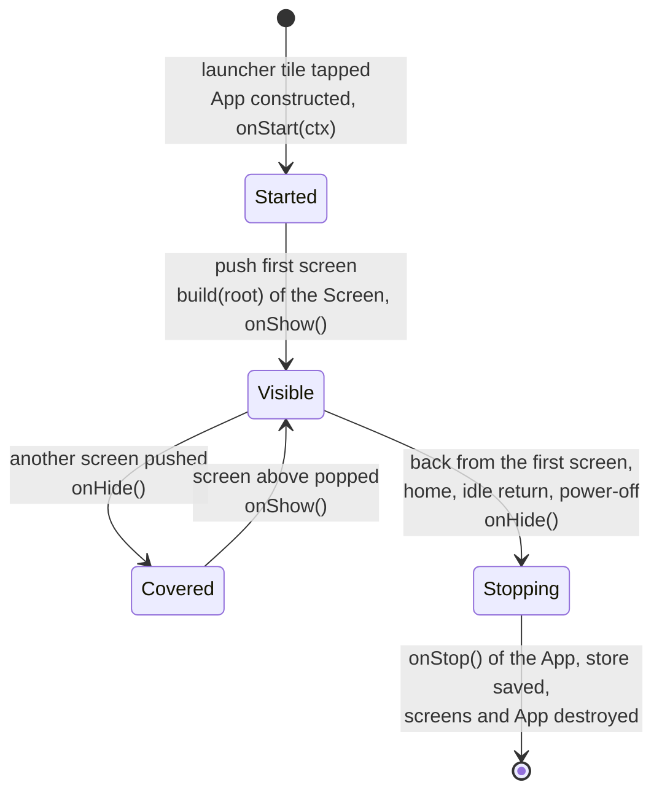
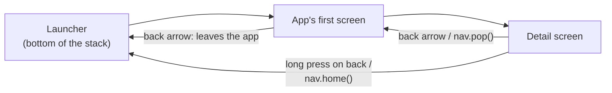
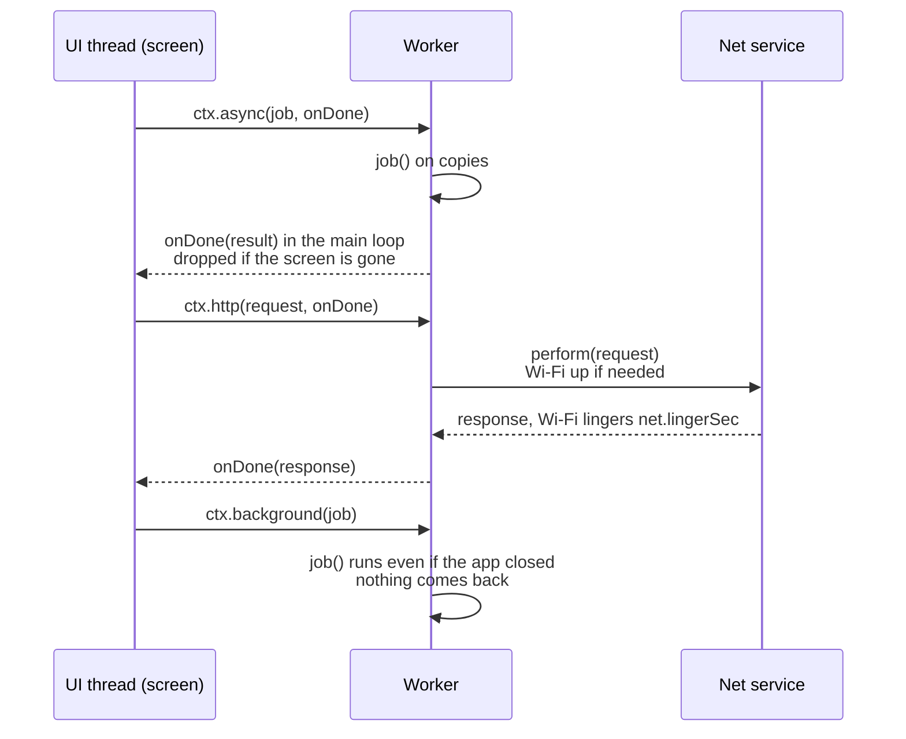

# Writing apps

An app is a folder under `src/apps/` with one class. Adding an app never requires touching the core: create the
folder, register the class, rebuild. The framework was built in tasks P2-4 and P2-5; this doc is its contract.

It covers registration, the lifecycle, navigation, what an app gets (`AppContext`), threads, errors, the rules for app
code and the checklist for a new app.

**Contents**

- [Minimal app](#minimal-app) · [Registration](#registration) · [Lifecycle](#lifecycle) ·
  [Screens and navigation](#screens-and-navigation)
- [What an app gets](#what-an-app-gets) · [Threads](#threads) · [Errors](#errors)
- [Rules for app code](#rules-for-app-code) · [Checklist for a new app](#checklist-for-a-new-app) ·
  [Framework files](#framework-files) · [Built-in apps](#built-in-apps)

---

## Minimal app

```cpp
// src/apps/hello/hello_app.cpp
#include "core/app.h"
#include "ui/widgets.h"

namespace pos::apps::hello {

class HelloScreen : public Screen {
 public:
  void build(ui::Column& root) override {
    setTitle("Hello");
    label_ = root.add<ui::Label>("Tap the button", ui::Type::Body);
    root.add<ui::Button>("Count", [this] {
      ++count_;
      label_->setText("Tapped " + std::to_string(count_) + " times");   // invalidates itself
    });
  }

 private:
  ui::Label* label_ = nullptr;
  int count_ = 0;
};

class HelloApp : public App {
 public:
  void onStart(AppContext& ctx) override { ctx.nav.push<HelloScreen>(); }
};

POS_REGISTER_APP(HelloApp, {
    .id = "hello",          // unique, lowercase; also the config and cache namespace
    .name = "Hello",        // label under the launcher tile
    .icon = Icon::Info,     // from src/gen/icons.h
    .order = 90,            // position in the launcher (lower first)
});

}  // namespace pos::apps::hello
```

That is the whole app. This code is compiled verbatim in `tests/unit/app_test.cpp` and tested.

## Registration

`POS_REGISTER_APP` adds the app to a static registry that the launcher reads, sorted by `order`, then id.

- **Static initialiser** in the app's `.cpp`. PlatformIO links `src/` objects directly (no archive), so nothing is
  dropped; no extra linker flag is needed. If a new app does not show up in the launcher, check that its folder is
  built (`build_src_filter` in `platformio.ini` excludes only `apps/_template/`).
- **Field order matters** (designated initialisers):

| Field | Meaning |
|---|---|
| `.id` | unique, lowercase; also the config and cache namespace |
| `.name` | label under the launcher tile |
| `.icon` | from `src/gen/icons.h` |
| `.order` | position in the launcher (lower first) |
| `.stayOpen` | optional, default `false`; see [Staying open](#staying-open) |

### Opened at a place

D38. `ctx.link` holds where something outside the app asked it to open ("date=2026-01-16", "page=1"; "" for the app's
own choice). `ctx.linkValue("date")` returns one key of it.

- Read it in `onStart` or in the first screen's `build`.
- Ignore keys you do not know.
- Today the sleep screen's taps use it (apps/launcher.md "When unused").

### Staying open

apps/launcher.md "When unused", D38. An app nobody touches for the idle time (`power.autoOffMin`) is left for the sleep
screen or the launcher. An auto-off resumes it at the next start only if it stays open.

- **`.stayOpen = true`** (after `.order`): for an app one looks at for minutes without a touch, a book or a game.
- **`bool staysOpen() const`** on a screen: for a single screen that is in use without a finger (a code being compared
  with the phone, files arriving). It is asked at every look, so it may change.
- **Typing** is safe by itself: nothing leaves while the on-screen keyboard shows.

## Lifecycle



| Callback | When | Do here |
|---|---|---|
| `App::onStart(ctx)` | the app was opened | push the first screen |
| `Screen::build(root)` | once per screen instance | create widgets |
| `Screen::onShow()` | every time the screen becomes visible | start loading |
| `Screen::onHide()` | covered by another screen, or the app is leaving | |
| `App::onStop()` | back from the first screen, home, idle return, power-off | save state |
| `App::sleepInfo(info)` | just before power-off, while the app is still open | fill what the sleep screen shows (title, picture, progress); return `true` |

Between `onShow` and `onHide` the screen handles events, async results and timers.

- **One app at a time.** Only one app is alive. Leaving an app destroys it, so it must save what it wants to keep
  (`ctx.store`) in `onStop()` or `onHide()`.
- **Power-off** calls `onStop()` first. So does the idle return: an app left alone for `power.autoOffMin` is closed the
  same way ([Staying open](#staying-open)).
- **Order when leaving**: top screen `onHide`, `App::onStop`, the store is saved, then the screens and the App are
  destroyed. Pending `ctx.async` results of the app are dropped.

## Screens and navigation

The Shell (`core/shell`) is the `Surface` the Os shows: status bar, title bar, and a stack of screens with the launcher
at the bottom.



- **`ctx.nav`**: `push<S>(args...)`, `pop()`, `home()`. They run after the current gesture or callback returns, so a
  button can pop its own screen. Back from an app's first screen leaves the app.
- **`pos::Screen`** is the app-level screen; the widget surface of the whole panel is `ui::Root`.
- **`Screen::build(root)`** gets a `ui::Column` with 24 px side margins inside the content area. The title bar (back
  arrow, title; long press on the arrow = launcher) is shown for every app screen and hidden for the launcher.
- **`fullScreen()`** returning `true` gives the screen the whole panel: no status bar, no title bar, no side margins (the
  reader's page). It then draws its own way out (the reader's menu).
- **`sideMargin()`** changes the side margins of a screen that keeps the bars (Teletekst: 10 px, its grid of 40
  characters is 520 px wide); everything else stays at 24.
- **`debugState()`** is a one-line description for UI scripts (`expect-state`, `page-through`).
- **Title bar**: `setTitle`, `setAction(icon, fn)` (an icon button at the right end), `setTitleAccessory` (UI.md
  "Screen anatomy").
- **Status bar clock**: local time (`net.timezone`); "--:--" while the RTC is unset.

## What an app gets

`AppContext` (`core/app.h`):

| Member | Purpose |
|---|---|
| `ctx.nav` | `push<S>(args...)`, `pop()`, `home()` |
| `ctx.async(job, onDone)` | run `job` on the worker thread, deliver its result to `onDone` on the UI thread; dropped if the screen is gone |
| `ctx.background(job)` | run `job` on the worker thread, nothing comes back; it runs even if the screen or the app closes first (save a file, switch something off) |
| `ctx.http(request, onDone)` | convenience over `async`: brings Wi-Fi up, performs the request, applies the Wi-Fi linger policy. Offline: status 0 and error "No Wi-Fi: ..." |
| `ctx.transport()` | for a job that makes several requests in a row (`ctx.async`): what the job calls to send one, with the same Wi-Fi handling as `ctx.http`. One job, one update of the screen (Hacker News: a list is two requests). Blocking: never on the UI thread |
| `ctx.ha()` | a Home Assistant client for jobs on the worker (`HA_URL` / `HA_TOKEN` from the card, Wi-Fi on demand; BACKEND.md). Blocking: never on the UI thread |
| `ctx.store` | per-app key/value JSON persisted at `/data/apps/<id>.json`: `get<T>(key, default)`, `set(key, value)`, `save()` |
| `ctx.config` | read-only system settings (`config.json`) |
| `ctx.secrets` | read-only secrets by key (`HA_TOKEN`), from `/sd/paperos_config`: `present`, `get`; never log or show values |
| `ctx.cache` | `read(name)`, `write(name, text)` under `/data/cache/<id>/`: show stale data first |
| `ctx.timer(ms, fn)` | one-shot timer on the UI thread; cancelled with the screen |
| `ctx.keepWifi()` | counts as use of the connection: Wi-Fi, when up, stays up another `net.lingerSec`; never brings it up. For a screen whose next tap is most likely a request (Teletekst), bounded by the caller |
| `ctx.syncClock(done)` | the clock was lost (battery ran flat): joins Wi-Fi once and waits up to 12 s for the time sync; `done(ok, error)` |
| `ctx.toast(text)` | 3 s message |
| `ctx.clock` | `now()`, `millis()` |
| `ctx.log(fmt, ...)` | `POS_LOG` with the app id as tag |
| `ctx.link`, `ctx.linkValue(key)` | where the app was asked to open ([Opened at a place](#opened-at-a-place)) |
| `ctx.appId()` | the app's id |
| `ctx.os()` | the Os: for built-in system apps only (Settings changes config, cleans the panel) |

Timers and async results are tied to the screen that was on top at the call: a timer is cancelled and a result dropped
when that screen is gone. All pending results are dropped when the app is left.

### Opening the WhatsApp compose screen from another app

`#include "apps/inbox/compose.h"`, then `whatsapp::sendToFavorite(ctx, "Family", text)` (or `openCompose` /
`openNewMessage`).

- The compose screen is pushed onto your app's stack.
- The user confirms before anything is sent; back returns to your screen (apps/inbox.md "Sending").
- To hand text to any app instead, use the clipboard: `clipboard::set(text, "<your app id>")` (`core/clipboard.h`, D21).

## Threads

Two threads, and an app only ever writes code for the first:

- **The UI thread** runs everything of a screen: `build`, `onShow`, widget handlers, timers, and the `onDone` of
  `ctx.async`. Widgets and the screen's members are touched here and nowhere else, so an app needs no locks.
- **The worker** runs what takes time, one job after the other (FIFO): `ctx.async(job, onDone)` when the screen wants
  the result, `ctx.background(job)` when nobody waits for it. A job gets copies (capture by value) and touches no
  widget, no `this`, no `ctx`.



### What goes where

| Work | Where | Why |
|---|---|---|
| saved state in `/data`: `ctx.store`, `ctx.cache`, small files (up to 16 KB) | UI thread, in `build()` | `core/fs` answers them from memory after the first read (a file on the flash costs ~9 ms to open); the first frame already shows the data |
| the network (`ctx.http`, `ctx.ha()`), the SD card, big files, anything over a few ms of computing | `ctx.async` | it blocks for hundreds of ms to seconds |
| writing a file after a refresh, switching the radio back, cleaning up | `ctx.background` | a write to the flash is ~35 ms; and it must happen even when the user leaves at that moment |
| the phone pairing with its keys (`companion::loadPairing`), making or opening envelopes | `ctx.async` | deriving the session keys is ~50 ms; a screen that only asks "is a phone paired?" uses `companion::pairedPhone()` |

### Stack size

**The UI thread's stack is 8 KB on the device** (`CONFIG_ARDUINO_LOOP_STACK_SIZE`; the worker's is 16 KB) and the
simulator's is not. A local of a few KB in screen code (a parsed page, a big array) works in every test and overflows on
the device. Keep such things on the heap (`std::make_shared`, a `std::vector`, a member of the screen); Teletekst's
8 KB `Page` is the example.

### Fewer passes

On this panel every extra pass shows (DISPLAY.md), so the order matters more than on an LCD:

1. **Read what is saved before the first frame, not after it.** "Draw empty, load in the background, draw again" is two
   passes over the screen; reading the saved copy in `build()` is one. This is why small `/data` files are kept in
   memory instead of being made asynchronous.
2. **One result, one change.** In `onDone`, set the new values on the widgets that exist. Their setters compare, and a
   widget whose text did not change is not drawn again (`Label::setText`, `ListItem::set*`, `PagedList::refill`). Do
   not rebuild the screen for a result that changed two values.
3. **`relayout()` only when sizes change** (rows came or went, a bar appeared). It is a whole-screen pass.
4. **Several results at once, not one after the other.** One job that fetches everything a screen needs
   (`HaClient::getMany`, one relay read) gives one update; three jobs give three.
5. **What changes together is one region.** Three widgets that change in one callback are three regions, and each is a
   push that waits for the one before (280 ms on the panel against 70). Invalidate their common parent once
   (`parent->invalidate(Hint::Content)`; Hacker News `oneChange`).
6. **Nothing is drawn on the finger going down that the tap replaces.** A pressed look in flight delays the result
   (`Pressable`, `PagerBar` and `Segmented` wait `kPressDelayMs` for that).
7. **Dropped work**: a result for a screen that is gone is dropped by itself (`ctx.async`); a job nobody waits for any
   more is not even started when the app closes. What must happen all the same goes to `ctx.background`.

### Measured

On the device:

| Case | Before | After | Change |
|---|---|---|---|
| Leaving an app for the launcher, before the first pixel | 134-354 ms | 15 ms | the launcher's 16 small files kept in memory instead of read on the UI thread |
| Leaving an app, tap to panel | 255-476 ms | 137 ms | same |
| Opening WhatsApp or Mail, before the first pixel | 53-54 ms | 18-19 ms | `pairedPhone()` instead of deriving the pairing's keys twice |
| Opening WhatsApp or Mail, tap to panel | 221-238 ms | 179-197 ms | same |

- The shell logs `[perf] close <app> took N ms: ...` when leaving an app costs 30 ms or more.
- **Measure before moving work**: the first guess for WhatsApp and Mail (cleaning the saved messages) cost nothing
  measurable on the device.

## Errors

Handle failure visibly:

- **First load failed**: `EmptyState` with a Retry button.
- **Cached data on screen**: `Toast`.
- **Home Assistant**: `apps::addHaErrorState(holder, error, retry)` (`apps/common/ha_error_state.h`). The same words in
  every app, and a missing or refused token is told apart from "cannot reach".

## Rules for app code

1. **Never block**: no `delay`, no HTTP, no SD card, no file of more than a few KB on the UI thread. Use `ctx.async` /
   `ctx.http` / `ctx.background` ([Threads](#threads) says what goes where).
2. **Never draw directly** to the canvas outside a widget's `draw()`; never call the display. Change widget state and
   `invalidate()` with the right hint (`DISPLAY.md`).
3. **Theme tokens and existing widgets** (`UI.md`). A new widget goes in `src/ui/` if a second app could use it, with a
   line in the widget table of `UI.md`.
4. **Paginate lists** with `ui::PagedList` (or `ui::Pager` when a page is more than rows). No scrolling, no animation.
5. **Cached data first**, then refresh: `ctx.cache.read` in `onShow`, then `ctx.http`.
6. **Show failures** as in [Errors](#errors).
7. **Shared code only**: no `Arduino.h`, `M5Unified.h`, `SDL.h` (see `ARCHITECTURE.md`).
8. **No private copies of helpers**: text, dates, paths, sheets, badges are in the table of `ARCHITECTURE.md` "Code
   conventions". The launcher badge is `setAppBadge(ctx.appId(), n)`.

## Checklist for a new app

1. `tools/new-app.sh <id> "<Name>" <Icon>` (task P2-5) copies `src/apps/_template/` (excluded from every build) and
   fills in the names. It also writes `tests/ui/<id>.script` and a `docs/apps/<id>.md` stub. Or copy the folder by hand.
2. If the icon is not in `assets/icons.txt`, add its Lucide name and run `tools/gen-assets.sh`.
3. Write screens. Run `make run` or `program --app <id>`.
4. Add `tests/ui/<id>.script` with at least one `shot` per screen and, if it uses HTTP, fixtures under
   `tests/fixtures/http/`. Run `make ui-test` (it reports the new screenshot), look at the images, then
   `make ui-accept`.
5. Write `docs/apps/<id>.md`: purpose, screens, data sources, config keys.
6. `make check`.

## Framework files

Built in P2-4:

| File | Content |
|---|---|
| `core/app.h` | App, Screen, Nav, AppContext, registry, `POS_REGISTER_APP` |
| `core/shell.{h,cpp}` | the Shell: status bar, title bar, the screen stack with the launcher at the bottom |
| `core/store.{h,cpp}` | `Store`, `Cache` |
| `ui/chrome` | StatusBar, TitleBar, TabBar |
| `ui/widgets.h` | umbrella header of the widget kit |
| `src/apps/apps.cpp` | `apps::createSurface(name, os)`, called by the platform mains |

`apps::createSurface(name, os)` picks what to show:

| `name` | Shows |
|---|---|
| "" | the launcher; after a power-off, the app that was open comes back once |
| a registered app id | the launcher with that app opened |
| a UI test screen name | that test screen (`apps/uitest`) |

## Built-in apps

| App | Doc | Phase |
|---|---|---|
| Launcher (home screen, not in the registry) | `apps/launcher.md` | P2 |
| Settings | `apps/settings.md` | P2, P3 |
| Read | `apps/reader.md` | P4 |
| Home (Home Assistant) | `apps/home.md` | P5 |
| WhatsApp, Mail (two tiles, one implementation) | `apps/inbox.md` | P6 |
| Somdoku (daily sum puzzle) | `apps/somdoku.md` | P7 |
| Word game (daily five-letter word game in Dutch) | `apps/wordgame.md` | P7 |
| Weather (Google Weather through Home Assistant) | `apps/weather.md` | P7 |
| Agenda (the phone's calendar, one way) | `apps/agenda.md` | P7 |
| Teletekst (NOS Teletekst, page by page) | `apps/teletekst.md` | P7 |
| Hacker News (story lists, comments, articles as text) | `apps/hackernews.md` | P7 |
| Schaken (chess against the Lichess computer or the Paper) | `apps/chess.md` | P7 |
