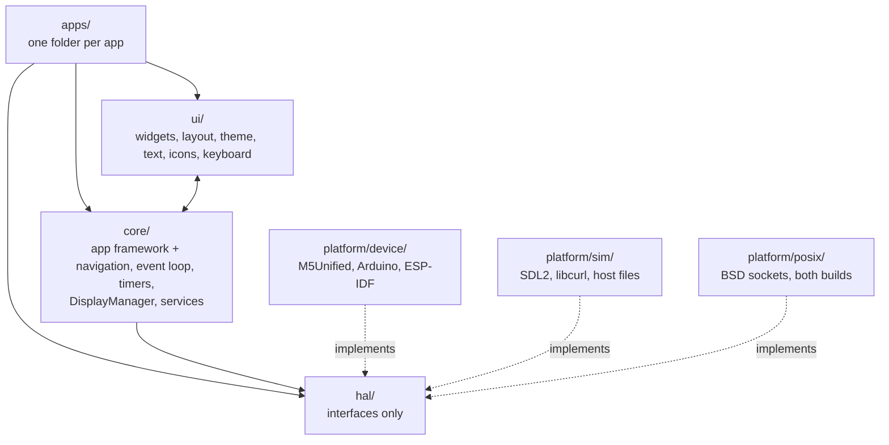
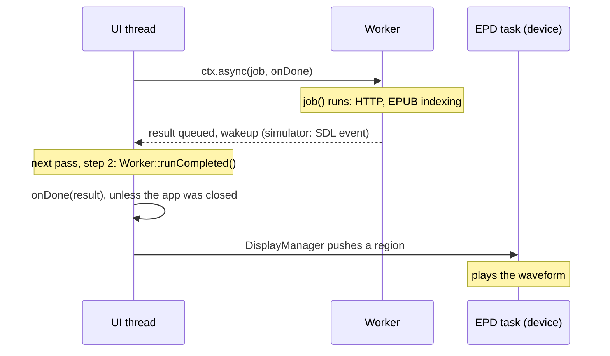
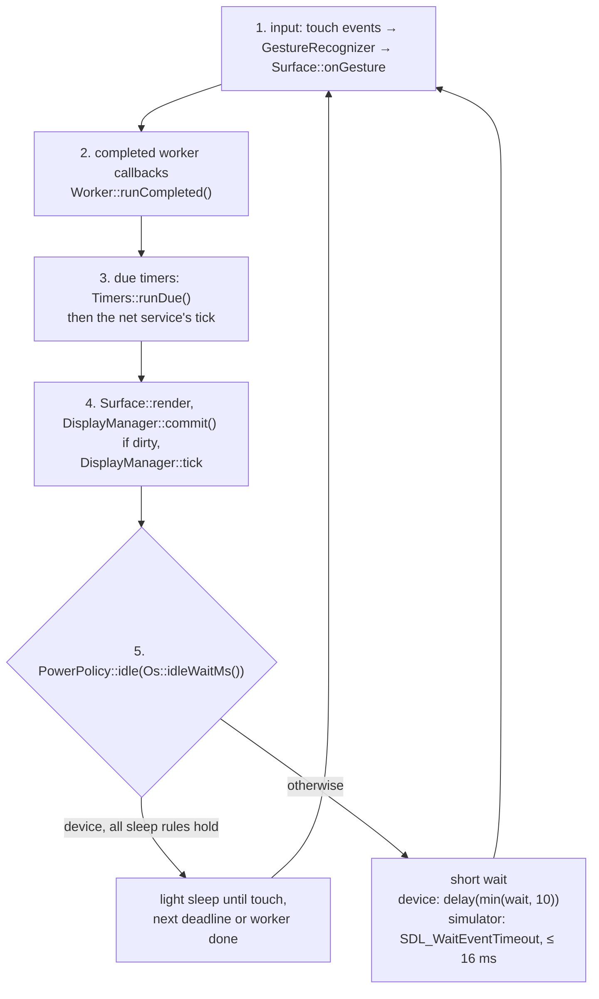

# Architecture

PaperOS is one firmware image for the M5PaperS3 plus a desktop simulator built from the same source. "OS" here means a
launcher, an app framework, a UI kit, a display manager tuned for e-ink, and system services (Wi-Fi, storage, time,
power). Apps are C++ classes compiled into the image. There is no dynamic loading.

This doc covers the layers, the directory layout, the threads and main loop, the HAL, storage, and the flash and memory
budgets. Decisions and their reasons are in `DECISIONS.md`: read that before proposing a different stack.

**Contents**

- [Layers](#layers) · [Directory layout](#directory-layout)
- [Runtime model](#runtime-model): [Threads](#threads) · [Main loop](#main-loop) · [Rendering path](#rendering-path)
- [HAL interfaces](#hal-interfaces) · [Files](#files) · [Storage layout](#storage-layout)
- [Flash layout](#flash-layout) · [Memory budget](#memory-budget) · [Third-party libraries](#third-party-libraries)
- [Code conventions](#code-conventions)

---

## Layers



Arrows mean "may include". `core` and `ui` use each other: the app framework and the shell (`core/app.h`,
`core/shell.h`, the sleep screen, the quick panel) build on widgets. Nothing outside `apps/` includes `apps/`.

| Layer | Contents | Docs |
|---|---|---|
| `apps/` | launcher, reader, home, inbox, agenda, weather, teletekst, hackernews, somdoku, wordgame, chess, settings | `APPS.md`, `docs/apps/*.md` |
| `ui/` | widgets, layout, theme, text, icons, keyboard | `UI.md` |
| `core/` | app framework + navigation, event loop, timers, DisplayManager; services: net, config, storage, time, power policy, log | `APPS.md`, `DISPLAY.md`, `POWER.md` |
| `hal/` | interfaces only: Display, Input, Net, Power, Clock, HttpServer, Updater, plus system hooks (`hal/system.h`) | [HAL interfaces](#hal-interfaces) |
| `platform/device/` | M5Unified, Arduino, ESP-IDF | `HARDWARE.md` |
| `platform/sim/` | SDL2, libcurl, host files | `SIMULATOR.md` |

### The rule that keeps the simulator honest

- **No platform headers in shared code.** Nothing under `src/core`, `src/ui`, `src/apps` or `src/hal` may include
  `Arduino.h`, `M5Unified.h`, `SDL.h`, ESP-IDF headers or `<curl/...>`. Those live only under `src/platform/`.
- **Allowed third-party headers** in shared code: `M5GFX.h` (sprite drawing and fonts work on both platforms),
  `ArduinoJson.h`, and the C++ standard library.
- **Checked by `make check`**, which builds both targets.

## Directory layout

```
platformio.ini        two environments: sim (native) and papers3 (device), plus test
partitions.csv        flash layout
Makefile              developer commands (make help)
docs/                 all documentation; ROADMAP.md + STATUS.md drive the work
src/
  core/               gfx.h (types), app framework, display manager, services
  ui/                 widget kit
  apps/<name>/        one folder per app
  apps/common/        what several apps share: the Home Assistant error screen, the daily games' clock and score helpers
  hal/                abstract interfaces (headers only)
  platform/device/    main.cpp + HAL implementations on M5Unified
  platform/sim/       main.cpp + HAL implementations on SDL/host, UI script runner
  platform/posix/     implementations on BSD sockets, built for both: the HTTP server of Files over Wi-Fi (D30),
                      the remote server of Wireless development (D39)
  gen/                generated fonts and icon tables. Never edit by hand (tools/gen-assets.sh)
lib/miniz/            vendored tinfl (EPUB unzip)
assets/               source TTF fonts, icon list, emoji atlases
tools/                asset generation, UI test runner, book fetch, USB file push, device and camera tools
tests/
  ui/                 simulator scripts (*.script), golden screenshots, preset data per script
  fixtures/http/      canned HTTP responses for offline simulator runs
  unit/               host unit tests for pure logic (pagination, JSON mapping, zip)
sim-data/
  sd/                 stands in for the microSD card (books/ etc.)
  data/               stands in for the internal LittleFS (config.json, caches)
android/              companion app for the inbox (Android)
ha/                   Home Assistant package YAML for the inbox feeds (docs/BACKEND.md)
backup/               factory firmware image (not in git)
out/                  screenshots and test output (not in git)
```

Folders that do not exist yet are created by the roadmap task that needs them.

## Runtime model

### Threads

| Thread | Owner | Does |
|---|---|---|
| UI thread | Arduino `loopTask` on the device (core 1, priority 1, 16 KB stack), `main()` in the simulator | Everything visible: input dispatch, app code, drawing into the canvas, DisplayManager. Owns all app and widget state. |
| Worker | `core/worker` (one `std::thread`; on the device 16 KB stack, core 0, priority 1) | Blocking jobs: HTTP requests, EPUB indexing. Never touches the canvas or widgets. |
| EPD task | M5GFX (device only) | Plays e-ink waveforms. We only queue regions to it. |

- **App code is single-threaded.** To do something slow, an app calls `ctx.async(job, onDone)`. `job` runs on the
  worker and returns a value; `onDone(value)` runs later on the UI thread.
- **Capture by value** in `job`.
- **Stale results are dropped.** If the app was closed meanwhile, `onDone` never runs: `cancelAll()` bumps a generation
  counter, and the framework checks it.
- **The worker is pinned to core 0.** A long job (indexing a book: 7-17 s) must never take the UI loop's core.
- **Fire and forget**: `ctx.background(job)` for work that must happen but returns nothing (`core/app.h`).



### Main loop

The UI thread runs this loop. There is no fixed frame rate: nothing is drawn unless something was invalidated.



| Piece | Where | Does |
|---|---|---|
| `Os::loopOnce()` | `core/os.h` | steps 1-4 (P1-7). With a `Surface` set, touches go through `GestureRecognizer` to it and step 4 calls `Surface::render`. |
| `Loop::iterate()` | `core/loop.h` | adds step 5: `PowerPolicy::idle(Os::idleWaitMs())` |
| `Os::idleWaitMs()` | `core/os.cpp` | time to the next timer, DisplayManager, gesture or net deadline; 0 if work is waiting; at most 1 s |
| `PowerPolicy` | `core/power_policy.h` | light-sleeps only when all its rules hold (`decideSleep`), else the platform's short wait; also auto-off (POWER.md) |
| `Timers` | `core/timers.h` | `after`, `every`, `cancel`; earliest first; callbacks may add timers, which wait for the next pass |
| `Worker` | `core/worker.h` | `async(job, onDone)`, FIFO; `cancelAll()` bumps a generation so stale callbacks are dropped |

- **Device wait**: touch is polled each pass, so the short wait is `delay(min(wait, 10))`.
- **Simulator wait**: an SDL event, at most 16 ms. A finished worker job pushes an SDL event (`Os::setWakeup`).
- **Worker start**: `Os::setup()` starts the thread. The device first sets its stack to 16 KB with
  `esp_pthread_set_cfg`. This costs ~20 KB of internal heap (measured when added: 282 KB -> 245 KB free).

### Rendering path

Widgets draw into one full-screen 8-bit grayscale canvas (`pos::Canvas`, an `LGFX_Sprite`, 540x960 = 518 KB in PSRAM).
The DisplayManager compares the canvas with what the panel last showed, and pushes only changed rectangles, each with a
refresh mode. Details: `DISPLAY.md`.

## HAL interfaces

Defined in `src/hal/*.h` (task P1-1). Sketch; the final signatures are in the headers:

```cpp
namespace pos::hal {

struct TouchEvent { enum Type : uint8_t { Down, Move, Up } type; int16_t x, y; uint32_t ms; };

class Display {                 // device: M5.Display   sim: SDL window + e-ink emulation
 public:
  virtual void push(const Canvas& frame, Rect area, Refresh mode) = 0;  // queue a region
  virtual bool busy() = 0;                                              // waveform still running
  virtual void wait() = 0;
};

class Input {                   // device: M5.Touch (GT911)   sim: mouse or script
 public:
  virtual bool poll(TouchEvent& out) = 0;       // non-blocking
};

class Clock {                   // device: millis() + BM8563 RTC   sim: real or scripted time
 public:
  virtual uint32_t millis() = 0;
  virtual int64_t now() = 0;                    // unix seconds, 0 if never set
  virtual void set(int64_t unixSeconds) = 0;
};

struct HttpRequest  { std::string method, url, body; std::vector<std::pair<std::string,std::string>> headers; uint32_t timeoutMs = 10000; };
struct HttpResponse { int status = 0; std::string body; std::string error; };   // status 0 = transport error

class Net {                     // device: WiFi + HTTPClient   sim: fake Wi-Fi world + fixtures or libcurl
 public:
  virtual bool wifiConnect(const std::string& ssid, const std::string& pass, uint32_t timeoutMs) = 0;
  virtual void wifiOff() = 0;
  virtual bool wifiConnected() = 0;
  virtual int  rssi() = 0;
  virtual std::vector<WifiNetwork> scan() = 0;
  virtual HttpResponse request(const HttpRequest&) = 0;   // blocking: worker thread only
};

enum class Wake : uint8_t { Touch, Timer, Button, Other };

class Power {                   // device: M5.Power   sim: fake values
 public:
  virtual int  batteryMv() = 0;
  virtual int  batteryPercent() = 0;
  virtual bool charging() = 0;
  virtual Wake lightSleep(uint32_t maxMs) = 0;  // returns on touch, button or timeout
  virtual void powerOff(uint32_t wakeAfterSec) = 0;   // 0 = until the button is pressed
};

struct Platform {
  Display& display; Input& input; Clock& clock; Net& net; Power& power; const char* name;
  HttpServer* http = nullptr;   // Files over Wi-Fi; null where there is none
  Updater* update = nullptr;    // firmware update over Wi-Fi; null where there is none
};

void logWrite(const char* line);   // log sink, defined by each platform (stderr / Serial)

}  // namespace pos::hal
```

- **`Platform`** is built in each platform's `main.cpp` and handed to `pos::Os` (`core/os.h`), which owns the frame
  canvas and runs `setup()` / `loopOnce()`. `name` is shown in the demo footer.
- **`HttpServer`** (`hal/http_server.h`): the local file server; device port 80, simulator 8080.
- **`Updater`** (`hal/update.h`): writes the other app slot, confirms or rolls back a new image (D37).
- **System hooks** (`hal/system.h`): storage sizes, memory, restart, board name, MAC address, build id, `chime()`.

### Files

Files need no HAL class. Both platforms have POSIX file APIs: on the device the SD card is mounted at `/sd` and LittleFS
at `/littlefs` through the ESP-IDF VFS, so `fopen` and `opendir` work (no `<fstream>` in firmware code: D31).

Shared code uses virtual paths `/sd/...` and `/data/...` and calls `pos::fs::resolve(path)` (`core/fs.h`), which maps them:

| Virtual | Device | Simulator |
|---|---|---|
| `/sd/...` | `/sd/...` (microSD) | `sim-data/sd/...` |
| `/data/...` | `/littlefs/...` (internal flash, 5.9 MB) | `sim-data/data/...` |

| `pos::fs` call | Does |
|---|---|
| `resolve` | virtual to real path; "" for paths outside `/sd` and `/data` and for any `..` component |
| `normalize` | one spelling of a virtual path |
| `exists`, `isDir`, `fileInfo` | stat (size and mtime) |
| `readFile`, `appendFile` | whole-file read, append (creates the file and its folders) |
| `writeFile` | atomic: `<path>.tmp` + rename, creates parent folders |
| `listDir` | sorted `DirEntry{name,isDir,size}` |
| `mkdirs`, `rename`, `removeAll` | folders, move, recursive delete |
| `Writer`, `Reader` | large files: sequential write, random-access read |
| `setRoots` | change the roots (tests) |

The simulator roots are relative to the working directory: run it from the repository root.

## Storage layout

```
/sd/books/                    EPUB and TXT files copied onto the card
/sd/books/.paperos/<id>/      per-book cache: page index, extracted cover, progress
/sd/paperos_config            secrets, KEY=VALUE: HA_TOKEN, HA_URL, WIFI_SSID, WIFI_PASSWORD (read-only for us)
/sd/paperos/home.json         optional override of the Home app layout
/sd/paperos/emoji/            emoji atlases (UI.md "Emoji")
/data/config.json             settings (no secrets)
/data/system.json             scheduled wake state across a power-off
/data/apps/<id>.json          per-app key/value store (core/store.h)
/data/wifi.json               Wi-Fi networks added on the device
/data/home.json               Home app layout (tiles -> entities), see docs/apps/home.md
/data/cache/                  last fetched feeds, so apps can show stale data instantly
/data/power.csv               power log, one line every 10 minutes (POWER.md "Measuring"); power.old.csv before it
/data/refresh.log             scheduled refresh runs
```

- **The log is not a file.** `POS_LOG` lines go to the serial port or stderr and to an 8 KB RAM ring (`core/log`), read
  with `>log`.
- **Config** is JSON read with ArduinoJson. `core/config` exposes typed getters with defaults; a missing file or key
  never crashes. Schema: `docs/apps/settings.md`.

## Flash layout

16 MB flash, `partitions.csv`:

| Partition | Offset | Size | Purpose |
|---|---|---|---|
| nvs | 0x9000 | 20 KB | Wi-Fi calibration, Arduino preferences |
| otadata | 0xE000 | 8 KB | which app slot boots |
| app0 | 0x10000 | 5 MB | firmware slot A |
| app1 | 0x510000 | 5 MB | firmware slot B |
| storage (LittleFS) | 0xA10000 | 5.9 MB | `/data` |
| coredump | 0xFF0000 | 64 KB | crash dumps (core dumps are off in `custom_sdkconfig`, D27) |

- **Two app slots** (D37): an update over Wi-Fi goes to the slot that is not running. The bootloader falls back to the
  other if the new image is reset before it is confirmed.
- **`make flash`** writes app0 and resets `otadata`.

### Firmware size budget

- **Budget: under 3 MB** of the 5 MB slot. Current size: `docs/STATUS.md`.
- **After the size pass of D31**: 2.31 MB (code 1.6 MB, fonts and icons 0.47 MB, other data 0.26 MB).
- **What keeps it small** (D31): no C++ exceptions, no iostreams, a trimmed ESP-IDF.
- **Past 3 MB**: `make fw` prints the size. If a task pushes it past 3 MB, stop and look at the linker map
  (`.pio/build/papers3/firmware.map`) before continuing: one include can cost 150 KB.

## Memory budget

- **Internal RAM** is for stacks, Wi-Fi and TLS: ~115 KB free at idle, lowest 69-83 KB during a TLS read (STATUS.md).
- **PSRAM** (8 MB) holds everything else. Ordinary `malloc` and `new` go to PSRAM (D27: `SPIRAM_MALLOC_ALWAYSINTERNAL=0`);
  FreeRTOS objects, task stacks and DMA buffers ask for internal RAM and get it from a 32 KB reserve. mbedTLS buffers are
  in PSRAM. Sprites use it via `setPsram(true)`.

| Consumer | Size | Where |
|---|---|---|
| Canvas (8-bit) | 518 KB | PSRAM |
| Shadow of last pushed frame (8-bit, exact copy) | 518 KB | PSRAM |
| M5GFX EPD buffers | ~1 MB | PSRAM/DMA, allocated by the driver |
| Reader: one chapter of text + layout | up to 1 MB | PSRAM |
| JSON documents (HA, inbox) | up to 256 KB | PSRAM |
| UI thread (loop task) stack | 16 KB | internal |
| Worker stack | 16 KB | internal |
| TLS session | ~45 KB | mbedTLS buffers in PSRAM (D27); a TLS read still takes 32-46 KB of internal heap (115 KB -> 69-83 KB) |

Rules:

- **No large stack arrays** (the UI thread stack is 16 KB).
- **No unbounded `std::string` growth** from network input: response bodies are capped at 512 KB.
- **Check every allocation** that can exceed 64 KB.

## Third-party libraries

| Library | Version | Used for | Where |
|---|---|---|---|
| M5GFX | 0.3.0 | sprite drawing, fonts, PNG/JPEG decode, device EPD + touch drivers | shared |
| M5Unified | 0.3.0 | board bring-up, power, RTC, touch, SD | device only |
| ArduinoJson | 7.4.2 | JSON: `core/store` (app key/value files), config (P2-6) | shared (added in P2-4) |
| miniz (tinfl only) | 3.0.2, vendored in `lib/miniz` | EPUB unzip | shared (P4-3) |
| doctest | PlatformIO registry | host unit tests | test only |
| SDL2 | Homebrew (`sdl2-compat`) | window and input | sim only |
| libcurl | macOS system | HTTP | sim only |

Pin exact versions in `platformio.ini`. Do not add a library without an entry in `DECISIONS.md`.

## Code conventions

- **Style**: C++17, namespace `pos` (`pos::ui`, `pos::hal`, `pos::apps::<name>`). Two-space indent, 120 columns,
  `clang-format` default Google style with `ColumnLimit: 120`.
- **No exceptions, no RTTI-dependent code** (they are disabled on the device). Fallible functions return `bool` or a
  small result struct.
- **No `delay()` and no blocking I/O** on the UI thread.
- **Colours** are `pos::Color` (`uint32_t` 0xRRGGBB) and only the 16 grays from `gray(0..15)`. Passing a `uint8_t` or
  `uint16_t` colour to LovyanGFX silently selects RGB332 / RGB565.
- **Logging**: `POS_LOG("tag", "fmt", ...)` (`core/log.h`): serial on the device, stderr in the sim.
- **Panel text** is kept in the app that shows it. Most of it is English; the daily games are Dutch ("Klok zetten").
  Text from Home Assistant (entity names in `home.json`) is shown as-is, in Dutch.
- **One copy of every helper.** Before writing a small helper, look in the table below. A second app that needs one
  moves it here instead of copying it.

### Shared helpers

| Need | Where |
|---|---|
| UTF-8: decode (strict), append, valid, length, prefix (first n characters), truncate (bytes, at a boundary) | `core/utf8.h` |
| trim, lower case, starts/ends with, split and join (also of numbers) | `core/strings.h` |
| day numbers and dates, "14:05", weekday and month names, "is the clock set" | `core/timefmt.h` |
| CRC-32 | `core/crc32.h` |
| paths: one spelling (`normalize`), `isDir`, a write or rename that keeps the old file until the new one is there; small `/data` files answered from memory | `core/fs.h` |
| work off the UI thread: `ctx.async` (the screen wants the result), `ctx.background` (must happen, nothing comes back) | `core/app.h`, APPS.md "Threads" |
| "owed since" marks in a file | `core/time_mark.h` |
| an app's launcher badge | `appBadge` / `setAppBadge` in `core/store.h` |
| sheets (`openSheet`, `confirmSheet`, `Sheet::addButton`), a paged list (`PagedList`), `Widget::removeAll` | `ui/panels.h`, `ui/list.h`, `ui/widget.h` |
| the screen for "Home Assistant could not be read" | `apps/common/ha_error_state.h` |
| daily games: today's date, "Klok zetten", copy the score | `apps/common/daily_game.h` |
