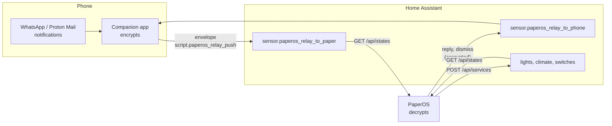
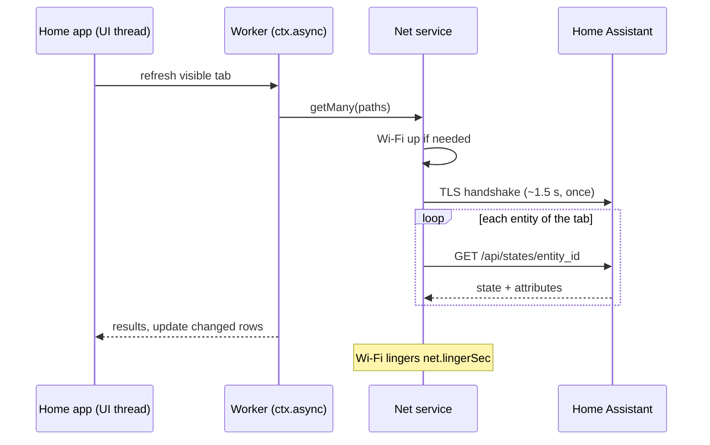

# Backend: Home Assistant is the hub

The device talks to exactly one server: the owner's Home Assistant (HA OS 2026.10, with add-ons and HACS). Home Assistant
does the heavy work; the device only reads small JSON documents. This doc covers the connection and token, the REST calls
the device makes, the inbox feeds and the encrypted relay behind them, and what Home Assistant may and may not see.

**Contents**

- [Two uses](#two-uses) · [Connection](#connection) · [API calls used](#api-calls-used) ·
  [Reading the Home app's states](#reading-the-home-apps-states)
- [Inbox feeds](#inbox-feeds) · [Companion app](#companion-app) · [Mark all read](#mark-all-read) ·
  [Replies through the phone](#replies-through-the-phone)
- [Installing the package](#installing-the-package) · [Privacy](#privacy) ·
  [No fallback through Home Assistant](#no-fallback-through-home-assistant) ·
  [Removed: the add-on route](#removed-the-add-on-route)

---

## Two uses

| Use | What Home Assistant does |
|---|---|
| **Home app** | serves entity states, runs service calls |
| **Inbox (WhatsApp, Mail)** | stores and forwards ciphertext only (D22, "Companion app" below) |

Home Assistant is **not trusted with message text** (DECISIONS.md D22). A companion Android app on the phone reads the
WhatsApp and Proton Mail notifications, encrypts each one for the device, and posts only ciphertext. Home Assistant stores
and forwards it.

- **Built**: the relay and the Paper side, run end to end on the device with a scripted test phone. The Android app is
  built in `android/` (P6-11); its end-to-end acceptance run with real traffic is open.
- **Never**: the device never speaks WhatsApp or IMAP, and Home Assistant never sees a message in plaintext.
- **Removed**: the earlier route (a WhatsApp add-on and Proton Mail Bridge inside Home Assistant, D16/D17). See
  "Removed: the add-on route" below.



## Connection

| Setting | Where | Notes |
|---|---|---|
| Token | `/sd/paperos_config`, line `HA_TOKEN=...` | present on the device's SD card (183 characters); see `apps/settings.md` "Provisioning" |
| Base URL | `/sd/paperos_config` `HA_URL=...`, else `config.json` `ha.baseUrl` | the public HTTPS address (below) |
| User | a dedicated **non-admin** Home Assistant user | the design below needs no admin rights |

- **Base URL**: the public HTTPS address, set as `HA_URL=` on the card, so the device also works away from home. It is
  **never hard-coded in firmware and never committed as a default**: the `config.json` default stays a placeholder.
- **HTTPS vs. HTTP**: HTTPS with the CA bundle is the expected case. The plain `http://` LAN address remains an optional
  alternative at home: no TLS handshake, faster, less RAM.
- **Non-admin user**: the home-assistant repo's standing rule is to never put the Mac's admin token on other devices (the
  TV app has its own non-admin user). Which user the current token belongs to is not confirmed yet: task P5-1.
- **Headers**: every request carries `Authorization: Bearer <token>` and `Content-Type: application/json`.
- **Lost device**: the token sits in plain text on the SD card, so whoever holds the device can read it. Revoke it in
  Home Assistant (profile > Security).

### Cost of TLS

HTTPS is the expected case, and a handshake takes about 1.5 s and about 45 KB of RAM.

- **One kept-alive connection per refresh**: the net service sends every request of that refresh over it (a Home tab reads
  many entities). Do not open a connection per request.
- **Linger**: `net.lingerSec` must be long enough that a second refresh a few seconds later does not pay a second
  handshake (POWER.md "Wi-Fi policy").

## API calls used

The client is `core/ha` (`HaClient`), blocking, on the worker thread (`ctx.async`).

| Purpose | Request | Response |
|---|---|---|
| Test | `GET /api/` | `{"message":"API running."}` |
| One entity | `GET /api/states/<entity_id>` | `{"entity_id","state","attributes":{...},"last_changed"}` |
| Call a service | `POST /api/services/<domain>/<service>` body `{"entity_id":"light.x","brightness_pct":60}` | `200` + list of changed states |
| Service with a response | `POST /api/services/<domain>/<service>?return_response` | `{"changed_states":[...],"service_response":{...}}` |
| Weather forecast (P7-11) | `POST /api/services/weather/get_forecasts?return_response` body `{"entity_id":"weather.thuis","type":"daily"}` (and `hourly`) | `{"changed_states":[],"service_response":{"weather.thuis":{"forecast":[...]}}}` (apps/weather.md) |
| Rain in the next hours (P7-11) | `GET /api/states/sensor.google_neerslag_minuten` | `attributes.segments[]` of Google's minute forecast (apps/weather.md) |
| Sun (P7-11) | `GET /api/states/sun.sun` | `attributes.next_rising`, `next_setting` (ISO times, UTC) |
| Relay push, read, ack | `script.paperos_relay_push`, `GET /api/states/sensor.paperos_relay_to_paper`, `script.paperos_relay_ack` | COMPANION.md section 6 |

**Not used** (they need an admin token, or are too large):

| Request | Why not |
|---|---|
| `GET /api/states` | returns every entity (hundreds of KB) |
| `POST /api/template` | would give everything in one call, but needs an admin token |
| `POST /api/events/<event_type>` | needs admin; "Mark all read" is local now (below), and the relay scripts fire their event for the caller (a non-admin user may call a script, not fire an event) |

## Reading the Home app's states

v1: one `GET /api/states/<id>` per entity in `home.json`, sequentially over one kept-alive HTTP connection (about 30
entities; expected 1 to 2 s on the LAN). Only the visible tab's entities are fetched first; the other tabs follow in the
background.



**Aggregate sensor, only if needed**: if task P5-2 measures more than 3 s for a tab, add a template sensor
`sensor.paperos_home` to the Home Assistant package whose attribute `states` holds `{entity_id: {s, b, ...}}` for the
listed entities, so the device needs one request. Do not build this before measuring.

## Inbox feeds

Both feeds have the same shape, so the device has one implementation (`apps/inbox.md`). The Paper builds the items from
decrypted notifications (`inbox::feedFromNotifs`).

**Former sensors**: before D22, Home Assistant filled these two sensors in plaintext (D16/D17). Both are gone; the layout is
kept because the feed contract below comes from them.

| Entity | state | attributes |
|---|---|---|
| `sensor.paperos_whatsapp_inbox` | unix time of last change | `items`: list, newest first, max 30; `updated` |
| `sensor.paperos_mail_inbox` | unix time of last change | `items`: list, newest first, max 20; `updated` |

### Feed contract

One item:

```json
{ "id": "1763200000-31612345678", "from": "Anna", "chat": "Family", "text": "Are you coming at six?",
  "ts": 1763200000, "key": "31612345678@s.whatsapp.net" }
```

| Field | WhatsApp | Mail |
|---|---|---|
| `id` | timestamp + sender number | IMAP uid |
| `from` | sender display name | sender address/name |
| `chat` | group name, or empty for a direct chat | empty |
| `subject` | absent | mail subject |
| `text` | message text, max 500 chars | start of the body as plain text, max 1500 chars |
| `ts` | unix seconds | unix seconds |
| `key` | chat id (JID): used to drop a chat's items | IMAP config entry id: used to fetch the full text |

Since D22 this is the shape of a feed **after the device has decrypted it**. The relay holds ciphertext; the device turns
each decrypted item into this contract, and the list, detail and badge code stay as they are. The relay's own layout is
fixed in tasks P6-8/P6-9 (ROADMAP.md).

What a notification gives:

- **WhatsApp** (MessagingStyle): sender, group name and the message texts.
- **Proton Mail**: sender and subject, maybe a short preview, never the full body. So mail `text` is short and `key` no
  longer names an IMAP entry.

### The relay package

`ha/paperos_inbox.yaml` is a copy of the live `packages/paperos_inbox.yaml` in the Home Assistant config repo. The Home
Assistant repo is the source; sync by copying. It is the **companion relay** (home-assistant commit `e04d613`):

- **Scripts**: `script.paperos_relay_push`, `script.paperos_relay_ack`.
- **Queue sensors**: `sensor.paperos_relay_to_paper`, `_to_phone`, `_pairing` (COMPANION.md section 6).
- **Checked live**: the queue template in Home Assistant's own engine (16 cases), push / duplicate / bad input / ack through
  REST, and a full round trip with the device (STATUS.md).
- **Recorder exclusion needs a Home Assistant restart** to take effect (the recorder reads its config only at start).
  Until then the relay sensors write history rows (test data only so far).

## Companion app

D22. The protocol, the relay entities and calls, the credentials and the limits are in **`docs/COMPANION.md`** (v1). In
short:

1. The phone pushes ChaCha20-Poly1305 envelopes (X25519 + HKDF-SHA256 keys from a QR pairing) to
   `script.paperos_relay_push`.
2. Three recorder-excluded template sensors (`sensor.paperos_relay_to_paper`, `_to_phone`, `_pairing`) hold them.
3. The Paper reads `to_paper` with its token, decrypts, and acks with `script.paperos_relay_ack`.
4. Replies go the other way, and the send guards live in the phone app.

Home Assistant sees timing, sizes and counts only.

### Mark all read

"Mark all read" is local: the Paper drops that app's notifications and sends the phone a `dismiss` envelope with their
keys (COMPANION.md 7.2). `script.paperos_inbox_clear` is gone.

### Replies through the phone

The Paper pushes an encrypted `reply` envelope to `to_phone`. The phone app sends it through the notification's reply
action and holds the guards (COMPANION.md 7.2, apps/inbox.md "Replying").

**Former send script**: `script.paperos_whatsapp_send` (D21: guards in a Home Assistant script) was installed, sent one
message to the owner's own number, and was removed the same day with the add-on (D22). Its design is in git history
(`ha/paperos_inbox.yaml` before D22, `tests/ha/check-send-script.py`).

## Installing the package

The Home Assistant config is a repo of its own: **live on push to main**, with its own rules (its docs: check YAML, push to
main, wait for the sync).

1. Change `packages/paperos_inbox.yaml` in the Home Assistant repo (the source).
2. Validate and push.
3. Copy it byte for byte to `ha/paperos_inbox.yaml` here.

Add-ons and integrations set up in the UI live in `.storage/` and are not in git: record what was installed in that repo's
`docs/HANDOVER.md`.

## Privacy

| Where | What it holds |
|---|---|
| Home Assistant | no message or mail text (D22); ciphertext and metadata (timing, sizes, count) only |
| Device memory and internal flash (`/data/cache/inbox/`) | decrypted text |
| Sleep screen (anyone near the device can read it) | the unread count only (a count per app), never a sender or text; the agenda's event titles and times (D28, POWER.md "Today board"), unless "Today on the sleep screen" is off |
| Reader services of D34 | the address of a link shared for reading later (apps/reader.md "Articles"); also the second service, markdown.new, when the first cannot read the page, as for an article opened in Hacker News |

**Shared instance**: other people use this Home Assistant too. Nothing of the inbox may appear on a dashboard or under
`www/`.

## No fallback through Home Assistant

The Home Assistant Android app's notification sensors (D8) would put message text into Home Assistant in plaintext, so they
are no longer a fallback (D22). Without the companion app the inbox simply stays empty.

## Removed: the add-on route

D16, D17; in use from 2026-11-15 to 2026-11-16. Kept as a record. Details are in git history: this file before D22,
home-assistant `addons/protonmail_bridge/` up to d97a365, and the Proton Mail notes.

### WhatsApp Gateway

FaserF, Baileys 7.0.0-rc14, add-on 2.1.10 + `whatsapp` integration. Once linked, a real message reached the feed in 5 s.

- **Findings**: without its UI password every private-network address was superadmin, and its API key went out over mDNS.
  `/api/dashboard` and `POST /api/autoresponder/config` had no auth even with it. The integration offered 57 services
  (including `whatsapp.send_message`) to every Home Assistant login.
- **Removal**: "Hard Reset & Logout" in its web UI (Baileys `logout()`: the linked device is dropped at WhatsApp,
  credentials deleted), then the integration, the add-on with its data, and the add-on repository.
- **Left on disk**: `/config/custom_components/whatsapp` (unused code the add-on wrote; delete by hand).

### Proton Mail Bridge

Local add-on, Bridge 3.27.2 built on the Green; IMAP over SSL on port 143 for Core only, because the IMAP integration
speaks implicit TLS only. Built and running, never logged in to Proton.

- **Removal**: removed with its data.
- **Left on disk**: `/local_apps/protonmail_bridge` (the add-on source copy; delete by hand).
