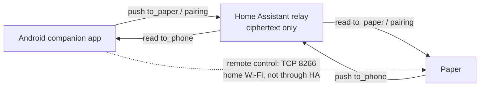
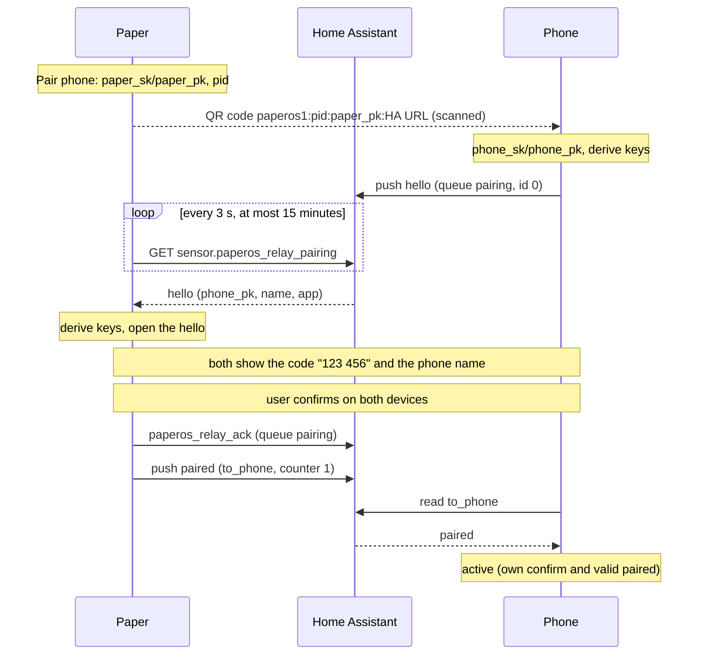
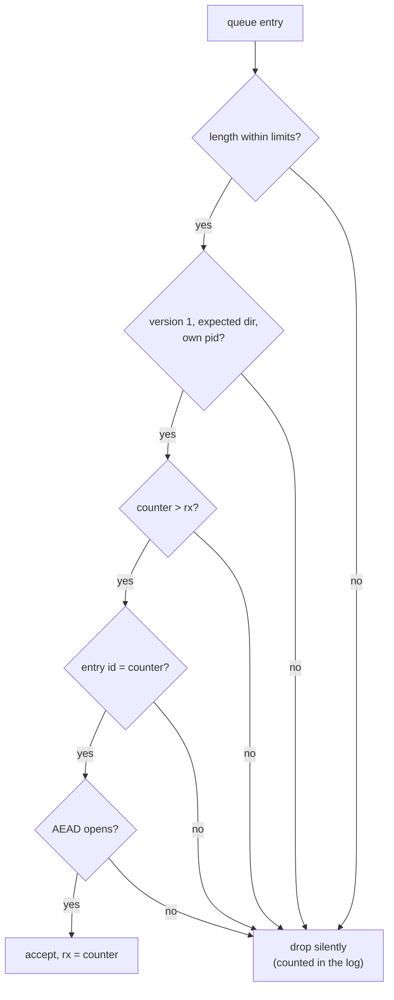
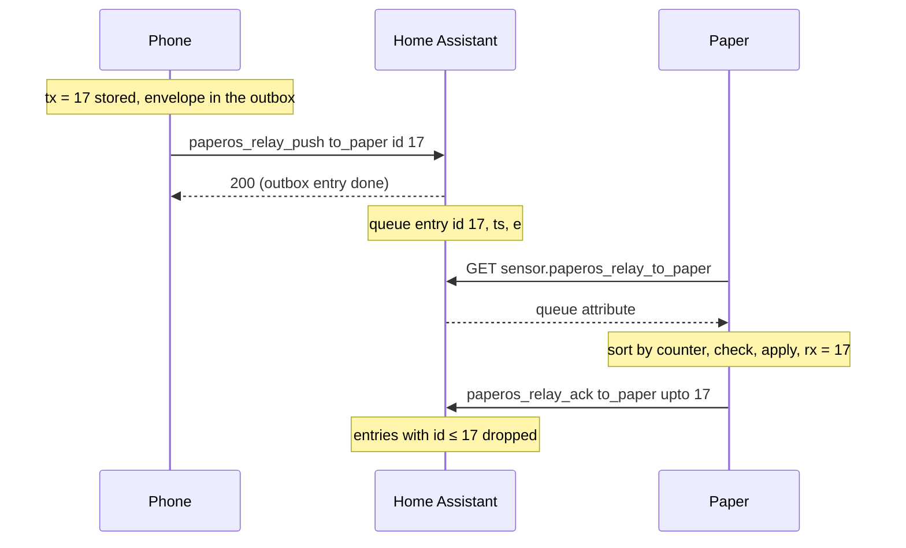
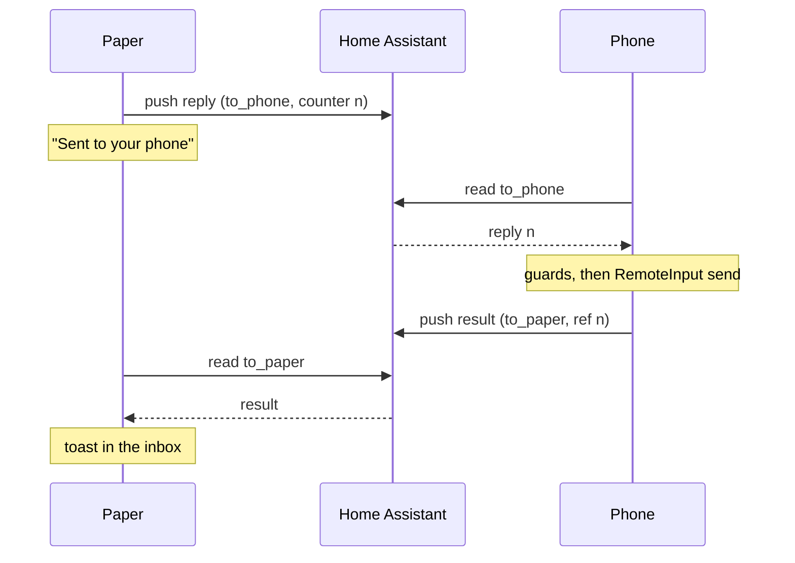
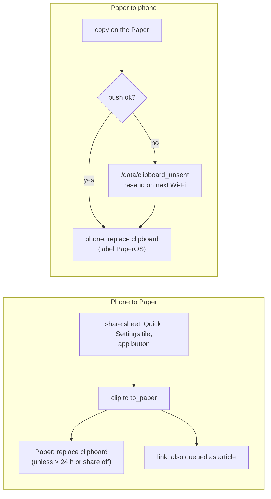
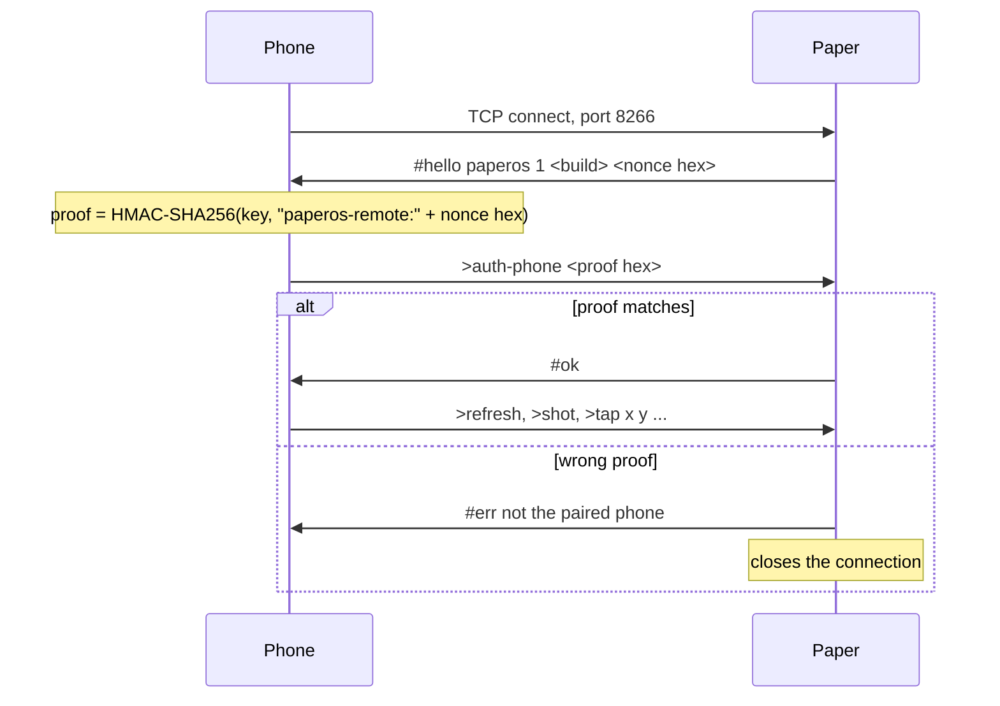

# Companion protocol v1: phone notifications to PaperOS through an untrusted Home Assistant

The Android companion app (repo folder `android/`) reads WhatsApp and Proton Mail notifications on the phone, encrypts them
for the PaperOS device ("the Paper") and posts the ciphertext to Home Assistant. The Paper fetches, checks and decrypts.
Replies, the clipboard and a few control messages go the other way. Decision: DECISIONS.md D22.

**Home Assistant is a dumb pipe.** It can read metadata, drop, delay, reorder and replay. It cannot read, forge or
successfully replay an envelope, and it cannot make the phone send.

This file is the contract between the two code bases. Both sides implement it exactly; anything not written here is not
part of v1. Shared test vectors: `tests/fixtures/companion/vectors.json` (both sides must reproduce them byte for byte).



**Contents**

- [1. Primitives](#1-primitives) · [2. Identities and pairing](#2-identities-and-pairing) ·
  [3. Key schedule](#3-key-schedule) · [4. Envelope](#4-envelope)
- [5. Counters, replay and order](#5-counters-replay-and-order) ·
  [6. The Home Assistant relay](#6-the-home-assistant-relay-packagespaperos_inboxyaml) · [7. Messages](#7-messages)
- [8. Behaviour](#8-behaviour) · [9. Test vectors](#9-test-vectors) ·
  [10. Remote control](#10-remote-control-task-p7-21-decisionsmd-d40)

---

## 1. Primitives

| What | Algorithm | Paper (simulator and firmware: one code path) | Android (API 31+) |
|---|---|---|---|
| Key agreement | X25519 (RFC 7748) | libsodium 1.0.22 `crypto_scalarmult_curve25519` | `KeyPairGenerator`/`KeyAgreement` `"XDH"` (`NamedParameterSpec.X25519`) |
| Key derivation | HKDF-SHA256 (RFC 5869) | `crypto_kdf_hkdf_sha256_extract` / `_expand` | HMAC-SHA256 (`Mac "HmacSHA256"`), RFC 5869 by hand |
| AEAD | ChaCha20-Poly1305, IETF, 12-byte nonce, 16-byte tag (RFC 8439) | `crypto_aead_chacha20poly1305_ietf_encrypt` / `_decrypt` | `Cipher "ChaCha20-Poly1305"`, `IvParameterSpec(nonce)`, `updateAAD` |
| Random | CSPRNG | `randombytes_buf` (device: hardware RNG through the ESP-IDF port; simulator: the OS) | `SecureRandom` |
| Text encoding | base64url **without padding** (RFC 4648 §5) | `sodium_bin2base64(..., sodium_base64_VARIANT_URLSAFE_NO_PADDING)` | `Base64.getUrlEncoder().withoutPadding()` |

### Why libsodium on the Paper

- The ESP-IDF 5.5.5 libraries that PlatformIO ships (mbedTLS 3.6.6) are precompiled with `MBEDTLS_CHACHA20_C` and
  `MBEDTLS_POLY1305_C` off, so mbedTLS cannot do the AEAD on the device.
- The same libraries ship `espressif__libsodium` 1.0.22 (linked by default).
- Homebrew has libsodium 1.0.22 for the simulator.

### Raw keys on Android

- Raw X25519 keys are 32 bytes. Android's XDH keys are X.509 / PKCS#8 encoded.
- **Export**: the raw public key is the **last 32 bytes** of `PublicKey.getEncoded()`. The encoding is the fixed 12-byte
  prefix `302a300506032b656e032100` plus the key.
- **Import**: prepend that prefix to the raw public key and use `X509EncodedKeySpec`.
- A shared secret of 32 zero bytes is rejected on both sides.

## 2. Identities and pairing

The Paper and the phone each hold one static X25519 key pair per pairing. A **pairing id** (`pid`) is 8 random bytes made
by the Paper. Pairing again makes new keys and a new `pid` on both sides; old envelopes then fail.



### Steps

1. **Paper**: Settings > Home Assistant > Phone > "Pair phone" makes `paper_sk`/`paper_pk` and `pid`, and shows a QR code
   whose text is (ASCII, byte mode):

   `paperos1:<pid b64url>:<paper_pk b64url>:<HA base URL>`

   e.g. `paperos1:AAECAwQFBgc:3p7bfXt9wbTTW8...:https://ha.example.com`

   - `pid` is 11 characters, the key 43.
   - The URL is the Paper's `HA_URL` with no trailing slash and may itself contain `:`. Split on the first three `:` only.
   - The screen also shows the pid as text for checking.
2. **Phone**: scans the code, makes `phone_sk`/`phone_pk`, derives the keys (section 3) and pushes a **hello** to the
   `pairing` queue (section 6). The hello is the envelope of section 4 with `dir` = `H` and the 32-byte `phone_pk` in place
   of the counter (see 4.2). Plaintext: `{"t":"hello","name":"<phone model>","app":"<app version>"}`.
3. **Paper** polls `sensor.paperos_relay_pairing` while the pairing screen is open (every 3 s, at most 15 minutes). It takes
   `phone_pk` from the hello, derives the keys and decrypts it. If it opens, both screens show the **comparison code**
   (section 3) as `123 456` plus the phone name. The user confirms on **both** devices that the codes match.
   - Home Assistant relays `phone_pk`. A swapped key gives a different code, which is why the comparison is mandatory.
4. **Paper**, on Confirm: stores the pairing, clears the pairing queue (`paperos_relay_ack` with queue `pairing`), and sends
   `{"t":"paired"}` as its first envelope (counter 1) on `to_phone`.
   - Until a push of it reaches Home Assistant, the Paper pushes `paired` again (counter 1, fresh nonce) whenever its Wi-Fi
     comes up: for at most a day, and not once the phone has written to `to_paper`.
   - **Phone**: becomes active only after its own user confirmation **and** a valid `paired` envelope. Until then it sends
     nothing but the hello.
5. Either side can unpair: it sends `{"t":"unpair"}` (best effort) and forgets the keys. A side that receives `unpair`
   forgets the pairing too.

Pairing state on the Paper: `/data/companion.json` (internal flash; never logged, never shown, not readable over USB).

## 3. Key schedule

```
ss        = X25519(own_sk, peer_pk)                                  32 bytes; all-zero: abort
transcript = pid (8) || paper_pk (32) || phone_pk (32)                72 bytes
prk       = HKDF-Extract(salt = "PaperOS companion v1" (20 ASCII bytes), ikm = ss)
k_p2d     = HKDF-Expand(prk, info = "PaperOS p2d" || transcript, 32)  phone -> Paper key
k_d2p     = HKDF-Expand(prk, info = "PaperOS d2p" || transcript, 32)  Paper -> phone key
code      = HKDF-Expand(prk, info = "PaperOS code" || transcript, 4)  read as uint32 big-endian, mod 1000000,
                                                                      shown as 6 digits with leading zeros, "123 456"
```

- The info strings are ASCII with no terminator; `||` is concatenation.
- "p2d" = phone to device, "d2p" = device to phone.

## 4. Envelope

### 4.1 Normal envelope (`dir` = `P` or `D`)

Binary, then base64url without padding:

| Offset | Size | Field |
|---|---|---|
| 0 | 1 | version = `0x01` |
| 1 | 1 | `dir`: `0x50` `P` phone to Paper (key `k_p2d`), `0x44` `D` Paper to phone (key `k_d2p`) |
| 2 | 8 | `pid` |
| 10 | 8 | counter, uint64 big-endian, ≥ 1 |
| 18 | 12 | nonce, random per envelope |
| 30 | n + 16 | ChaCha20-Poly1305 ciphertext of the plaintext (n bytes), then the tag |

- **AAD** = bytes 0..17 (version, dir, pid, counter).
- **Nonce** is random, so a counter reset can never reuse a nonce. The counter is for ordering and replay (section 5).

### 4.2 Hello envelope (`dir` = `H`, `0x48`)

| Offset | Size | Field |
|---|---|---|
| 0 | 1 | `0x01` |
| 1 | 1 | `0x48` |
| 2 | 8 | `pid` (from the QR code) |
| 10 | 32 | `phone_pk` |
| 42 | 12 | nonce |
| 54 | n + 16 | ciphertext + tag under `k_p2d` |

AAD = bytes 0..41.

### 4.3 Limits

| | Limit | Who enforces |
|---|---|---|
| Plaintext | UTF-8 JSON object, **at most 1000 bytes** | the sender shortens text fields to fit (section 7); the receiver rejects anything longer |
| Envelope | 30 + 1000 + 16 = 1046 bytes = **at most 1395 base64url characters** (hello: 1411) | receivers reject longer strings before decoding |

## 5. Counters, replay and order

- **`tx`**: the last counter a side sent. Starts at 0, so the first envelope is 1. Written to storage **before** the
  envelope is pushed.
- **`rx`**: the highest counter a side accepted from the other side. Starts at 0.
- Both are stored with the keys.

A receiver reads its whole queue, **sorts entries by counter**, and runs every entry through these checks:



- Dropped envelopes are counted in the log, never shown or logged as text.
- **Late envelopes are lost**: an envelope delayed by Home Assistant past a newer one is dropped; `sync` (section 7)
  repairs the state.
- **Re-push**: a sender that is not sure whether a push reached Home Assistant re-pushes **the same envelope** (same
  counter). The relay ignores a duplicate `id`.

## 6. The Home Assistant relay (`packages/paperos_inbox.yaml`)

The package is `packages/paperos_inbox.yaml` in the Home Assistant config repo; this repo keeps a copy at
`ha/paperos_inbox.yaml` (BACKEND.md).

### Queues

Three trigger-based template sensors, filled by the event `paperos_relay`. The sensors and the event are excluded from the
recorder. They hold only ciphertext and a receive time. Attributes survive a Home Assistant restart.

| Queue | Entity | Written by | Read by | Max entries | Kept for |
|---|---|---|---|---|---|
| `to_paper` | `sensor.paperos_relay_to_paper` | phone | Paper | 40 | 7 days |
| `to_phone` | `sensor.paperos_relay_to_phone` | Paper | phone | 20 | 2 days |
| `pairing` | `sensor.paperos_relay_pairing` | phone | Paper | 1 (a new hello replaces the old) | 15 minutes |

| Sensor part | Content |
|---|---|
| state | unix time of the last change |
| attribute `queue` | list sorted by `id` ascending of `{"id": <counter, or 0 for a hello>, "ts": <unix seconds when Home Assistant took it>, "e": "<base64url envelope>"}` |
| attribute `updated` | ISO time |

- **Full queue**: the lowest ids go first.
- **Expiry**: expired entries go on every change and hourly.

### Calls

Plain REST, JSON body, header `Authorization: Bearer <token>`.

| Action | Request | Notes |
|---|---|---|
| Push | `POST /api/services/script/paperos_relay_push` `{"queue":"to_paper","id":17,"env":"AQ..."}` | `queue` one of the three; `id` an integer 0..2^53 (the script checks `^[0-9]{1,16}$`); `env` matches `^[A-Za-z0-9_-]{40,1411}$`. Anything else is ignored (the call still answers 200). |
| Read | `GET /api/states/sensor.paperos_relay_to_paper` | 404 = relay not installed |
| Ack | `POST /api/services/script/paperos_relay_ack` `{"queue":"to_paper","upto":17}` | drops entries with `id` ≤ `upto` (`pairing`: clears it). Acks are not authenticated: Home Assistant can drop entries anyway. |

The phone may instead watch `sensor.paperos_relay_to_phone` over the websocket API (`subscribe_entities`, allowed for
non-admin users) and read the attribute from the event.



### Credentials

- **Paper**: its existing token (`HA_TOKEN` on the card; a dedicated non-admin user after development, D18).
- **Phone**: a **long-lived token of a dedicated non-admin Home Assistant user** (e.g. "PaperOS phone"), created by the
  user and pasted into the app. The app keeps it in Android Keystore-backed storage and never logs it. The base URL comes
  from the QR code.
- **No webhook**: the phone needs a token to read `to_phone` anyway. A webhook for pushing would add a second secret and an
  unauthenticated internet endpoint without lowering the phone's rights.
- **Token scope**: a non-admin Home Assistant user can still call any service, so the token is sensitive. The envelopes do
  not depend on it: a stolen token can read ciphertext and push garbage, nothing more for this protocol.

## 7. Messages

Plaintext JSON objects with a type `t`.

- Unknown types and unknown fields are ignored.
- Times are unix seconds.
- All strings are UTF-8. Lengths below are in characters and are cut by the sender (the Paper cleans text again on
  display).

| Direction | Types |
|---|---|
| Phone to Paper (`P`) | `post`, `remove`, `sync`, `result`, `clip`, `agenda`, `unpair` |
| Paper to phone (`D`) | `paired`, `reply`, `dismiss`, `clip`, `unpair`, `remote` |
| Pairing (`H`) | `hello` (section 2) |

### 7.1 Phone to Paper (`P`)

#### `post`

A notification was posted or updated. It **replaces** everything the Paper holds for the same key.

```json
{"t":"post","k":"0|com.whatsapp|1|AbC|10123","app":"whatsapp","chat":"Family","reply":true,"ts":1763200000,
 "msgs":[{"from":"Anna","text":"Are you coming at six?","ts":1763199990}]}
```

| Field | Meaning |
|---|---|
| `k` | the notification key (`StatusBarNotification.getKey()`), opaque to the Paper, at most 120 characters (the phone may hash a longer key) |
| `app` | `whatsapp` or `mail` (Proton Mail); other values are ignored by the Paper v1 |
| `chat` | WhatsApp: the group or conversation title for a group, `""` for a direct chat. Mail: `""` |
| `reply` | true if the notification has a RemoteInput reply action |
| `ts` | the notification's `postTime` |
| `msgs` | oldest first, at most 6 (see below) |

| `msgs` entry | Fields (max characters) |
|---|---|
| WhatsApp | `from` (sender, 60), `text` (500), `ts` from MessagingStyle |
| Mail | one entry: `from` (sender, 80), `subj` (subject, 150), `text` (the preview the notification shows, 500, may be `""`), `ts` |

- When the plaintext would exceed 1000 bytes the phone drops the oldest messages first, then shortens `text`.
- Notifications that are summaries (group summary of several chats or mails) are not sent; their children are.

#### `remove`

`{"t":"remove","k":"...","why":"read"}`, `why` one of `read`, `dismissed`, `other` (from `onNotificationRemoved` reasons).
The Paper drops that key.

#### `sync`

`{"t":"sync","keys":["...","..."]}`: the keys of all active WhatsApp and Proton Mail notifications.

- The Paper drops every key it holds that is not listed.
- Sent after the app (re)connects and at most once an hour; skipped if it would exceed 1000 bytes.

#### `result`

The outcome of a reply: `{"t":"result","ref":5,"ok":false,"why":"gone"}`. `ref` = the counter of the Paper's `reply`
envelope.

| `why` | Meaning |
|---|---|
| `""` | sent |
| `gone` | no such notification, or it has no reply action |
| `stale` | older than 6 hours |
| `too_long` | text too long |
| `too_soon` | less than 10 seconds since the last send |
| `hourly_limit` | 20 sends in the last hour |
| `failed` | the RemoteInput send threw |

#### `clip`

D23. `{"t":"clip","text":"Pick up bread","ts":1763200000}`: the user shared text with the Paper.

- **Sources**: share sheet, Quick Settings tile or the app's button. Never automatic: Android lets an app read the
  clipboard only while it has focus.
- **Size**: `text` 1..900 characters, cut by the sender, then shortened until the plaintext fits 1000 bytes.
- **Applied**: the Paper replaces its clipboard with it (the newest `clip` of a queue wins).
- **Not applied**: older than 24 hours by `ts`, or the Paper's "Share the clipboard" is off. Such a `clip` is read and
  acked, not applied.
- **A `clip` that is a link** (its text is one http(s) address, alone or as the last word after a title) is also queued on
  the Paper to be read later as an article (apps/reader.md "Articles", P7-18). This happens with the clipboard not shared
  too, and whatever its `ts`.
- A clipboard Android marks sensitive (`ClipDescription.EXTRA_IS_SENSITIVE`) is never sent.

#### `agenda`

D28, one way: the Paper never changes the calendar. The phone's calendar for a run of days.

```json
{"t":"agenda","from":"2026-11-16","to":"2026-11-18",
 "days":[{"d":0,"ev":[{"n":"Anna's birthday"},{"s":570,"e":615,"n":"Dentist","l":"Main St 4"}]},
         {"d":2,"ev":[{"s":1320,"n":"Night train"}],"more":1}]}
```

| Field | Meaning |
|---|---|
| `from`, `to` | first and last day of the run, `YYYY-MM-DD` in the phone's time zone, `to` ≥ `from`, at most 14 days. The message **replaces everything the Paper holds for every day of the run**: a day that is not listed has no events |
| `days[].d` | the day, counted from `from` (0 = `from`); each day at most once |
| `days[].ev` | that day's events, at most 12: first the ones without `s` (all day, or begun on an earlier day), then by `s` |
| `ev[].s`, `ev[].e` | start and end in minutes after that day's midnight on the phone (`s` 0..1439, `e` 0..1440, `e` ≥ `s`). `s` is left out when the event began before this day, `e` when it ends after it; an all-day event has neither. An event over several days is listed on every day it touches |
| `ev[].n` | the title (80), `""` for an event without one |
| `ev[].l` | the location (60), left out when empty |
| `days[].more` | the number of events of that day that were left out (more than 12, or the plaintext limit); left out when 0 |

**What the phone reads**

- The calendars that are visible in its calendar app (`CalendarContract.Instances`, permission `READ_CALENDAR`).
- The permission is asked when the user switches on "Share the agenda" (off by default).
- Minus the calendars the user switched off under Paper > Calendars. The app keeps the switched-off ones (their ids,
  `agenda_skip` in its settings), so a calendar added later is shared.
- Today and the 13 days after it.
- Declined and cancelled events are not sent.

**When it sends**

| Trigger | Sends |
|---|---|
| A day in the window changed since it was last sent (a calendar change, 60 s after the last one) | a run with that day |
| Once a day after the phone's midnight | the whole window |
| After pairing or switching the share on | the whole window |
| Switching a calendar on or off | the whole window |
| Share switched off (or the permission taken away) | one `agenda` with the whole window and no days: empties the Paper's agenda |

Days are packed into as few envelopes as fit 1000 bytes. A day that does not fit alone loses its last events to `more`.

#### `unpair`

`{"t":"unpair"}`.

### 7.2 Paper to phone (`D`)

#### `paired`

`{"t":"paired"}`, always counter 1 (section 2).

#### `reply`

`{"t":"reply","k":"...","text":"See you at six","ts":1763200100}`, `text` 1..900 characters after trimming. The phone
sends it through the notification's RemoteInput action and answers with `result`.



**The send guards live in the phone app.** It refuses unless:

| Guard | Refusal |
|---|---|
| the key is an active notification with a reply action | `gone` |
| the envelope is at most 6 hours old by `ts` and by the queue entry's `ts` | `stale` |
| the text fits | `too_long` |
| the last send was at least 10 seconds ago | `too_soon` |
| there were fewer than 20 sends in the last hour | `hourly_limit` |

- Every attempt that passes the guards counts towards the limits.
- Never more than one send per envelope (counter), also after a restart.

#### `dismiss`

`{"t":"dismiss","keys":["..."]}`: the user cleared these on the Paper ("Mark all read").

- v1 phone behaviour: none by default; an app setting may cancel those notifications on the phone.
- Never marks anything read inside WhatsApp.

#### `clip`

D23. `{"t":"clip","text":"Somdoku 12:34","ts":1763200100}`, same limits as above.

- **When**: after every copy on the Paper (a field's "Copy all", a game's "Kopieer score") while a phone is paired and
  "Share the clipboard" is on.
- **Wi-Fi** does not need to be up: the push joins Wi-Fi like any request (POWER.md "Wi-Fi policy": fast path ~1.3 s, then
  the usual linger).
- **Failed push** (no known network in range, a timeout or a server error): the Paper keeps the time of the copy
  (`/data/clipboard_unsent`; the text is the clipboard itself). It resends the clipboard, stamped with that time, the next
  time Wi-Fi comes up for any reason (one try per connect, no background polling).
- **Dropped resend**: a newer copy, a `clip` from the phone, an empty clipboard or 24 hours drop it.
- **On the phone**: replaces its clipboard (label `PaperOS`) unless it is older than 24 hours by `ts` and by the queue
  entry's `ts`, or the app's "Share the clipboard" is off.
- A `clip` that came from the phone is never sent back.



#### `unpair`

`{"t":"unpair"}`.

#### `remote`

`{"t":"remote","host":"192.168.1.60","port":8266}`: where the Paper's wireless development listens (section 10).

## 8. Behaviour

### Paper

- **Fetch**: reads `to_paper` when an inbox app opens, on its refresh button and in the scheduled refresh (POWER.md).
  Applies accepted envelopes in counter order to its local store (`/data/cache/inbox/notifs.json`), then acks up to `rx`.
  Items older than 7 days are dropped locally.
- **WhatsApp app**: one row per key (`chat`, or the sender of a direct chat), messages from `msgs`. **Mail app**: one row
  per key.
- **Reply**: only on a WhatsApp key that is present and has `reply: true`. Sending pushes a `reply` to `to_phone` (Wi-Fi
  needed; nothing is queued on the Paper) and says "Sent to your phone". A later `result` shows as a toast in the inbox
  ("Reply to Anna sent" / "Reply to Anna not sent: <reason>").
- **"Mark all read"**: clears the local items of that app and sends `dismiss` with their keys.
- **Clipboard** (D23): a text field's clipboard sheet and the reply screen's Paste read `to_paper` first, so a `clip` the
  phone just sent is there. Any read of the queue (inbox, scheduled refresh) applies a `clip` too.
- **Agenda** (D28): any read of the queue (inbox, Agenda app, scheduled refresh, clipboard pull) applies `agenda` messages
  in counter order to `/data/cache/agenda/agenda.json` (private, deleted with the pairing).
  - Days before the Paper's own today are dropped.
  - Times are shown as the phone sent them (the phone's wall clock); "today" and "next" use the Paper's clock and time
    zone.
  - The Paper sends nothing back.
- **Not paired**: the inbox says so and points to Settings > Home Assistant > Phone.

### Phone

- **Outbox**: envelopes not yet confirmed by a 200 from `paperos_relay_push`, persisted, retried in counter order with
  back-off (30 s doubling to 15 minutes) while offline. Hours away are fine: the relay keeps `to_paper` 7 days. The outbox
  has no limit beyond the 40-entry relay cap (oldest posts may be replaced by a `sync` instead).
- **Read**: `to_phone` on reconnect and then at least every minute while on a network (or watches it). Handles accepted
  envelopes in counter order, acks up to `rx`.
- **Sync**: sends `sync` after every reconnect.
- **Service**: runs as a foreground service with a battery-optimisation exemption; never logs plaintext or the token.

## 9. Test vectors

`tests/fixtures/companion/vectors.json` holds fixed inputs and the expected outputs.

| | Content |
|---|---|
| Inputs | both secret keys, `pid`, nonces |
| Expected outputs | both public keys, `ss`, `k_p2d`, `k_d2p`, the comparison code, a hello envelope, a `post` envelope (counter 1) and a `reply` envelope (counter 1), each as base64url |
| Must be **rejected** | flipped tag byte, wrong `pid`, wrong `dir`, counter not above `rx`, oversize |

- The Paper's unit tests (`tests/unit/companion_test.cpp`) check every value.
- The Android tests must produce the same bytes with the same nonces.

## 10. Remote control (task P7-21, DECISIONS.md D40)

The companion app can show the Paper's screen and touch it, over the home Wi-Fi, while the Paper's Settings > Developer >
Wireless development is on (D39). Not through Home Assistant: a plain TCP connection to the Paper's port 8266, the same
service and commands as the Mac's tools (`src/core/remote.h`), with a sign-in of its own.

### Sign-in

```
key   = HKDF-Expand(prk = k_p2d, info = "PaperOS remote", 32)        (14 ASCII bytes; one HMAC-SHA256 block)
Paper: #hello paperos 1 <build> <nonce hex, 64 characters>
Phone: >auth-phone <hex of HMAC-SHA256(key, "paperos-remote:" + nonce hex)>
Paper: #ok   (or "#err not the paired phone", then it closes)
```



- **Key**: separate from `k_p2d` (domain separation). It exists only while paired: unpairing or pairing again changes it.
- **Allowed commands** after the sign-in: `>shot`, `>refresh`, `>tap x y`, `>long x y`, `>swipe x1 y1 x2 y2` and
  `>ota <size>`. Every other command is answered `#err not from the phone` (no files, settings, logs or restarts).
- **`>ota`** takes a package signed on the Mac with the update key (DECISIONS.md D37). The Paper checks the signature
  before it writes a byte, so the phone only carries it and can install nothing the Mac did not sign.
- **Not encrypted** (as the Mac's, D39): someone on the home Wi-Fi can see the frames while the remote is open.

### Where the Paper is

Message `remote` (Paper to phone, section 7.2): `{"t":"remote","host":"192.168.1.60","port":8266}`.

- Pushed when wireless development starts listening at an address the phone was not yet told about (once per address per
  boot; a failed push is tried again after 5 minutes).
- The phone stores it (`settings.json` `remote_host`, `remote_port`); the user can also type the address.
- `host` is an IPv4 address or a host name (letters, digits, `.` and `-`), `port` 1..65535; anything else is ignored.

### Firmware update from the phone

`FirmwareActivity`:

1. `make ota-phone` on the Mac builds, signs and pushes `paperos.posota` to the phone's Downloads (adb).
2. The app reads its header (build, size, signing time) and shows the build the Paper runs (from its hello).
3. It sends it as `tools/ota.py` does: `>ota <size>`, `#ota go`, 4 KB pieces, one `#ack` per full piece, then
   `#ack <total>` and `#ok`.
4. The Paper restarts into it (rollback as D37).

### The phone

`RemoteActivity`, `proto/Remote.kt`. One thread owns the connection while the screen is visible.

| What | When |
|---|---|
| `>refresh` | every 250 ms |
| `>shot` | when the refresh log changed, after every touch (150 ms later) and every 5 s |

- Tap = tap, hold 600 ms = long press, drag = swipe, in the Paper's 540 x 960 coordinates.
- The screen stays on while open.

### Vectors

| | Value |
|---|---|
| `k_p2d` | from section 9 |
| key | `11d342f40c8190135181b05ae1957219d7456ca3343ee39672acb39f7f1e8175` |
| nonce | `000102...1f` (bytes 0..31 as hex) |
| proof | `012199eacab31abc2c8e56351a8598c2d8f3393c532ad5558f9836bee7b1ce9e` |

Tests: `tests/unit/remote_phone_test.cpp`, `android/.../RemoteTest.kt`.
