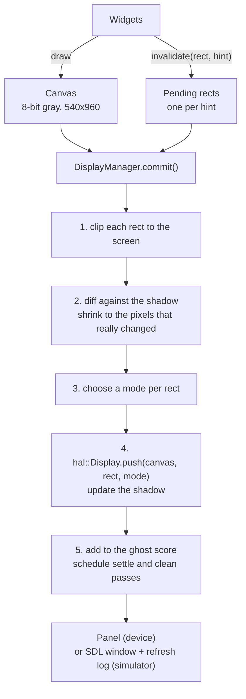
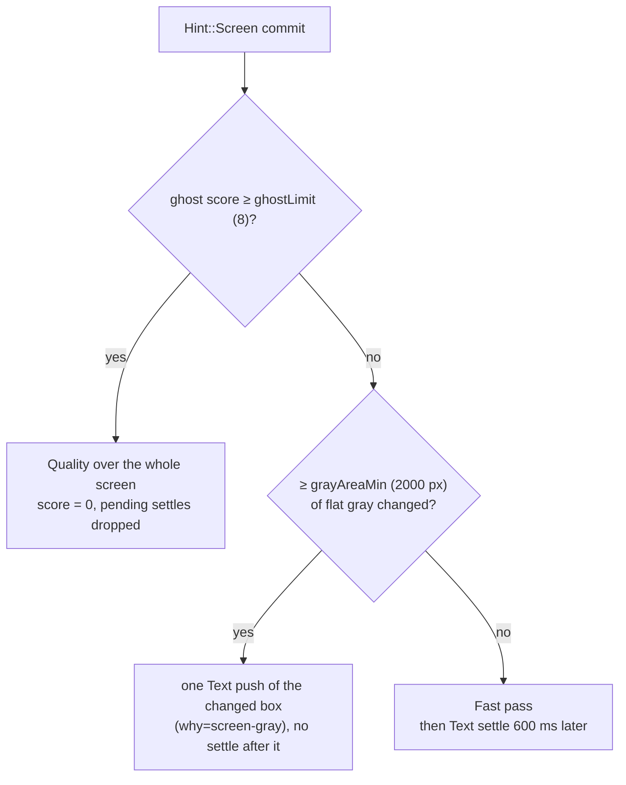
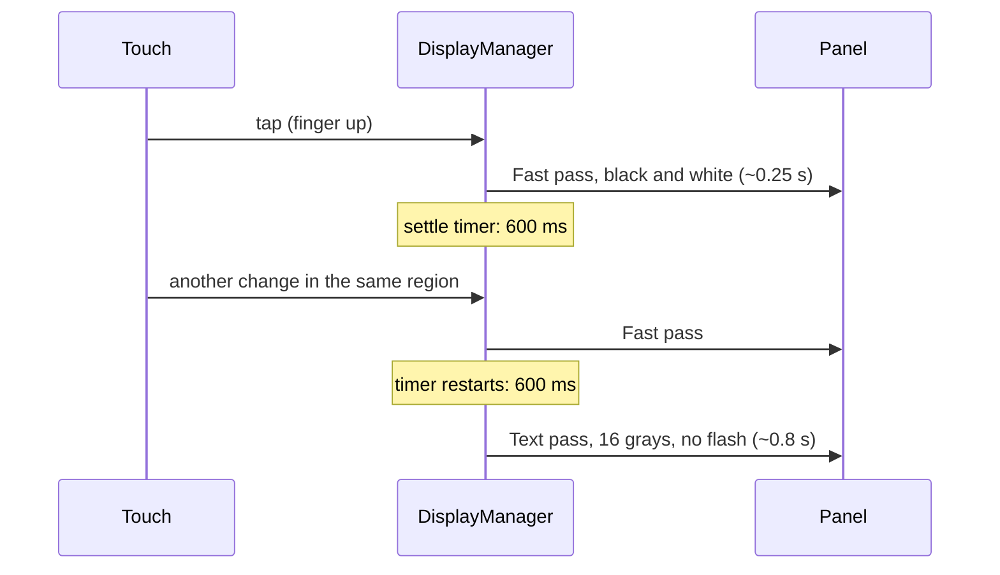
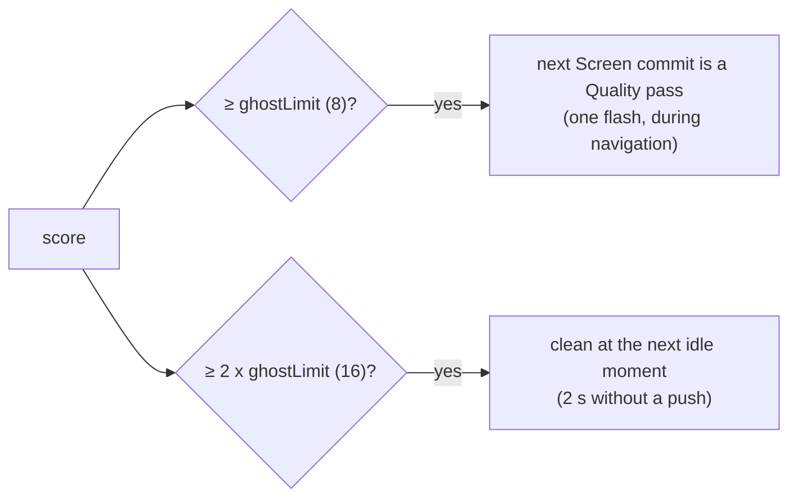

# Display: rendering for e-ink

**Goal**: updates feel quick, the screen almost never flashes, and ghosting stays invisible.

**One rule**: everything that reaches the panel goes through `core/display_manager`. Apps and widgets draw into the
canvas and call `invalidate(hint)`; they never call the panel.

**Contents**

- [Panel modes](#panel-modes) · [Pipeline](#pipeline) · [Refresh classes](#refresh-classes) · [Ghost budget](#ghost-budget)
- [As implemented](#as-implemented) · [Unchanged pixels are left alone](#unchanged-pixels-are-left-alone) ·
  [Gray areas cost a flicker](#gray-areas-cost-a-flicker)
- [Navigation speed](#navigation-speed) · [Tap latency](#tap-latency) · [Rules for UI code](#rules-for-ui-code)
- [Device implementation notes](#device-implementation-notes) · [Simulator emulation](#simulator-emulation) ·
  [Test patterns](#test-patterns) · [What the panel does to grays](#what-the-panel-does-to-grays)
- [Camera on the panel](#camera-on-the-panel) · [Calibration target](#calibration-target) ·
  [Reader ghosting](#reader-ghosting)

---

## Panel modes

The panel has three update modes. Measured on the device (M5GFX 0.3.0 default waveforms, push + waveform with
`waitDisplay()`):

| Update | Mode | Time |
|---|---|---|
| Full screen 540x960 | Quality | 1363 ms |
| Full screen | Text | 1371 ms |
| One row 540x96 | Text | 871 ms |
| Box 200x200 | Fast | 268 ms |
| Full screen | Fast | 504 ms |

| Mode | Shows | Speed | Use it for |
|---|---|---|---|
| **Fast** | black and white (grays as a dither) | 0.27-0.5 s | responding to input |
| **Text** | 16 grays, no flash | 0.9-1.4 s | settling after Fast |
| **Quality** | 16 grays, exact, with a flash | same as Text | cleaning ghosts, images |

Text is too slow to respond with; it settles. Quality costs no more than Text, so when grays must be exact and a flash is
acceptable there is no speed reason to avoid it.

## Pipeline



The **shadow** is an exact 8-bit copy of the last pushed frame (518 KB). The diff compares quantised values, so
anti-aliasing noise below one of the 16 levels never causes an update.

## Refresh classes

Widgets do not pick panel modes. They invalidate with a **hint** that states intent:

```cpp
enum class Hint : uint8_t {
  Feedback,   // immediate response to a touch: pressed state, toggle, cursor
  Content,    // new content in place: list rows, values
  Page,       // a new page of text (reader): Fast, no settle; every Nth page a Quality clean
  Screen,     // whole screen changed: navigation, app switch
  Image,      // grayscale picture: book cover, photo
};
widget.invalidate(Hint::Content);
```

| Hint | First pass | Settle pass | Why |
|---|---|---|---|
| Feedback | Fast, at once | none if the changed pixels are pure black/white, else Text | a tap's result reaches the panel within 100 ms of the finger going up |
| Content | Fast | Text after 600 ms without further changes in the region | "fast then settle" |
| Page | Fast | none | reader page turns; every 10th turn is one Quality pass instead ([Ghost budget](#ghost-budget)) |
| Screen | Fast, or **one Text pass** if the new screen has flat gray areas | Text after 600 ms; **Quality instead** when the ghost budget is spent | navigation is the natural place to hide a clean |
| Image | Quality on the image rect | none | the only place a flash is expected |

How a `Screen` commit picks its mode:



### Fast then settle

A Fast pass shows the new content in black and white right away: text is readable, edges are slightly rough. When the
region has been quiet for 600 ms, a Text pass over it restores the 16-level anti-aliasing without a flash. New input in
the region restarts the timer, so rapid changes stay at Fast speed.



### The Fast pass is an ordered dither

The canvas always holds the full-gray frame. Black and white for the Fast pass is made in `hal::Display`: by the panel
driver on the device, by the emulation in the simulator. It is an **ordered dither, not a threshold** (M5GFX
`Panel_EPD`, `epd_fast`): a pixel is black if `value + Bayer4x4 * 16 < 248`.

- Grays appear in the Fast pass as dots: a gray(9) divider has 6 of 16 pixels black, gray(13) 2 of 16, gray(3) 13 of 16.
- Anti-aliased edges look speckled until the settle pass turns the dots into even gray.
- The simulator uses the same formula (`platform/sim/display.cpp`), indexed by logical x, y; the driver indexes it in
  panel coordinates.
- Text and Quality modes also dither between neighbouring levels in the driver (`(value + Bayer - 8) >> 4`); the
  simulator shows the exact level there.

Confirmed on the panel with the camera (Display lab "Fast" pattern). Lightness per level, 0 = ink, 1 = white:

| Level | g0 | g2 | g3 | g5 | g7 | g9 | g11 | g13 | g15 |
|---|---|---|---|---|---|---|---|---|---|
| Fast pass, measured | .01 | .13 | .23 | .30 | .44 | .57 | .64 | .81 | 1.04 |
| White share of the dither | | | .19 | | .44 | .62 | | .88 | |

A steady rise that follows the dither; a threshold would give two flat groups. (On a reader page the pattern is not
visible to the camera: at 1.3 camera pixels per panel pixel the 4x4 pattern blurs away.)

## Ghost budget

Fast updates leave faint remains, and many of them build DC bias on the panel. The manager keeps a score:

| Event | Score |
|---|---|
| Fast pass | + `changedPixels / screenPixels` (full screen = 1.0, a small button = 0.01) |
| Text settle | − half of what its region added |
| one Text push for a gray screen (`screen-gray`) | + half of what a Fast pass would add |
| Quality pass over the full screen | reset to 0 |
| Image (Quality on a box) | unchanged |



`ghostLimit`, the settle delay and the idle delay live in `config.json` under `display`, so they can be tuned on the
device without rebuilding.

### Page turns have their own cadence

Every `pageCleanEvery`-th page (default 10, `display.pageCleanEvery`, 0 = off) is one full-screen Quality pass; the other
turns are Fast without a settle.

Why: as `Content`, a page turn added about 0.13 net to the score (a Fast pass over ~0.26 of the screen, the settle took
half back). The reader never commits `Screen`, so only the idle clean at 16 was left, after roughly 120 turns, and the
ghost grew to 2 % of contrast. The Text settle was also a dark sweep over the text 0.6 s after every turn.

| | `Content` (before) | `Page` (now) |
|---|---|---|
| Ghost after 1 / 9-10 / 30 turns | 1.23 / 1.54 / 1.99 % | 1.27 / 1.15 / 1.14 % (flat) |
| Turn finished on the panel | 1.6 s after the tap | 0.67 s |
| Dark sweep after a turn | yes | no |

## As implemented

`core/display_manager.{h,cpp}`. Unit tests: `tests/unit/display_manager_test.cpp`.

**API**: `invalidate(Rect, Hint)`, `commit()`, `tick(nowMs)`, `nextDeadlineMs()`, `forceClean()`, `ghostScore()`,
`refreshLogTail()`, `shadowPacked()`.

**Parameters** (`DisplayParams`):

| Parameter | Default | In `config.json` | Meaning |
|---|---|---|---|
| `ghostLimit` | 8.0 | yes | score at which the next Screen commit becomes a Quality pass |
| `settleMs` | 600 | yes | quiet time before a Fast region gets its Text settle |
| `idleCleanMs` | 2000 | yes | idle time before a forced clean at 2 x `ghostLimit` |
| `pageCleanEvery` | 10 | yes | every Nth `Page` push is a Quality pass |
| `grayAreaMin` | 2000 px | no | flat gray pixels that make a Screen pass one Text push |

### Commit order

One pending rect per hint (invalidations of the same hint are united). `commit()` handles them in this order, and each
later rect diffs against the shadow the earlier ones updated:

1. Feedback
2. Page (before Content: a page turn's footer is Content and must not make the page wait; the page's push call took 322 ms
   behind the footer, 82 ms in front of it)
3. Content
4. Screen
5. Image

### Settles

- A settle region merges with any overlapping or touching Fast region and restarts its timer. Unrelated regions keep
  their own timers.
- A **`Page` push** removes the pushed box from every pending settle and keeps what lies outside it (up to four
  rectangles: above, below and beside). So a screen that opens with a page still gets its settle around the page, while
  page turns stay one Fast pass.
- A **Quality** Screen pass drops all pending settles.
- A **`screen-gray` Text push** drops the settles inside its box; one that sticks out keeps only the strip outside, when
  that is one rectangle.

### Gray screens: one Text push

A Fast pass shows flat gray *areas* only as sparse dots, and the settle then fills them in 0.6 s later: a second
refresh, seen as a dark sweep. So the diff of a Screen pass also counts changed pixels of **flat gray**: levels 1-14 with
the same level 2 px away on all four sides (so anti-aliased edges and 1 px dividers do not count; it stops at the limit).

At `grayAreaMin` (2000 px, a disc of radius 25) the pass is **one Text push** of the changed box (`why=screen-gray`): the
final screen at once, one waveform instead of two. It takes longer on the panel than a Fast pass (full screen 1.37 s
against 0.5 s), but ends with the final look. Screens without gray areas keep Fast then settle. See also
[Gray areas cost a flicker](#gray-areas-cost-a-flicker).

### Cleans

- **Idle clean**: score ≥ 2 x `ghostLimit` and 2 s without a push: `tick()` runs `forceClean()`.
- **Clean on demand**: a swipe up from the bottom edge (UI.md "Gestures") runs `forceClean()` (`why=clean`): one
  Quality push, about 0.66 s visible on the panel; it removed 1.5 % of ghost from a reader page.
- `forceClean()` also runs at boot to make the shadow valid; before that every pixel counts as changed.

### Logging and busy state

- Every push is logged: `POS_LOG("disp", ...)` and the refresh log, `t= mode= rect= changed= why= diff= call=`.
- **`hal::Display::busy()` on the device only means "M5GFX update queue full"**: M5GFX cannot say whether a waveform is
  running. It queues up to 8 updates and merges overlapping ones, so "coalesce while busy" rarely triggers on the device.
- `>set epd-timing on` makes the device wait after each push and log `[epd] ... push+waveform <ms>`. It blocks the UI:
  debug only.

## Unchanged pixels are left alone

`tools/patch_m5gfx.py` patch 4. Navigation used to flash, worst in Settings: every navigation was a Fast pass over 78 %
of the screen and, 0.6 s later, a Text settle over the same area.

**Cause** (M5GFX `Panel_EPD.inl`, `step_fast` / `step_text`): the update task remembers, per pixel pair, the *request* it
last got, and a request carries its mode. So:

- a **Text settle after a Fast pass** drives every pair of its rectangle again, the white background too ("white, asked by
  Fast" is not "white, asked by Text"). For white the Text waveform goes five frames toward black and back: the whole
  region darkens and returns, the "dark sweep";
- a **Fast pass after a Text or Quality pass** does the same on a smaller scale (two frames toward black first);
- a **Text pass** drives every pair that is not white, changed or not.

**Fix**: a pair whose two pixel values equal what was last requested is not driven again, whatever mode asks. Only what
changes is driven: the settle touches the anti-aliased edges and gray lines, a navigation the pixels that differ.
Quality is untouched (a clean drives everything). `>set epd-keep off|on` switches between the stock rule and the patch
on a running device, for comparisons.

**On the panel** (camera, Settings > Display and back). How much the white that stays white darkens during a push, in %
of the white-to-ink contrast:

| | Fast pass of the navigation | Text settle 0.6 s later |
|---|---|---|
| Stock rule | 25-31 % darker, visible 236-241 ms | **66-82 % darker**, visible 327-367 ms |
| Patch 4 | 0.3-0.4 %, visible 73-106 ms | 0.5 % or less: no visible change |

- The screen is final about 1.17 s after the tap instead of 1.34 s.
- The settle still does its work: the 16 levels of the Display lab ramp read the same with and without the patch
  (within 0.01).
- Ghost after 20 navigations: 0.75 % with the patch, 1.09 % with the stock rule. The ghost budget stays as it is.
- `>set epd-selftest on`: "identical" for Fast and Quality.

### Gray areas cost a flicker

| Pass | Seen on the panel (camera) |
|---|---|
| Text pass | three pulses of change (Settings to a launcher with gray icon wells: 366 ms) |
| Fast pass | one pulse (144-170 ms) |
| Fast then settle, screen with gray | one pulse, then three more where the gray is, a second later |
| Fast then settle, ink and paper only | one pulse, then a ripple of about a sixth of it at the edges |

**So flat gray on a screen that is visited often is paid for on every visit.** The launcher's gray icon wells went for
that reason (apps/launcher.md "No gray on the launcher"), then those of every `Tile`.

Screens that still go out as one Text pass (`why=screen-gray` in the UI test logs): the Agenda's day view (gray event
blocks), anything with the on-screen keyboard (gray keys), a book's cover page, the Display lab.

## Navigation speed

Opening a screen from a row or tile, measured on the device with injected taps (`tools/device.py tap`, finger down and
up 60 ms apart):

| Step | Before | After |
|---|---|---|
| Tap to the new screen's Fast pass done | 925 ms (tile), ~1 s (row) | **605 ms** |
| Diff of the new screen | 107-229 ms | 21-29 ms |
| Layout + drawing (`[perf] render`) | 116 ms | 56-60 ms |
| `hal::Display::push` call | 531 ms | 88 ms |

**What was slow**

1. The pressed look of the tapped row was pushed on finger down, and its waveform (~250 ms) still ran while the next
   screen was built. **While an EPD waveform runs, every PSRAM access is several times slower** (the EPD task streams
   frame buffers from PSRAM): diff, drawing and the push all crawled.
2. The diff looked at every one of the 400,000 changed pixels.

**Fixes**

1. **Press feedback delay**: a `Pressable` shows its pressed look only if the finger is still down after
   `ui::kPressDelayMs` = 120 ms. A quick tap goes straight to its result: one Fast pass, no waveform running while the
   next screen is built, half the ghost score. `Segmented`, `LevelBar` and `TabBar` still preview on finger down (their
   result is the preview).
2. **Cheaper diff**: per row, 8 bytes at a time, find the first and last changed pixel; the black/white check runs only
   for Feedback regions.

**Remaining cost of a screen change**

| Part | Time |
|---|---|
| Finger up | 60-150 ms |
| Render | 57 ms |
| Diff | 25 ms |
| Push call | 88 ms |
| Fast waveform (492x824 area, fixed by the panel) | ~400 ms |

Later work (next section) took the push call and render down further.

## Tap latency

Measured with `tools/latency.py` (the firmware's `[lat]` line per tap: event → gesture → render → commit) and
`tools/cam.py around` (when the panel changes). Medians, from finger up to the update handed to the panel driver; the
waveform follows (Fast: ~0.13-0.17 s visible).

| Tap | Before | Now |
|---|---|---|
| Reader page turn | 516 ms | **105-112 ms** (slowest of 60: 159 ms) |
| Open a screen (Settings row) | 807 ms | **150 ms** |
| Small control (stepper) | 52 ms | **5 ms** |
| List page turn (Hacker News) | 415 ms, three passes | **105 ms, one pass** |
| Segmented control with a list under it | 330 ms, three passes | **120 ms, one pass** |

On the panel (camera, page turn): first change 0.53 → **0.38 s** after the tap, turn finished 0.67 → **0.55 s** (both
include the camera's own ~0.2 s delay).

### Where the time went

| Change | Effect |
|---|---|
| **Fast text path** (`ui/text.cpp`): glyphs rasterised once by LovyanGFX and blended into the canvas, byte-identical (`tests/unit/text_fast_test.cpp`) | page render 362 → ~100 ms, screen render 121 → 60 ms (LovyanGFX decoded each glyph with a malloc and wrote every pixel as a 1x1 fill) |
| **Frame buffer write in tiles** (M5GFX patch 1, D24): 32 source rows per tile, whole bytes, same Bayer quantisation | page push 450-530 → ~87 ms, also while a waveform runs |
| **Finished rows skipped** in the update task (patch 2) | less work per frame |
| **Both cores** for the frame buffer write (patch 3): a helper task takes 16-row chunks from a shared counter | page push call 87 → 61 ms |
| **Prefetch** (`TextBlock::prefetch`): 600 ms after a page shows, the next one is drawn into a spare canvas | the turn copies it in |
| **64 KB data cache** with 64-byte lines (D25) | screen change during a running settle 408 → 306 ms |
| **120 MHz flash and PSRAM** (D25): PSRAM 51 → 64 MB/s | page turn 199 → 140 ms, screen change 306 → 190 ms |
| **Diff and shadow in one pass** | no second pass over the box after a push |
| **`measureText` from the glyph cache**, `ellipsize` by halving | a title was measured a dozen times at 12 µs a character |
| **No pressed look in flight**: `PagerBar` and `Segmented` wait `kPressDelayMs` too | the following page no longer waits 150 ms for a small Fast pass |
| **Writes after the tap**: `config.json` ~1 s after the last change (`Os::saveConfigSoon`), the reading position a second after the turn | 25-50 ms of flash write off the tap |
| **Next chapter loaded early**: on the worker as soon as it starts within the next two pages | boundary turns ~130 ms instead of up to ~1 s |
| **Frame dumps stream between loop passes** (16 KB TX buffer) | a `>shot` no longer holds the UI for ~1 s |

Tried and reverted: skipping the diff for pages (a page turned under an open menu sheet re-pushed the sheet's gray text
in Fast mode).

### Lessons for every app

- **Nothing draws on finger down that a tap replaces.** Its waveform makes the real result wait.
- **Do not push a "loading" state** when the answer mostly comes within 0.2 s: its waveform runs while the real screen is
  drawn (Teletekst: push call 170 ms instead of 65).
- **Do not write flash while a screen is drawn** (drawing 65-99 ms instead of 33).
- **What changes together is one invalidation.** Queued bands overlap in the driver and finish about one waveform after
  the last one arrives, so they do not add up on the panel; what a band costs is its diff and push call (2-30 ms).
- **On the panel, the savings are no settle** (pure black/white changes) **and no relayout** for a change of a few
  widgets. With `epd-timing`, a Fast push takes 246-250 ms whatever its size, a Text push 820-824 ms.

## Rules for UI code

Enforced in review; see also UI.md.

1. **No animation, no scrolling.** Lists paginate. Progress is a static label.
2. **Interactive state is pure black/white.** Pressed, selected, on/off must be drawable in black and white only, so
   the Fast pass shows the final look. Grays are for secondary text, dividers and images.
3. **Invalidate the smallest widget.** A toggling switch invalidates itself, not its row.
4. **Never invalidate from a timer faster than once per minute** (the status bar clock).
5. **One commit per event.** Handle the event, change state, let the loop commit once.
6. **Coalesce**: while the panel is busy (`display.busy()`), further commits merge their rects and wait, except
   `Hint::Feedback`, which may queue at once (M5GFX handles overlapping updates).
7. **Feedback and Content go out per band of changed rows** (`DisplayManager::pushPass`; a screen, a page and an image
   stay one pass).
   - Without bands, a key press at the bottom and its bullet in the field at the top were one Fast push of 190x626 px for
     3,600 changed pixels, and every unchanged gray in between lost its gray until the settle.
   - The diff ends a band after `kBandGap` = 48 unchanged rows; the next band is pushed on its own, at most `kMaxBands` = 4
     (the last takes the rest). The key is now 48x66, the bullet 16x32.
   - In UI scripts, `tap X Y 200` or `PAPEROS_TAP_MS=200` holds the finger long enough to show a pressed key;
     `tools/push-audit.py` lists pushes that are large for what changed in them.

## Device implementation notes

`src/platform/device/display.cpp`:

```cpp
void push(const Canvas& frame, Rect r, Refresh mode) {
  M5.Display.setEpdMode(toEpd(mode));         // Quality->epd_quality, Text->epd_text, Fast->epd_fast
  M5.Display.setClipRect(r.x, r.y, r.w, r.h);
  frame.pushSprite(&M5.Display, 0, 0);        // only pixels inside the clip are transferred
  M5.Display.clearClipRect();                 // endWrite inside pushSprite queues the update
}
```

- `pushSprite` needs a `const_cast`: it is not const in LovyanGFX.
- Call `M5.Display.waitDisplay()` before light sleep and before power-off, or the image is left half-driven.
- `epd_fastest` is not used. Reserve it for future drag feedback.

## Simulator emulation

`platform/sim/display.cpp` keeps a `panel` buffer (what a real panel would show) separate from the canvas:

| Pushed mode | Effect on `panel` |
|---|---|
| Quality | region = canvas quantised to 16 levels; ghost residue cleared; counts as a flash |
| Text | region = canvas quantised to 16 levels; residue halved |
| Fast | region = canvas as the driver's ordered dither (black/white); where a pixel changed, 6 % of the old value is left as residue |

- Screenshots, `>shot` and `snapshot4()` show `panel` **without** residue, so goldens are stable and the device frame
  matches after a settle. Key `G` in the window overlays the residue, exaggerated 8x.
- Every push is appended to the **refresh log**: `t=<ms> mode=<Q|T|F> rect=x,y,w,h changed=<pixels>`. UI tests assert on
  it ("a page turn causes no Quality push", "a toggle pushes at most 120x80 pixels"): rendering is tested without
  hardware.
- Headless one-shot runs use a fake clock (the log shows t=0); `--headless --remote` and the window use real time.
- The emulation is a model, not physics: the final check is on the device, with the camera.

## Test patterns

Settings > Developer > **Display lab** (`DisplayLabPage` in `apps/settings/settings_app.cpp`, goldens `lab-*`):

| Pattern | Shows | Use |
|---|---|---|
| **Ramp** | 16 labelled bars, gray(0) to gray(15) | gray levels on the panel |
| **Check** | checkerboard, one Fast pass | ghosting: Check, then White, shows what a Fast pass leaves behind |
| **White** | white, one Fast pass | second half of the ghosting test |
| **Text** | caption in gray 0/3/5/7/9, body in gray 0/3/5/7, the four reader sizes, 1 px lines in gray 0/7/9/11/13 | readability of grays |
| **Fast** | the ramp upside down, pushed as `Hint::Page` (one Fast pass, no settle) | what the driver's Fast mode makes of 16 grays |

- "Clean (Quality)" runs a cleaning pass. A line below shows the pushes per mode and the ghost score against the limit.
- Fast is upside down so it differs from Ramp in every band and is pushed even right after Ramp.
- Check the counters line or `tools/device.py refresh` for an `F ... why=page` push: a Page push can also be the reader's
  every-10th Quality clean.

## What the panel does to grays

Frame dumps and simulator screenshots cannot show this. On the physical panel the white is itself gray, and mid-grays
read **lighter** than on a monitor; thin anti-aliased gray text goes first.

Checked by eye with the Display lab Text pattern:

| Element | Lightest gray that still reads |
|---|---|
| Caption text (18 px) | gray(3) |
| Body text | gray(5) |
| 1 px line | gray(11) barely visible, gray(13) invisible |

Rules that follow (tokens in UI.md "Colour"):

- No text lighter than gray(3); content text is `ink`, never gray.
- A content line is not set in the caption size when the row has room.
- Tokens: `secondary` gray(3), `disabled` gray(5), `divider` gray(9).

## Camera on the panel

A webcam above the device sees what frame dumps cannot: ghosting, the Fast-then-settle sequence, the flash of a Quality
pass, how grays and thin lines come out. A look by eye is only needed for what the camera cannot tell (touch feel,
reading comfort, ghosting too faint for it).

### Set-up

| Item | Detail |
|---|---|
| Camera | Logitech C922, above the device; the panel turned 90° in the image, about 300x540 camera pixels at 1920x1080 |
| Modes | avfoundation gets uncompressed frames only; USB 2 carries ~20 MB/s: 640x480 at 30 fps, 864x480 at 15, 1280x720 and 1920x1080 at 10 |
| Use | stills at 1920x1080; videos and `around` at 640x480/30 fps (timings good to ~33 ms; grays match the 1080p still within 0.02) |
| Lock | `cam.py lock` fixes exposure (33 ms), gain (white at 185 of 255), white balance and focus through `uvc-util` (IOKit, no camera permission) and writes `out/cam-lock.json`; `cam.py unlock` gives the automatics back |
| Focus | a sweep over 0..250 on the page shown (text works best), sharpest inside the panel |
| Permission | macOS gives the camera per app. An app that never asks for it gets no frames, so `cam.py` runs ffmpeg through a capture server in a Terminal window (`cam.py serve`, owner-only Unix socket, runs nothing but ffmpeg, quits after 30 idle minutes). From a terminal app (`TERM_PROGRAM` set) ffmpeg runs directly; `--via direct\|terminal` overrides |
| Clock | avfoundation timestamps do not advance reliably for this camera: stills and videos stop on the wall clock |

`uvc-util`: github.com/jtfrey/uvc-util, built with
`clang -O2 -o uvc-util -framework IOKit -framework Foundation uvc-util.m UVCController.m UVCType.m UVCValue.m` (no ARC).

### How a run measures

- **Registration**: every run finds the panel again with a SIFT match of the camera image against the frame dump of the
  same moment. The outline is saved (`out/cam-corners.json`) and reused within the hour for pages without features.
  Four optional ArUco markers (4x4_50, ids 0-3) on the bezel can take over after a calibration.
- **Normalisation**: light is a smooth surface fitted through the white areas; black and contrast are a robust fit of
  camera value against the frame's gray. A number is "% of this image's white-to-black contrast".
- **Comparisons only within one session** (before against after). The set-up moves between days: no camera goldens, no
  thresholds in `make check`.
- **Ghost** = how much darker than expected the camera sees pixels that the frame dump says are white and at least 3 px
  from any ink. Known test: Display lab Check, then White, then `make cam-compare`; Clean (Quality) and `make
  cam-compare` again gives the floor of the session. Use `compare --ref` for ghost numbers.

### Commands

`uv run --script tools/cam.py ...`; every command has a run limit and prints progress.

| Command | What it does |
|---|---|
| `devices` | cameras and their modes (screen capture never; the built-in camera only with `--camera`) |
| `make cam-shot` | one still to `out/cam.png` after 2 s of warm-up |
| `make cam-video SECONDS=5` | `out/cam.mp4`, 60 fps if offered, else the camera's best rate |
| `make cam-compare` | frame dump + still + `compare`: warp to 540x960, residual against the frame dump; ghost number (mean, p95) overall and per region (3x4), lightness per gray level, `out/cam-diff.png` |
| `calibrate` | registers `out/cam.png` against `out/device.png`, saves the outline |
| `around tap X Y` / `long X Y` / `swipe X1 Y1 X2 Y2` | frame dump, video, the input, the serial log, the refresh log with host times, frame dump after. Per push: when its rect starts and stops changing on the panel, and how far the white that stays white darkens. Writes `out/cam-timing.png`, `out/cam-frames.png`, `out/cam-around.mp4` |
| `compare --ref IMG` | ghost relative to a camera image of the same page after a Clean: uneven light cancels out |
| `make cam-target` (`target [--keep]`) | shows the calibration screen, takes a still, reports what the set-up is worth, saves the outline |
| `selftest` | synthetic camera images: registration within 0.5 px, ghost found in the right region, timing within a frame |

`--source FILE` replays a video instead of a camera. **The panel can show private messages**: images stay in `out/`
(gitignored); never commit, upload or paste them, and do not record screens that show secrets.

### Calibration target

The screen `camcal` (`apps/uitest`, golden `camcal`, one Quality pass) checks alignment, lens, light and grays:

- a lattice of ink dots every 60 px over the whole panel;
- the 16 grays three times between the dot rows (rising, falling, shifted by eight: each level in three places);
- black and white bars, line pairs of 1 to 4 px down and across, checkerboards;
- lines of text (features for the first match) and a 2 px frame on the outermost pixels.

`cam.py target` reports:

| Check | How |
|---|---|
| Where the panel is | feature match, then a least-squares fit to the 144 dots; error in panel pixels |
| Lens | the same fit with one radial term |
| Light | how uneven it is; too dark or near the camera's limit |
| Reflections | what ink reads at each dot is a map of stray light; taken out of the gray readings |
| Grays | each level as the mean of its three places, their spread, levels not told apart, the largest step |
| Sharpness | contrast left in the line pairs: from which line width on detail shows |

Result on the current set-up (dim, fixed place):

| Item | Result |
|---|---|
| Registration | 144 of 144 dots, 1.14 camera px per panel px; 0.20 px error (worst 0.43) |
| Lens | the radial term takes 0.04 px off: **no lens correction needed** |
| Light | the darkest part gets 85 % of the brightest |
| Black | **far from even**: ink reads 28-67 % of the white around it. With one black, a gray differs up to 0.23 between its places; with the dot map as each place's black, 0.12-0.13 |
| Grays (mean of three places) | g0 −0.03, g3 0.15, g5 0.30, g7 0.53, g9 0.63, g11 0.78, g13 0.96, g14 1.01: in order, g0 and g1 not told apart, largest step g6 to g7 |
| Precision | a single gray patch ~0.06, the mean of three ~0.02 |
| Lines | 4 px 0.86, 3 px 0.69, 2 px 0.48, 1 px 0: detail from 3 panel pixels on |

`compare` and `around` use the black map of the last target run (within an hour) for gray levels. Ghost numbers do not
(white areas only), so they stay comparable with earlier runs.

What the camera showed about grays: the ends crowd. gray(0)-gray(6) lie within 0.10 of each other and gray(12)-gray(15)
within 0.15 of white, so gray(13) wells read almost white and gray(1)-gray(4) are hard to tell from ink. A faint vertical
line in the dark bars (x ≈ 410 of 540) is a panel or driver artefact, not a ghost.

### Reader ghosting

Measured with the camera locked, on a reader page at size M; each block starts from a cleaned page, and the ghost is
measured against the same page after a Clean.

| Turns | `Content` (before) | `Page` (now) |
|---|---|---|
| 1 | 1.23 % | 1.27 % |
| 9-10 | 1.54 % | 1.15 % / 1.11 % (the 10th is the Quality clean) |
| 29-30 | 1.99 % | 1.22 % / 1.14 % |
| p95 | 4.9-7.2 % | 4.5-5.5 % |

- With `Page`, the page right after a clean reads 1.1 %: that is the floor, so the ghost no longer grows with the
  number of pages.
- Text size changes little (after 10 turns as `Content`: S 1.36 %, M 1.54 %, L 1.54 %, XL 1.71 %).
- The ghost sits mostly in the word gaps and margins, because each page's lines fall in the same rows as the last.
- A Clean (Quality push) shows on the panel from ~0.3 s to ~1.2 s after the push call; the push call itself returns
  after ~100 ms.
- `ghostLimit`, `pageCleanEvery` and the settle defaults stay as they are.
