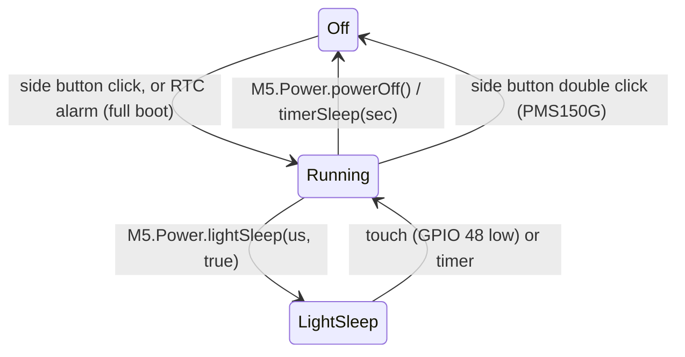

# Hardware: M5Stack M5PaperS3 (SKU C139)

Facts the software depends on: specs, pins, power behaviour, the display driver and the toolchain. Each fact names its
source, so it can be re-checked:

| Source | Means |
|---|---|
| **docs** | https://docs.m5stack.com/en/core/papers3 |
| **M5Unified** / **M5GFX** | library source at version 0.3.0 (in `.pio/libdeps/papers3/`) |
| **measured** | read from our own device (see `docs/STATUS.md` "Measurements") |

## Specs

| Item | Value | Source |
|---|---|---|
| SoC | ESP32-S3R8, dual core LX7 240 MHz, Wi-Fi 2.4 GHz, BLE | docs |
| Flash | 16 MB quad SPI | docs, measured (`esptool flash-id`) |
| PSRAM | 8 MB octal (must be enabled, OPI mode) | docs |
| Display | 4.7" e-ink ED047TC1, 960x540, 16 gray levels, ~235 ppi, driven directly by the ESP32 (no controller chip) | docs |
| Touch | GT911 capacitive, 2 points, I2C | docs |
| RTC | BM8563, I2C 0x51, alarm can power the board on | docs |
| IMU | BMI270, I2C 0x68 | docs |
| Battery | 3.7 V 1800 mAh LiPo, charger LGS4056H (~330 mA), no fuel gauge: voltage via ADC only | docs |
| Storage | microSD slot (SPI), see [microSD](#microsd) | docs, measured |
| Sound | passive buzzer (new-message chime, apps/inbox.md "Sound"; not heard yet) | docs |
| Power controller | PMS150G microcontroller: handles the side button, power on/off, download mode | docs |
| USB | USB-C, native USB serial/JTAG (shows up as `/dev/cu.usbmodem*`, VID:PID 303A:1001) | measured |
| Size | 121.5 x 67.7 x 7.7 mm, 89 g | docs |

### microSD

The 64 GB card in the device mounts with Arduino `SD.begin(47, SPI, 25000000, "/sd")` after `SPI.begin(39, 40, 38, 47)`
(`platform/device/storage.cpp`).

## Pin map

| Function | GPIO | Source |
|---|---|---|
| EPD data DB0..DB7 | 6, 14, 7, 12, 9, 11, 8, 10 | docs |
| EPD XSTL / XLE / SPV / CKV | 13 / 15 / 17 / 18 | docs |
| EPD power enable | 45 | docs |
| I2C SDA / SCL (GT911, BM8563, BMI270) | 41 / 42 | docs, M5Unified |
| Touch interrupt (active low) | 48 | M5Unified |
| microSD SCK / MOSI / MISO / CS | 39 / 38 / 40 / 47 | docs, M5Unified |
| Battery voltage ADC | 3 | docs |
| Charge status (low = charging) | 4 | M5Unified `Power_Class.inl` |
| USB power detect (>0.2 V = plugged) | 5 | docs |
| Power-off pulse to PMS150G | 44 | M5Unified |
| Buzzer PWM | 21 | docs |
| Status LED | 0 | M5Unified |
| Grove port (yellow / white) | 1 / 2 | docs |

- **We never drive these pins by hand.** M5Unified (`M5.begin()`) detects the board and configures the display, touch,
  RTC, IMU, power and SD pins. Our device HAL calls M5Unified.
- **One exception: the buzzer** (`platform/device/sound.cpp`) is a square wave from the Arduino LEDC timer on GPIO 21
  (`ledcAttach`, `ledcWriteTone`, `ledcDetach`). M5Unified's speaker class would drive the same pin through I2S with a
  task that stays; it is never started.

## Power behaviour

Hardware constraints behind the power design (POWER.md).



- **Side button**: owned by the PMS150G, not a normal GPIO. One click powers on (or resets when on); double click powers
  off; hold while plugging USB = download mode (red LED blinks).
- **The firmware cannot see the side button.** The ESP32 cannot read a click while running
  ([Measured in P3-1](#measured-in-p3-1)). A double click leaves the last picture on the panel: the sleep screen comes only
  with a power-off from software (POWER.md).
- **Power off from software**: `M5.Power.powerOff()` sends 5 pulses on GPIO 44. In this state the board draws ~9 uA
  (docs). Only the side button, or an RTC alarm (`M5.Power.timerSleep(sec)`), brings it back, and that is a full boot.
- **Touch cannot wake from deep sleep or power-off**: GPIO 48 is not an RTC IO on the ESP32-S3. M5Unified logs
  `deepSleep: GPIO48 cannot be used as a deep sleep wakeup source`.
- **Touch can wake from light sleep**: `M5.Power.lightSleep(us, true)` arms a low-level GPIO wake on GPIO 48. The program
  continues after the call. This is our main idle state.
- **The e-ink image stays visible** with no power at all.

Documented currents at 4.2 V:

| State | Current |
|---|---|
| Running, Wi-Fi on | 154 mA |
| "Standby" (main power off, IMU on) | 950 uA |
| Off | 9.3 uA |
| Light sleep | not documented: measure it (task P3-5) |

### Measured in P3-1

Firmware with `hal::Power` on the device.

| Check | Result |
|---|---|
| Light sleep with a timer | **works**: `M5.Power.lightSleep(5000000, true)` slept 4992 ms, wake cause `ESP_SLEEP_WAKEUP_TIMER`; 10 s asked, woke after 9991 ms. Execution continues after the call. |
| Power off with an RTC alarm | **works**: `M5.Power.timerSleep(20)` (`hal::Power::powerOff(20)`): the USB port disappeared at once and came back after 20 s with a fresh boot (`booted` in 0.0 s of polling, boot log complete, config and storage mounted). |
| `powerOff(0)` (`M5.Power.powerOff()`, only the side button wakes it) | **not run**: nobody can press the button during automated tests |
| Side-button click while running | M5Unified has no `BtnPWR` mapping for the PaperS3 (the button belongs to the PMS150G, not an ESP32 pin), so a program cannot read it. Not testable without a human anyway. |
| Touch wake | armed by M5Unified with `gpio_wakeup_enable(GPIO48, LOW_LEVEL)`. An injected tap arrives over serial, not on GPIO 48, and cannot wake the chip. A real touch wake and delivery of the waking tap are **not verified** (Pending device checks in STATUS.md). |

### USB and light sleep

**Light sleep breaks the USB serial session.**

- The `/dev/cu.usbmodem*` node stays, but the open host handle receives nothing afterwards: not the reply to the command
  that slept, nor later commands. A new open works again.
- Bytes sent over USB while the chip sleeps do **not** wake it and are lost. A device in light sleep cannot be reached by
  `tools/device.py` until its timer fires or a touch wakes it (see P3-4, `power.stayAwakeOnUsb`).
- `HWCDC::isPlugged()` (SOF seen) tells whether a host is connected.
- **On a USB hub the node itself can go.** A device that light-slept (unplugged for over ten minutes, then on the hub;
  and after `>set sleep 15000`) was not on the USB bus at all: `ioreg` showed no 303A device and no
  `/dev/cu.usbmodem*`, also 60 s after the sleep had ended. It came back only when the cable was replugged. So
  `>set sleep` and `>set usbsleep` can cost the link until someone replugs: do not use them in an unattended run there.

## Display driver facts (M5GFX `Panel_EPD`)

- **Orientation**: native panel orientation is landscape 960x540. PaperOS runs portrait 540x960 (rotation is set in the
  device HAL; M5GFX reports 540x960 by default for this board).
- **Own frame buffer and task**: the driver runs a background FreeRTOS task (`"epd"`) that plays the waveform frames.
  - `M5.Display.display(x,y,w,h)` queues a region.
  - Drawing between `startWrite()` and `endWrite()` batches into one update.
  - `displayBusy()` / `waitDisplay()` report / wait for the task.
- **Modes** (`M5.Display.setEpdMode(...)`), waveform lengths from `Panel_EPD.inl`:

  | Mode | Frames | Grays | Flash | Use |
  |---|---|---|---|---|
  | `epd_quality` | 15 | 16 | yes (goes through black/white) | images, cleaning ghosts |
  | `epd_text` | 12 | 16 | no | text pages, lists |
  | `epd_fast` | 8 | 2 (black/white) | no | touch feedback, toggles |
  | `epd_fastest` | 5 | 2 | no | drag feedback only; ghosts most |

- **Reference times** from the M5Stack docs for a similar panel (PaperMono): quality 4.7 s (full screen clean), text
  0.45 s, fast 0.34 s, fastest 0.07 s. Our own numbers: `docs/STATUS.md` and `DISPLAY.md` "Panel modes".
- **Custom waveforms** are possible: `Panel_EPD::config_detail_t` takes replacement LUTs (`lut_quality`, `lut_text`,
  `lut_fast`, `lut_fastest`). Only touch this in task P7-1.
- **DC bias**: M5Stack warns that long runs of fast partial updates without a full refresh build up DC bias and can
  damage the panel. The DisplayManager's ghost budget (DISPLAY.md) exists for this reason too.

## Toolchain facts

Verified 2026-11-15.

| Item | Value |
|---|---|
| PlatformIO Core | 6.2.0, installed with `uv tool install --python 3.12 platformio` (binary: `~/.local/bin/pio`) |
| Device platform | pioarduino `55.03.312-1` (Arduino core 3.x on ESP-IDF 5.x). The official `espressif32` platform is stuck on Arduino core 2.x; do not switch to it. |
| Board definition | `esp32-s3-devkitc-1` with overrides in `platformio.ini` (16 MB flash, OPI PSRAM, native USB CDC). There is no `m5stack-papers3` board in PlatformIO. |
| esptool | `~/.platformio/penv/bin/esptool` |
| Factory image | `backup/factory-16MB.bin` (not in git) |

Restore the factory firmware:

```bash
~/.platformio/penv/bin/esptool --port /dev/cu.usbmodem101 write-flash 0 backup/factory-16MB.bin
```
