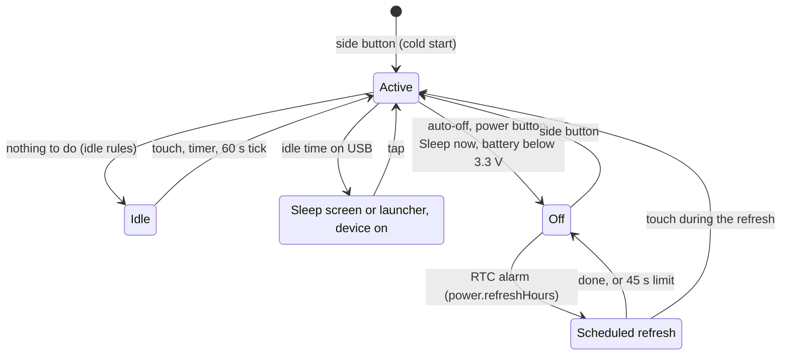
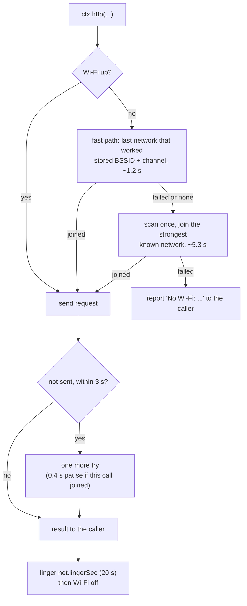
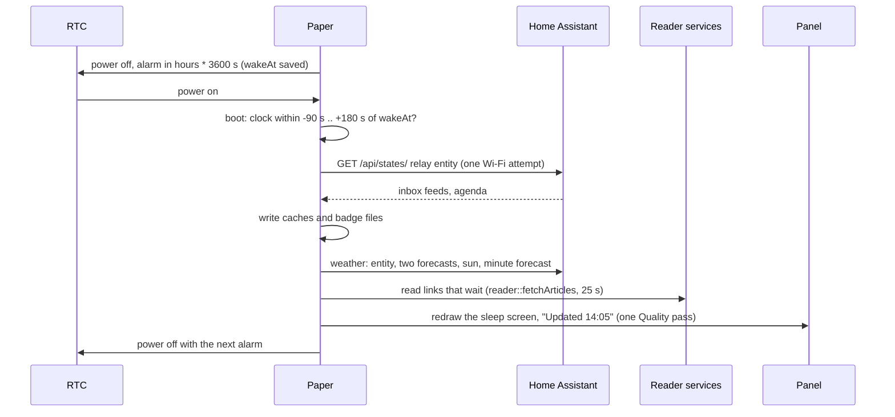

# Power

**Goal**: be asleep almost always and keep Wi-Fi off almost always. The battery is 1800 mAh and the device draws about
154 mA with Wi-Fi on (M5Stack docs): under 12 hours. The e-ink image stays visible while the processor sleeps, so sleeping
costs nothing the user can see.

This doc covers the power states, the idle and auto-off rules, the sleep screen, the Wi-Fi policy, the scheduled refresh
while off, and how power is measured. Hardware constraints are in `HARDWARE.md` "Power behaviour". The key one: touch can
wake the ESP32 from **light sleep** only, not from deep sleep or power-off.

**Contents**

- [States](#states) · [Idle rules](#idle-rules) · [Auto-off](#auto-off)
- [Sleep screen](#sleep-screen) · [Today board](#today-board) · [Resume after power-off](#resume-after-power-off)
- [Wi-Fi policy](#wi-fi-policy) · [Scheduled refresh](#scheduled-refresh)
- [CPU](#cpu) · [Battery reading](#battery-reading) · [Estimates](#estimates) · [Measuring](#measuring)

---

## States

| State | What is on | Entered when | Left by | Expected current |
|---|---|---|---|---|
| **Active** | CPU, maybe Wi-Fi | input, worker job running, display busy | nothing left to do | 40-160 mA |
| **Idle** (light sleep) | RAM kept, touch controller, RTC | UI thread has nothing to do | touch (GPIO 48), next timer, max 60 s tick | est. 1-5 mA, **measure** (P3-5) |
| **Off** (PMS power-off) | RTC only | auto-off timeout, the launcher's power button, quick panel "Sleep now", battery below 3.3 V | side button; RTC alarm if a wake time was set | ~9 uA (docs) |

There is no separate "deep sleep" state: power-off is lower and wakes on the same sources.



### Power HAL (P3-1)

`device::Power` (`platform/device/power.cpp`):

| Call | Implementation |
|---|---|
| battery | 8-sample average in 5 % steps |
| `lightSleep(maxMs)` | `Display.waitDisplay()` + `M5.Power.lightSleep(us, touch)`; returns the wake cause from `esp_sleep_get_wakeup_cause()` (timer / GPIO = touch / other) |
| `powerOff(sec)` | `timerSleep(sec)` (RTC alarm power-on), or `M5.Power.powerOff()` for 0 |
| `usbConnected()` | `HWCDC::isPlugged()` |

- **Settings > Developer**: "Sleep test" (10 s, toast with the wake cause) and "Power off" (confirmation sheet).
- **Debug commands**: `>set sleep <ms>`, `>set poweroff <sec>`.
- **USB and light sleep**: see HARDWARE.md. The serial link does not survive a sleep and nothing sent during it is
  received.

## Idle rules

`core/power_policy.{h,cpp}`, task P3-4. The main loop (`Loop`) calls `PowerPolicy::idle(maxWaitMs)` when it has nothing
to do. It takes the platform's short wait as a callback and decides with the pure functions `decideSleep` and
`autoOffDue`.

It light-sleeps when all of these hold, otherwise it waits 10 ms and returns:

- **Platform**: the platform can sleep (device only).
- **Work**: no worker job runs or waits, no callback is queued.
- **Display**: the panel is not busy, nothing is dirty, and no settle or clean pass is due within 50 ms.
- **Touch**: no finger is down, and at least 300 ms have passed since the last touch event (lets double taps and swipes
  finish).
- **Wi-Fi** is off. Wi-Fi drops in light sleep unless modem sleep is configured; v1 keeps it simple.
- **USB**: no USB host is connected, nor was one seen in the last 10 minutes (see below).

**Sleep duration** is the time until the next deadline (timer, settle or clean pass, long press, status bar minute tick,
auto-off), capped at 60 s, and no sleep at all if that is within 50 ms.

**Touch wake**: the GT911 still holds the touch data, so the tap that woke the device is delivered normally. The user
never has to tap twice.

### USB keeps the device awake

- **Rule**: no light sleep while a USB host is connected (`power.stayAwakeOnUsb`, default true), nor within 10 minutes of
  the last time one was seen (`kUsbHostHoldMs`).
- **Why**: light sleep kills the USB serial session and drops everything sent during it (HARDWARE.md), so a sleeping
  device cannot be driven by `tools/device.py`.
- **Why the 10-minute hold**: the host reading drops out now and then, and a Mac suspends a port nobody has open. Without
  the hold the device napped between two tool runs and the next command waited up to a minute.
- **Consequence**: an unplugged device starts light-sleeping ten minutes after the cable is pulled. Start battery sessions
  (P3-5) after that.
- **Off switch**: setting it to false (Settings > Power, or in `config.json`) lets the device sleep on USB too.

## Auto-off

| Key | Default | Meaning |
|---|---|---|
| `power.autoOffMin` | 15 | minutes without input until power-off; 0 = never |
| `power.autoOffMinReader` | 30 | the same while the reader app `read` is open |

**Sequence**: draw the sleep screen (below), `display.wait()`, then `power.powerOff(0)`, or with an RTC alarm, see
"Scheduled refresh". In code: `Surface::prepareForIdleOff()` (the Shell writes `lastApp` to `/data/system.json` and closes
the app so it saves), the panel finishes, then `power.powerOff(0)`.

- **Apps save first**: before power-off every app gets `onPause()` to save state (reading position).
- **Input counts remote traffic**: what the remote receives (USB or Wi-Fi, the Mac or the phone) is use: `Remote::feed`
  calls `Os::keepAwake`. An update, an upload or a live view is never cut by the sleep screen or a power-off.
- **Not while Wireless development is on** (Settings > Developer, D39): the device must stay reachable.
- **Not on USB**: never while a USB host is connected, and not while USB (a host on the data link, or the charger) was seen
  in the last 12 hours of this boot (`kUsbGraceMs`). A Mac suspends a port nobody has open, the device then sees no host,
  and only the side button could undo an unwanted power-off.
- **What resumes**: the next start after an auto-off resumes only a book or a game (`Surface::prepareForIdleOff`, D38);
  "Sleep now" and the launcher's power button resume whatever was open.
- **Boot after power-off** is a cold start. Target: **under 2.5 s from button to the previous screen** (task P3-6): the
  launcher restores the last app and the app restores its state from `/data`. Do not connect Wi-Fi during boot.

### On USB

On USB (or with USB seen in the last 12 hours) the device does not switch off. At the same idle time it shows what
Settings > Power "Then show" says: the sleep screen staying on (default) or the launcher (apps/launcher.md "When unused",
D38).

### "Tap to start" never shows on a device that is off

On battery, the Shell's idle sleep screen and the auto-off fall due at the same moment. The loop runs timers first, so the
Shell used to draw the screen that stays on, and the power-off then left it (its `prepareForIdleOff` found a sleep screen
already there).

- **Fix**: PowerPolicy tells the Os whether the idle time ends in a power-off (`Os::offWhenIdle`). The Shell then leaves
  the panel to the power-off ("Powered off").
- **Late power-off**: when a sleep screen that stayed on is followed by a power-off after all (12 hours after USB, wireless
  development switched off), the power-off draws it again as "Powered off".
- **Tests**: `power_policy_test` (the loop minute by minute), `app_test`.

## Sleep screen

A full-screen image drawn before power-off in Quality mode (it stays for hours). Task P3-6, simulator part done.

- **Layout**: large, clock-less, with the current book cover and progress, or the PaperOS mark.
- **State line** at the bottom: the power icon with "Powered off" (title size, ink) and under it "Press the side button to
  start". The panel keeps its picture without power, so this line is the only thing that tells off from on.
- **Unread line**: one caption-sized line above the hint shows the cached unread count (and the time of the last
  scheduled refresh).
- **Agenda line**: above it, what the phone's agenda has on now or next (`sleepAgendaLine`, D28), as of the moment the
  screen was drawn.
- **Only from firmware**: the screen is drawn only when the firmware switched the device off (auto-off, the launcher's
  power button, "Sleep now"). **A double click on the side button cuts the power outside the firmware** (HARDWARE.md), and
  the panel then keeps whatever was on it.

This is the **plain screen**: what the device shows when there is nothing for the Today board, or with the board switched
off.

**Code path**: `Shell::prepareForPowerOff()` asks the open app for `App::sleepInfo()` (title, subtitle, percent, cover path;
the reader keeps these in its store while a book is open), closes the app, draws `core/sleep_screen` into the canvas and
calls `forceClean()` (one Quality pass). The Shell draws nothing after that.

## Today board

Task P7-16, D35. The device is off most of the day and the panel keeps its picture, so with something to show the sleep
screen is a board of the day instead (`drawSleepBoard`; Settings > Power > "Today on the sleep screen", `power.sleepBoard`,
default on).

From the top, each part left out when it has nothing:

| Part | Content |
|---|---|
| **Date** | the day the board was drawn on ("Thursday 15 January", headline) |
| **Weather** | the weather app's first place, from its saved copy (no read at power-off): today's high and low, the day's condition and rain chance ("Rain, 80%", "Cloudy, rain 30%"), and the next four blocks of three hours as on the app's second page (hours, icon, temperature, rain chance). Left out when the copy was read more than 24 hours ago or has no forecast for today (`weather::fillSleepBoard`). |
| **Agenda** | today's events that are not over (an event that is on stays until its end), then the next days with events under their name ("Friday 16 January"); six lines in all, never ending on a day's name (`sleepAgendaRows`). Times as in the Agenda app's list. |
| **Open book** | one row: cover, title, author and percent |
| **Unread per app** | the app's icon and a count, nothing else (BACKEND.md "Privacy"). The book icon counts what there is to read later: links that wait and articles nobody opened (apps/reader.md "Articles"). Right of it "Updated 15:34" after a scheduled refresh. |
| **State** | "Powered off" and the hint, as on the plain screen |

- **Nothing reads as "now"**: no clock, no current temperature, no "Today" or "Tomorrow". Forecasts and clock times stay
  true while the picture stands; the date tells how old it is.
- **Fallback**: with no clock, or with neither weather nor agenda, the plain screen is drawn.
- **Layering**: `core/sleep_screen` draws a plain `SleepBoard` (texts and icons) and builds its agenda part. The weather
  part comes through `setSleepWeatherSource`, set to the weather app's `weather::sleepBoardSource` in `apps/apps.cpp`
  (core does not include apps). The Shell and the scheduled refresh both call `drawSleepScreenFor`.
- **Reading it back from a device**: a power-off takes the USB link with it, so use the test screen `sleepboard`
  (`tools/device.py set screen sleepboard`, then `shot`): the sleep screen as a power-off would draw it at that moment,
  without a book.
- **Goldens**: `today-board`, `today-board-refreshed`, `today-board-book`, `today-board-off`, `agenda-sleep` (agenda only),
  `sched-refreshed` (weather only).

## Resume after power-off

- **Store**: `prepareForPowerOff()` stores the id of the open app as `lastApp` in `/data/system.json`.
- **Boot**: the boot path (`apps::createSurface("", os, true)`) opens that app once and clears the key, so a boot after a
  crash shows the launcher. An unknown id shows the launcher.
- **App state**: each app restores its own. The reader keeps the open book's file name in its store (`open`, cleared when
  the user leaves the book for the library) and reopens it on the saved page; Settings just opens.
- No Wi-Fi at boot. `>set screen launcher` never resumes.

## Wi-Fi policy

`core/net`, task P3-2. Wi-Fi is off at boot. Apps never switch Wi-Fi on themselves: they call `ctx.http(...)` and the net
service connects if needed.



### Connecting

- **Known networks**: `WIFI_SSID[_2.._8]` from the card plus networks added on the device; the card wins duplicates.
- **Fast path**: the last network that worked, with its stored BSSID and channel (~1.2 s measured).
- **Scan path**: if the fast path fails or there is none, scan once and join the known network with the strongest signal
  (~5.3 s measured).
- **One attempt each**, never a loop. A failure is reported to the caller.
- **2.4 GHz only**: the SSID must also exist on 2.4 GHz (mesh routers normally do).

### Retry

A request gets one more try when it failed within 3 s before anything of it left the device (no address for the name, no
connection: `hal::HttpResponse::notSent`). The first lookup or connection on a link that is seconds old can fail, which
showed as "Home Assistant not reachable".

- **Pause**: 0.4 s before the retry when the same call brought Wi-Fi up. If the link fell, it reconnects first (the usual
  one fast and one scan attempt).
- **Safe for any method**: nothing was sent.
- **No more**: a failure that took longer, or a second one, is reported as it is (`NetService::perform`).

### Linger

| Case | Wi-Fi stays up |
|---|---|
| After the last request | `net.lingerSec` (default 20 s), in case another request follows, then off |
| Teletekst, after a page is shown | about a minute (`ctx.keepWifi()`, apps/teletekst.md "Saved copies and reads"): the next tap is mostly a read, and a reconnect costs 2 s and a TLS handshake. It ends with the screen (the idle timeout, `power.autoOffMin`, D38, leaves the app when nobody touches it). |
| Home app in the foreground, touched in the last 2 minutes | extended, so toggles respond fast. The device does not light-sleep during that window. |

### Time sync

- **When**: SNTP after a connect when the clock was never set or the last sync is over a day old. Written to the BM8563 RTC
  on the UI thread; the status bar updates at once (measured: the clock was set after the first connect).
- **Only SNTP's own answer counts** (its notification callback), never a system time that looks set: that one survives a
  restart and drifts minutes a day on the internal RC oscillator.
- **No start-up delay**: SNTP asks at once (`CONFIG_LWIP_SNTP_STARTUP_DELAY=n`): 51 ms on the device, against 4.95 s with
  the default random start-up delay.
- **Log**: how far the RTC was off (`clock was N s off`).
- **No connect for the clock alone** (Wi-Fi stays off at boot). Apps that need the date offer "Klok zetten"
  (`ctx.syncClock`: Somdoku, the word game), and any other connect (Home, an inbox refresh, Settings > Wi-Fi) sets it too.

### Polling and TLS

- **No background polling** while the device is on. While it is off, the scheduled refresh can fetch the inbox feeds (off
  by default).
- **TLS handshakes are expensive**: ~1.5 s, ~45 KB RAM. HTTPS to the public Home Assistant address is the expected case
  (BACKEND.md); the device keeps one connection alive per refresh.

| Free heap | Measured |
|---|---|
| idle | ~200 KB |
| Wi-Fi up | ~150 KB |
| during a TLS request | ~104 KB |

### First HTTPS request, phase by phase

Measured on the device (2026-11-15, `[net]` log lines). "Test connection", cold: Wi-Fi off, then `GET <HA_URL>/api/` over
TLS. It read **9.5 s** at first, with the Wi-Fi join only 1.3 s.

| Phase | Before | After |
|---|---|---|
| Wi-Fi join, fast path (stored BSSID/channel, includes DHCP) | 1.3 s | 1.3 s |
| DNS | 30-45 ms | 30-45 ms |
| TCP + TLS handshake | 0.56-0.76 s | 0.56-0.68 s (CPU was already 240 MHz) |
| request + response headers (server) | 0.5-2.9 s (varies) | 0.5-0.7 s |
| body | 0 | 0 |
| **UI thread stalled, result delivered late** | **~7.5 s** | **0** |
| **Total, cold** | **9.5-10 s** | **2.0-2.6 s** |
| Second request, kept-alive connection | 2.0 s (same stall) | **34 ms** |

**Cause**: the 7.5 s was not the network. **The UI thread blocked in `Serial.print`.** USB CDC log writes block (default
TX timeout) while no host reads the port, and the log lines of a request pile up; every `POS_LOG` could stall the loop for
~100 ms.

- **Fix**: `Serial.setTxTimeoutMs(0)` (drop when the buffer is full, never block). This also removed a 2.2 s UI gap right
  before taps and benefits every screen.
- **SNTP off the connect path**: the SNTP wait (up to 5 s) is its own worker job after the request.
- **No Wi-Fi HAL on the UI thread**: connected state and link info are cached by the net service (the stack's locks are
  held during connects and TLS).
- **Log lines**: the phases (`https phases: dns= tls+tcp= request+headers= body= cpu= reused=`) and `[perf] UI loop gap`
  for passes later than 400 ms.

The handshake itself is ~0.6 s, well under the 2 s worry; the request/response of the Home Assistant server is the rest.

## Scheduled refresh

Tasks P7-5 and P7-16, `apps/inbox/scheduled_refresh`. Settings > Power > "While off, wake to update the sleep screen
every" Off / 1 h / 2 h / 4 h / 8 h (`power.refreshHours`, default 0 = off).



### Setting the alarm

- Every power-off for sleep (auto-off, "Sleep now") goes through `Os::powerOffForSleep()`.
- With the setting on **and the clock set**, it powers off with an RTC alarm (`power.powerOff(hours * 3600)`) and
  remembers the alarm time as `wakeAt` in `/data/system.json`.
- Without a clock there is no alarm: the wake could not be told from the side button.

### Detecting the wake

- **Window**: at boot (`apps::createBootSurface`), if the clock is within -90 s .. +180 s of `wakeAt`, the boot is a
  scheduled wake (`isScheduledWake`).
- **No RTC flag**: it is not read, so a side-button press inside that window also counts. A touch during the refresh ends
  it in a normal boot.
- `wakeAt` is forgotten at every boot, so an earlier side-button press is an ordinary boot.

### What a wake does

1. Builds no launcher and no app, and keeps the panel as it is (no first Quality refresh).
2. Reads the relay (`GET /api/states/<entity>`, one Wi-Fi attempt as always): the inbox feeds and the agenda.
3. Writes each feed's cache and badge file (`/data/cache/<id>/badge` = items newer than that app's seen marker).
4. With the Today board on, reads the weather's first place as the app does (`weather::refreshSaved`: the entity, two
   forecasts, the sun, the minute forecast, on the connection that is open). Not asked when the relay's request found no
   network.
5. Reads and saves links that wait to be read later (apps/reader.md "Articles", P7-18: `reader::fetchArticles` with 25 s;
   no read starts with under 5 s of that left, and none waits longer than what is left). An article shared in the evening
   is on the card in the morning and the board's count is right.
6. Redraws the sleep screen of the last power-off (the book kept as `sleep.*` in `system.json`; date, agenda and weather as
   of this hour) with "Updated 14:05", in one Quality pass.
7. Powers off with the next alarm.

- **Nothing answered**: if neither the relay nor the weather answered, the panel is left alone.
- **Hard limit**: 45 s awake, then off.
- **Privacy**: the sleep screen shows a count only, never a sender or text. The count is also drawn at an ordinary
  power-off when badges are cached.

### Log and testing

- **Log**: one line per wake in `/data/refresh.log`:
  `unix,msSinceBoot,refreshMs,feedsAnswered,unread,weatherRead,articlesSaved` (`tools/device.py cat /data/refresh.log`;
  lines from before P7-16 have five fields, before P7-18 six).
- **Test without stranding the device**: `tools/device.py poweroff N` (RTC wake after N s, the refresh runs, then an
  ordinary boot) and `poweroff N M` (the refresh powers off once more for M s; the wake after that stays on).

### Measured wake time

Four RTC wakes (2026-11-15, USB power, known network on the fast path, HTTPS to the public address):

| Wake | Refresh (first loop pass to "done") | Since `setup()` |
|---|---|---|
| 1 | 2.8 s | 3.5 s |
| 2 | 5.2 s | 6.1 s |
| 3 | 2.9 s | 3.6 s |
| 4 | 3.0 s | 3.7 s |

- **Inside the refresh**: Wi-Fi join 1.2-1.4 s, first HTTPS request 1.2-3.4 s of which TLS 0.6-2.9 s, second request 37 ms
  on the kept-alive connection.
- **Not in those numbers**: ROM and bootloader before `setup()` (about 1.3 s, from the time between two chained wakes) and
  the Quality refresh that plays before the power goes (1.5-1.9 s).
- **Total per wake**: **about 6.5 s, up to 9 s** with a slow TLS handshake.
- **With the weather** (P7-16, 2026-11-18, one RTC wake on USB power): refresh 4.2 s (5.0 s since `setup()`). The relay's
  request took 1.0 s with its TLS handshake, then the weather's five requests 34-60 ms each on the same connection, about
  0.25 s together. Inside the range above; the estimate below stands.

### Battery cost (estimate)

Not measured: there is no current meter. At an assumed 120 mA average while awake with Wi-Fi up, one wake costs about
0.2 mAh (0.15-0.3).

| Interval | Per day | Of 1800 mAh |
|---|---|---|
| 1 h | ~5 mAh | well under 1 % |
| 2 h | ~2.5 mAh | well under 1 % |
| 4 h | ~1.3 mAh | well under 1 % |
| 8 h | ~0.6 mAh | well under 1 % |
| Bad case, 1 h: Home Assistant does not answer, every wake runs to the 45 s limit (~1.5 mAh a wake) | ~36 mAh | 2 % |

## CPU

**Planned, not built** (task P3-5): `setCpuFrequencyMhz(80)` when Wi-Fi is off (rendering text at 80 MHz is fine; measure
page turn time before and after), 240 MHz while Wi-Fi is on or while indexing a book. Today the firmware does not change
the CPU frequency and runs at 240 MHz.

## Battery reading

- **No fuel gauge**: `M5.Power.getBatteryVoltage()` (ADC on GPIO 3) and `getBatteryLevel()`.
- **Sampling**: voltage under load sags, so sample only when Wi-Fi is off, average 8 samples, and show steps of 5 %.
- **Charging**: `M5.Power.isCharging()` reads GPIO 4.
- **First boot**: 3716 mV = 52 % while charging.

## Estimates

To be replaced by measurements in task P3-5.

| Scenario | Assumption | Average | Battery life |
|---|---|---|---|
| Reading | 1 page / 40 s: 1 s active at 60 mA, rest idle at 3 mA | ~4.5 mA | ~400 h of reading |
| Home app, active use | Wi-Fi up, 100 mA | 100 mA | 18 h continuous |
| Checking inbox | 15 s Wi-Fi per check, 10 checks a day | ~0.5 mAh per check | negligible |
| Off | 9 uA | | years (self-discharge dominates) |
| Off with scheduled refresh | ~6.5 s awake at 120 mA per wake (time measured, current assumed) | ~0.2 mAh per wake | 2 h interval: ~2.5 mAh a day |

## Measuring

Task P3-5.

### Power log (built, `core/power_log`)

`/data/power.csv` gets one line at boot, then every 10 minutes (the loop wakes from light sleep for it):

```
unix,mv,state,wifiSeconds,pushes,usb,app
```

| Field | Meaning |
|---|---|
| `state` | `active` = touched in the last minute, else `idle` |
| `wifiSeconds`, `pushes` | counted since boot |
| `usb` | 1 when a host or charger is seen |
| `app` | id of the open app, empty on the launcher |

- **Switch**: on by default (`power.log` in config.json; switch in Settings > Developer).
- **Developer screen**: battery mV / percent / USB, time since boot, lines written and Wi-Fi seconds.
- **Rotation**: at 200 KB the file becomes `/data/power.old.csv`.
- **Reading it**: over USB, `tools/device.py cat /data/power.csv` (`>cat` reads only these two files).
- **Starting a run**: unplug the device; nothing else to set.
- **Not built**: the 40 s auto page turn for the reading session.

### Battery sessions

1. Run three sessions from a full charge with USB unplugged: 2 h reading (auto page turn every 40 s from a script flag),
   2 h idle on the launcher, 30 min Home app with Wi-Fi up.
2. Compute mAh/h from the voltage curve and compare with the table in "Estimates". With a USB power meter in line the
   numbers are better: use one if available.
3. Record results in `STATUS.md` and correct this file.
