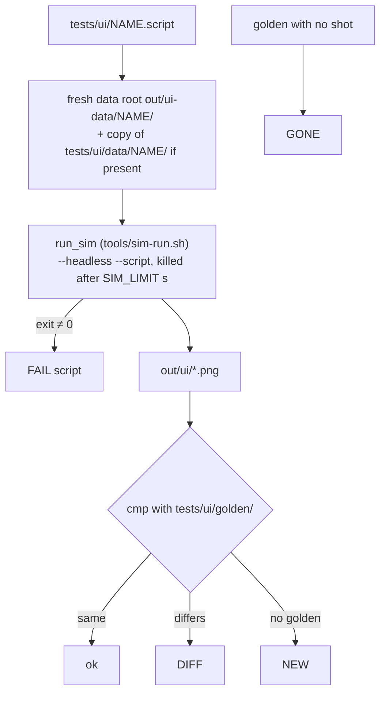
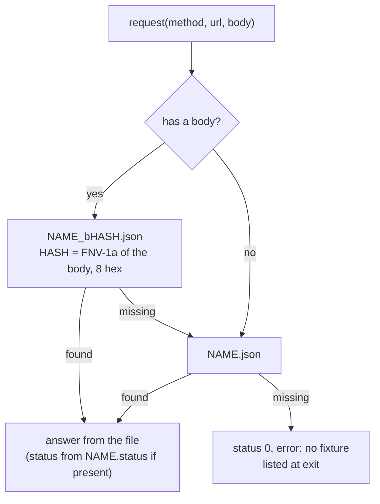
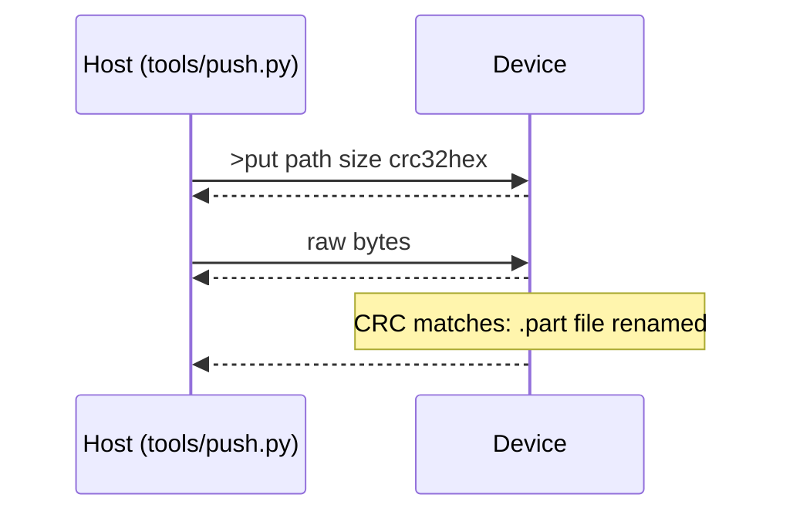

# Simulator and testing

The simulator is the same `core`, `ui` and `apps` code built for macOS with SDL2. It is the default way to develop:
build and screenshot take seconds, no device needed. The device is for what a model cannot show: real refresh
behaviour, touch feel, power.

This doc covers the simulator's command line, UI scripts and golden screenshots, the fake network and fixtures, unit
tests, and the tools that test the real device.

**Contents**

- [Commands](#commands) · [Command line](#command-line) · [UI scripts](#ui-scripts) ·
  [Golden screenshots](#golden-screenshots)
- [Wi-Fi world and test data](#wi-fi-world-and-test-data) · [HTTP fixtures](#http-fixtures) ·
  [E-ink emulation and the refresh log](#e-ink-emulation-and-the-refresh-log) · [Unit tests](#unit-tests)
- [What `make check` means](#what-make-check-means)
- [Device testing](#device-testing) · [Real-time runs against the simulator](#real-time-runs-against-the-simulator)

---

## Commands

| Command | Does |
|---|---|
| `make sim` | build `.pio/build/sim/program` |
| `make run` | window: mouse = touch (drag = move); keys in [Window keys](#window-keys) |
| `make shot` | headless: writes `out/shot.png` and exits (no window, works over SSH) |
| `make test` | host unit tests ([Unit tests](#unit-tests)) |
| `make ui-test` | every UI script vs its goldens ([Golden screenshots](#golden-screenshots)) |
| `make ui-accept` | accept new screenshots as goldens (look at them first) |
| `make gallery` | `out/gallery.html`: every UI test screenshot |
| `make fw` | build device firmware |
| `make flash` | build + flash (device on `/dev/cu.usbmodem*`) |
| `make monitor` | device serial log |
| `make check` | `sim` + `test` + `ui-test` + `fw`: must pass before any task is called done |

`program --headless --shot <file.png>` renders one frame and exits. The PNG is 540x960 grayscale quantised to the
panel's 16 levels. **UI work is verified by running `make shot` and looking at `out/shot.png`.**

## Command line

```
program [--headless] [--script FILE] [--shot FILE] [--out DIR] [--fixtures DIR] [--data DIR]
        [--time ISO8601] [--no-rtc] [--scale N] [--app NAME] [--name NAME] [--remote]
```

Command line and scripts came with P1-4 and P1-5.

| Flag | Meaning |
|---|---|
| `--headless` | no window. With `--script`: run it and exit. With `--remote`: serve stdin until it closes. Otherwise render the first frame to `--shot` (default `shot.png`) and exit. |
| `--script FILE` | run a [UI script](#ui-scripts), then exit (headless) or keep the window open |
| `--shot FILE` | where a headless one-frame render goes |
| `--out DIR` | where `shot` commands and `refresh.log` are written (default `out/`) |
| `--fixtures DIR` | answer HTTP from files instead of the network (default `tests/fixtures/http`); `none` = the real network through libcurl |
| `--data DIR` | root for `/sd` and `/data` (default `sim-data/`; tests use their own empty root) |
| `--time T` | start the fake clock at T, `YYYY-MM-DDTHH:MM:SS` (UTC); in headless mode time only advances by `wait` |
| `--no-rtc` | `now()` is 0, like a device whose RTC was never set, until a time sync sets the clock (then the fake or host time) |
| `--scale N` | window scale |
| `--app NAME` | open a registered app (`--app read`), a UI test screen (`widgets1`, `widgets3`, ...) or the font sheet (`fonts`); without it the launcher shows |
| `--name NAME` | platform name in the footer (`--name M5PaperS3` for a footer identical to a device dump) |
| `--remote` | also accept the remote commands (`core/remote.h`) on stdin, replies on stdout ([Simulator remote mode](#simulator-remote-mode)) |

### Window keys

| Key | Does |
|---|---|
| `S` | screenshot to `shot-N.png` |
| `G` | toggle the ghost-residue overlay |
| `L` | print the refresh log tail |
| `Q` / `Esc` | quit |

## UI scripts

Plain text, one command per line, `#` comments. Runner: `platform/sim/script.cpp`.

```
# tests/ui/launcher.script
wait 500              # advance time by ms and run the main loop
shot launcher         # writes out/launcher.png (from the emulated panel)
tap 140 300           # down + up at x,y
wait 800
shot reader-library
swipe 400 500 100 500 # from x1,y1 to x2,y2
long 30 90            # long press
back                  # tap the back arrow
type hello            # taps keys on the on-screen keyboard
wifi off              # make connections fail
wifi hiccup 1         # the next N requests fail before they are sent ("DNS failed"), as the first one on a new link can
expect-no-quality     # fail if the refresh log since the last 'shot' contains a Quality push
expect-max-pushed 20000   # fail if more than N pixels were pushed since the last 'shot'
restart               # save and close the app (as at power-off), build the surface again: a boot with the same data
timer-wake            # power-off, then the RTC alarm: the clock jumps and the device boots into the scheduled refresh (P7-5)
expect-off 7200       # the device switched itself off with a wake alarm in N seconds (0 = no alarm, -1 = it is on)
expect-state page=7/  # the top screen's debugState() contains the text (Screen::debugState(); the reader says page=N/M)
expect-shot-equal A B # two earlier shots are byte-identical (resume after restart, same page on the second visit)
expect-frame-equal A B # what the screen drew at two earlier shots is identical
page-through 200      # tap the right zone until the reader's last page (page=N/N); fails after 200 taps
```

The exit code is non-zero if an `expect-*` fails or the app crashed. A failure prints `<file>:<line>: <reason>`.

### Header lines

`tools/ui-test.sh` reads these from the top of a script and passes them on:

| Line | Becomes |
|---|---|
| `# app: NAME` | `--app NAME` |
| `# time: 2026-11-16T09:00:00` | `--time` (default `2026-01-15T12:34:00`) |
| `# rtc: unset` | `--no-rtc` |

### Script commands

| Command | Does |
|---|---|
| `wait MS` | advance time by MS and run the main loop |
| `shot NAME` | write `NAME.png` from the emulated panel |
| `tap X Y [MS]` | down + up; the finger is down 40 ms, or MS (1-450). A real finger is 150-250 ms, long enough for the pressed look to show. |
| `long X Y` | long press |
| `swipe X1 Y1 X2 Y2` | from x1,y1 to x2,y2 |
| `back` | taps (36, 92), the back-arrow target |
| `type TEXT` | tap the keys of the visible on-screen keyboard |
| `type-max N TEXT` | as `type`; every character key may push at most N pixels |
| `wifi on\|off\|hiccup N\|slow MS\|crowd N` | the [Wi-Fi world](#wi-fi-world-and-test-data) |
| `expect-no-quality` | no Quality push since the last `shot` |
| `expect-max-pushed N` | sum of pushed rectangle areas since the last `shot` is at most N |
| `expect-chimes N` | the new-message sound played N times since the start (the simulator has no sound; `core/sound.h` counts) |
| `expect-state TEXT` | the top screen's `debugState()` contains TEXT |
| `expect-shot-equal A B` | two earlier shots are byte-identical |
| `expect-frame-equal A B` | what the screen drew at shots A and B is identical; the shots themselves may differ, because they show the emulated panel with its history (pixels outside a Fast pass's box keep the last Quality state) |
| `page-through MAX [X Y [MS]]` | tap (default 400 500, 700 ms each) until `page=N/N`; fails after MAX taps; prints the page count |
| `page-until MAX TEXT` | tap the right zone until the page text contains TEXT |
| `restart` | save and close the app, build the surface again (same data) |
| `power-off` | what auto-off does before the power goes: state saved, sleep screen on the panel |
| `timer-wake` | power-off, then the RTC alarm fires and the device boots into the scheduled refresh; fails if no alarm was set |
| `expect-off SECONDS` | switched off with an RTC alarm in SECONDS (0 = no alarm, -1 = on) |

`PAPEROS_TAP_MS=200` in the environment holds every tap that long, for `tools/push-audit.py`; screenshots then differ in
timing.

### Time in scripts

- **Fake clock**: in `--headless` runs the clock only moves through `wait` and the short steps inside gestures.
- **Fixed start**: `tools/ui-test.sh` runs every script with `--time 2026-01-15T12:34:00` (UTC; the status bar shows
  13:34 in the default zone CET).
- **Worker jobs run in real time** while the fake clock jumps. The runner sleeps 3 ms real time per 10 ms step while a
  job is pending, so results arrive at a repeatable simulated time (checked: 15 identical `make ui-test` runs).

## Golden screenshots

`tools/ui-test.sh` (task P1-5) runs every `tests/ui/*.script` headless into `out/ui/`, then compares each PNG
byte-for-byte with `tests/ui/golden/<name>.png`. Rendering is deterministic: fixed fonts, fake clock, fixtures.



- **One data root per script**: `--data out/ui-data/<script>/` (empty, never `sim-data/`), so config written by one
  script (Settings) never leaks into another.
- **Bounded runs**: the simulator is started through `run_sim` (`tools/sim-run.sh`, also used by
  `tools/books-check.sh`). A run that hangs is killed after `SIM_LIMIT` seconds (120; exit code 142) and shows as a
  failed script instead of blocking `make check`.

```bash
make ui-test            # run all, list mismatches, exit 1 on any
make ui-accept          # copy out/ui/*.png over the goldens after looking at them
```

A mismatch is not automatically a bug. Look at the new image; if it is the intended change, accept it and commit the
golden with the code.

## Wi-Fi world and test data

The simulator's `hal::Net` is a small fake Wi-Fi world:

| Network | Details |
|---|---|
| HomeNet | two access points, channels 6 and 11 |
| Neighbour | secured |
| CafeFree | open |
| "Flat 01".. | only with `wifi crowd N`: N more networks, weaker than the four |

| Script command | Effect | Used by |
|---|---|---|
| `wifi off` / `wifi on` | no network reachable / back | `home-offline`, `inbox-error`, ... |
| `wifi hiccup N` | the next N requests fail before they are sent (the net service's one more try) | `tests/ui/inbox-hiccup.script` |
| `wifi slow MS` | every request takes MS ms longer, in real time (a tap while a read still runs) | `tests/ui/inbox-markall-race.script` |
| `wifi crowd N` | N more networks in range; the first scan hears every second one (paging and rescans) | `tests/ui/wifi-scan.script` |

- **Preset data**: `tests/ui/data/<script name>/` is copied into that script's data root before the run (for example
  `sd/paperos_config` with fake values for the Settings and Wi-Fi scripts).
- **HTTP** is answered from `--fixtures DIR` (default `tests/fixtures/http`), or from the real network through libcurl
  with `--fixtures none`. Missing fixtures are listed on stderr at exit.

## HTTP fixtures

`hal::Net::request` in fixture mode maps a request to a file (`fixtureFileName(method, url, body)` in
`core/http_fixture`):

```
tests/fixtures/http/<METHOD>_<host>_<path with / replaced by _>[_<query hash>].json
example: POST_ha.local_api_template.json, GET_ha.local_api_states_sensor.paperos_whatsapp_inbox.json
```



- **Body hash**: two POSTs to one URL that differ only in the body (the weather app's `weather.get_forecasts`, daily and
  hourly) get their own files. Every other fixture keeps its plain name.
- **Status codes**: a `<name>.status` file next to the fixture holds a status code (to test errors).
- **Unknown requests** return status 0 with error "no fixture" and are listed at exit, so missing fixtures are obvious.
- **Real network**: with `--fixtures none` the simulator uses libcurl and the real `sim-data/sd/paperos_config` (not in
  git).

## E-ink emulation and the refresh log

Described in `DISPLAY.md`. The window and screenshots show the emulated panel, not the raw canvas: Fast passes in black
and white by the panel driver's ordered dither, and ghost residue. A screenshot taken before the settle pass therefore
shows grays as dots. `out/refresh.log` records every push.

## Unit tests

Pure logic (EPUB zip reading, XHTML to paragraphs, pagination, JSON mapping, ghost accounting) gets host unit tests under
`tests/unit/`.

- **`make test`** runs `pio test -e test --without-testing`, then runs the built program directly. PlatformIO's own
  doctest runner reports 0 cases and "SKIPPED" for our custom `main`, so its summary is ignored.
- **`env:test`** compiles `src/core`, `src/hal`, `src/ui` and `src/apps` only (no `platform/`).
- **`tests/unit/main.cpp`** holds the runner and a silent log sink (`POS_TEST_LOG=1` prints logs).
- **doctest** comes from the PlatformIO registry.
- **Keep them fast**: all of `make test` under 10 s.

## What `make check` means

`sim` build, `test`, `ui-test`, `fw` build (since task P1-5; from P1-3 to P1-5 it was `shot`, `test`, `fw`). A task is
done only when `make check` passes.

## Device testing

| Need | Tool |
|---|---|
| serial log | `make flash && make monitor`; logs use the same `POS_LOG` lines as the simulator |
| drawn frame, injected touch | `tools/device.py shot`, `tap` ([Remote control over USB](#remote-control-over-usb)) |
| files on the card | `>put`, `>ls`, `>rm`, `tools/push.py` ([Files over the link](#files-over-the-link)) |
| whole UI scripts | `tools/device.py script` ([UI scripts on the device](#ui-scripts-on-the-device)) |
| live screen in a browser | `make view` ([Live view](#live-view)) |
| what the panel physically shows | the webcam ([Camera](#camera)) |

### Remote control over USB

Task P1-8. With these, device checks need neither eyes nor fingers.

- **`tools/device.py shot out/device.png`** dumps the frame the firmware drew (4-bit pixels over serial, converted to
  PNG). The dump is the frame buffer, not a photo: it cannot show ghosting or a half-played waveform.
- **`tools/device.py tap 140 300`** injects a touch.
- **Protocol**: one command per line, starting with `>`; replies end with `#ok` or `#err <reason>`.
- **Log lines wait while a reply leaves** (`RemoteHost::replyLeaving()`). A log line printed between two pieces of a
  frame dump (the 5 s heartbeat, a push) would land inside the pixels, and the host would never see `#ok`. So the device
  holds its serial log from a reply's first byte to its `#ok` / `#err` line and prints it then (`>log` has every line at
  once). Checked: 80 dumps in a row across six heartbeats came back whole.
- **Replies are queued** and sent between main-loop passes (`RemoteHost::writable()`): a dump takes ~0.5 s and does not
  stop the UI.
- **Right after a flash** the port needs a few seconds before it answers.

### Simulator remote mode

`program --headless --remote` reads `>` commands on stdin and replies on stdout (`--name M5PaperS3` for an identical
footer).

- Send `>shot` alone and wait for its reply. It runs after earlier touches were handled, so it answers after later
  one-line commands.

### Files over the link

Task P4-0. Commands over the same link:



| Command | Reply |
|---|---|
| `>put <path> <size> <crc32hex>` | `#put go`, then raw bytes, `#ack <total>` every 4096 bytes, `#ok` after the CRC matched and the `.part` file was renamed. A stalled upload is dropped after 8 s. |
| `>ls <dir>` | `#ls <bytes>`, then `name<TAB>size` lines, `-` for folders |
| `>rm <path>` | deletes the file or folder |

- **Allowed paths**: only `/sd/books/...` and `/sd/paperos/...`; never `paperos_config`, never `..`. The two root folders
  cannot be removed.
- **`tools/push.py [--to /sd/books/] FILE...`** skips files already there with the same size (`--force` to resend);
  `--sim --data DIR` talks to a simulator instead of the device. `make books` = fetch + push.
- **`tools/device.py ls DIR` / `rm PATH`**.

### UI scripts on the device

Task P7-2. `tools/device.py script tests/ui/NAME.script` (add `--sim` to run the same against the simulator's remote
mode):

- **Opens** the script's `# app:` screen with `>set screen`.
- **Plays** `wait`, `tap`, `long`, `swipe`, `back`, `shot`, `expect-no-quality`, `expect-max-pushed` (from `>refresh`),
  `expect-state`, `page-through`, `page-until` (from `>state` = `Screen::debugState()`), and `expect-shot-equal` /
  `expect-frame-equal` (the same on the device: its shot is the drawn frame).
- **Compares** every `shot`, saved to `out/device-ui/`, with the golden: IDENTICAL, identical below the status bar (the
  top 56 rows hold the live clock and battery), or DIFFERENT with a pixel count.
- **Never hangs**: a serial write times out after 5 s, an unanswered command is sent again with a line on stderr, and the
  whole run ends with exit code 3 after `--limit` seconds (default 90; a script: its waits + 20 s per step + 60). `-v`
  prints every script step.
- **Real time**: a shot right after a tap can catch the frame before or after the settle pass, so it may differ from the
  golden by a few hundred anti-aliased pixels (seen in `widgets3-stepper` and `-level`, even against the simulator's
  remote mode).

`tools/device.py scripts` lists what can run:

| Group | Scripts | Why |
|---|---|---|
| **compare** | `textblock`, `widgets1`, `widgets2`, `widgets2list`, `widgets2rows`, `widgets3` | no card data, no fixtures. Device run 2026-11-15: the first five identical, `widgets3` 6 of 12 (STATUS.md). |
| compare, cannot match | `launcher`, `display-lab` | live date line, counters and summary line; with a book open the Read tile goes straight to the book, so `launcher` goes off its path |
| **data** | `home`, `inbox-empty`, `inbox-link`, `launcher-summary`, `library`, `read-later`, `reader-menu`, `settings` | runs, but the goldens come from preset card data and HTTP fixtures the device does not have |
| **cannot**: `type` / `type-max` | `keyboard`, `wifi`, `textfield-menu`, `whatsapp-send`, `whatsapp-send-refused`, `whatsapp-send-missing` | key positions are not exposed |
| **cannot**: `wifi on\|off\|hiccup` | `home-offline`, `inbox-error`, `inbox-hiccup`, `inbox-mail` | simulator only |
| **cannot**: `restart` | `epub`, `inbox`, `inbox-wifi`, `reader` | |
| **cannot**: `power-off` | `sleep`, `sleep-reader`, `today-board` | |
| **cannot**: `timer-wake` | `sched-refresh`, `today-board` | on the device: `poweroff N M` |
| **cannot**: drawn by the Os | `fonts` | |

Not scripts:

- **`tools/ota.py send --sim`** sends a signed firmware package to a simulator whose update page is open (apps/settings.md
  "Update over Wi-Fi"). No script does it: a script's clock is not the tool's.
- **`sleepboard`** is a test screen (`>set screen sleepboard`) that draws the sleep screen as a power-off would now, to
  read the Today board back from a device (POWER.md "Today board").

### Sleep screen during tests

After 15 minutes without a touch the sleep screen comes (apps/launcher.md "When unused", D38). Injected taps count as
touches, frame dumps do not.

- **Camera work and other checks that need a screen to stay**: `tools/device.py set idle-min 0` (minutes, 0 = never;
  until the next boot).
- **UI scripts**: a `wait` of 15 minutes or more ends on the sleep screen (30 in the reader). A script that must sit still
  longer brings `data/config.json` with `"power": {"autoOffMin": 0}` (`hackernews-resume`, `hackernews-saved`,
  `teletekst-saved`).

### Without USB

D39. With Settings > Developer > Wireless development on:

- **Every command of `tools/device.py`** takes `--wifi` (and `--host ADDRESS`; port 8266, signed in with the update key).
- **`make view ARGS=--wifi`** shows the device live; **`make ota`** updates it.
- **The simulator listens too** (localhost:8266) when its config has the switch on.

### Live view

`make view` (`tools/view.py`) serves a page on `http://127.0.0.1:8137/` with the device's frame.

| Input on the page | Becomes |
|---|---|
| click | tap |
| hold 600 ms | long press |
| drag | swipe |

Pointer events, so a finger on a phone works too.

- **One thread owns the link.** It polls `>refresh` every 0.15 s and takes a `>shot` when the refresh log changed, after
  every input, and every 5 s. The page long-polls for the next frame.
- **Speed**, measured on the device: click to new frame in the page ~760 ms (dump 400-550 ms), so at most ~2 frames per
  second.
- **`ARGS=--sim`** shows the simulator's remote mode instead.
- **`ARGS=--lan`** listens on every interface for a phone on the same network. The address then carries a random key
  (whoever opens the page sees the screen and can tap). Without it only this computer can open the page (Host and Origin
  are checked).
- **Stops by itself** after 300 s without an open page (`--idle`), because it holds the serial port and the device does
  not sleep while a host holds it.
- **Same limits as the frame dump**: no ghosting, no flash.
- **One program per port**: `device.py`'s `Link` opens the port exclusively, so a second tool (while the viewer or
  another tool runs) ends at once with "in use by another program" instead of sharing replies with it.

### Camera

Task P7-7. What the panel physically shows (ghosting, flash, refresh timing on the panel, gray levels) comes from a
webcam: `make cam-shot`, `make cam-video`, `make cam-compare`, `tools/cam.py around tap X Y`. Details and limits:
DISPLAY.md "Camera on the panel".

### Device checks

- Things only the device can answer are listed per task as "Device check" in `ROADMAP.md`.
- If no device is attached, finish the task in the simulator and add the device check to `STATUS.md` under "Pending
  device checks".
- Never claim a device check passed without running it.

## Real-time runs against the simulator

`tools/device.py --sim script FILE` runs a UI script against the simulator in real time (waits are real), so other
programs can talk to it meanwhile (Files over Wi-Fi: curl or a WebDAV client against `http://localhost:8080`).

- **`--sim-data DIR`** gives it another data root, for example a card with a fake Wi-Fi network
  (`tests/ui/data/files-wifi`).
- **Copy a fresh build** to `.pio/build/sim/program` with `rm` first: macOS kills a binary copied over the old one in
  place (exit 137).
