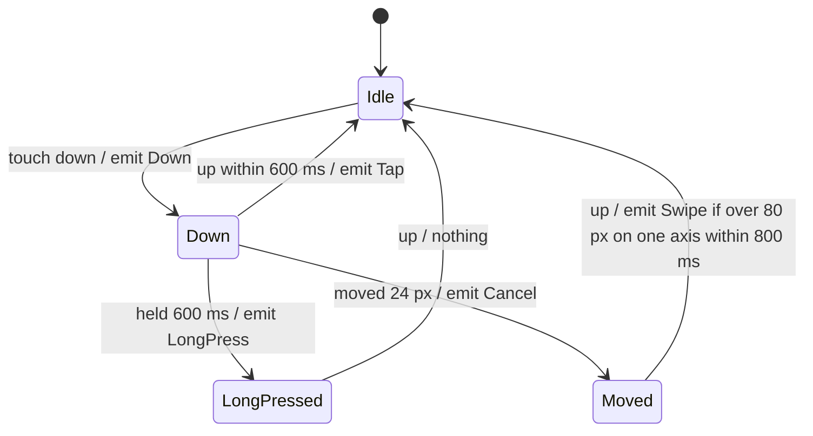

# UI system ("Ink")

One visual language for every app: black on white, large type, line icons, generous spacing, no motion. Built for a
540x960 portrait panel at 235 ppi (1 mm = 9.25 px) and for the refresh rules in `DISPLAY.md`.

This doc covers the design tokens, the widget kit in `src/ui/`, gestures, the screen patterns every app follows, how UI
work is reviewed, and emoji.

**Contents**

- [Foundations](#foundations): [Grid and spacing](#grid-and-spacing) · [Colour](#colour) · [Type](#type) ·
  [Icons](#icons)
- [Screen anatomy](#screen-anatomy) · [Widgets](#widgets) · [Widget details](#widget-details)
- [Gestures](#gestures) · [Patterns](#patterns) · [Reviewing UI work](#reviewing-ui-work)
- [Emoji](#emoji) · [Score squares](#score-squares)

---

## Foundations

Tokens live in `ui/theme.h`; colours are `pos::Color` from `core/gfx.h`.

### Grid and spacing

| Property | Value |
|---|---|
| Base unit | 8 px |
| Spacing tokens | `s1`=8, `s2`=16, `s3`=24, `s4`=32, `s6`=48 |
| Screen margins | 24 px left and right; content width 492 px |
| Minimum touch target | **72 x 72 px** (7.8 mm) |
| Preferred row height | 96 px |
| Corner radius | 16 px for tiles and buttons, 8 px for small chips |
| Stroke width | 2 px |

### Colour

16 grays, `gray(0)` black to `gray(15)` white (`core/gfx.h`). Tokens in `ui/theme.h`:

| Token | Value | Use | Earlier value |
|---|---|---|---|
| `ink` | gray(0) | text, icons, strokes, filled buttons | |
| `paper` | gray(15) | background | |
| `secondary` | gray(3) | **metadata only**: times, "Updated 20:21", counts, captions, hints | gray(5): too light on the panel |
| `disabled` | gray(5) | disabled text and icons | gray(9), then gray(7) |
| `divider` | gray(9) | 1 px separators | gray(11): barely visible on the panel |
| `fill` | gray(13) | icon wells, quiet backgrounds | |

Anything that changes on touch (pressed, selected, on/off) uses only `ink` and `paper`.

#### Limits on the panel

Checked by eye on the panel (Display lab, Text pattern):

| What | Finding | Rule |
|---|---|---|
| Caption size (18 px) | gray(3) is the lightest that reads; anything lighter is hard | caption text never lighter than gray(3) |
| Body size (22 px) | gray(5) is the lightest that reads | body text never lighter than gray(5) |
| 1 px lines | gray(13) is invisible; gray(11) is too thin to be usable | 1 px lines never lighter than gray(9) |
| Read S (24 px) | a comfortable reading size | |

#### Content is ink

What a person came to read is always `ink`. `secondary` is only for metadata.

- **No text lighter than gray(3); no content text in gray at all.**
- **Content**: message preview lines, mail subjects and excerpts, senders, book authors in the library, values (a room's
  temperature), results of an action, the launcher's summary line.
- **Metadata**: times, "Updated 20:21", counts, captions, hints. State lines such as "On - 51%" may stay secondary.
- **Size**: a content line is not set in the caption size (18 px) when the row has room.
  `ListItem::setSubtitleIsContent(true)` draws the subtitle in ink at the body size (22 px).

Where it is applied:

| Ink (content) | Still `secondary` |
|---|---|
| inbox and mail list rows (preview / subject) | the reader footer, "x% read" |
| library rows and the continue card (author) | times |
| mail detail sender (body size) | status lines ("Updated ...") |
| Home room tiles (the value) | Home state lines |
| Settings results (Wi-Fi status, tests) | Settings row hints |
| the launcher summary line (body size) | sheet hints, empty-state hints |
| the sleep screen's author; the reader's "Preparing book..." line | captions above controls |

### Type

Fonts are baked to 4-bit anti-aliased bitmaps by `tools/gen-assets.sh` (task P1-6) using `lv_font_conv`; M5GFX loads
that format (`loadFont(data, ft_lvgl)`).

| Token | Font | Size px | Use |
|---|---|---|---|
| `caption` | Inter Regular | 18 | timestamps, hints, status bar |
| `body` | Inter Regular | 22 | list subtitles, paragraphs in apps |
| `bodyStrong` | Inter SemiBold | 22 | list titles, button labels |
| `title` | Inter SemiBold | 28 | screen titles, tile labels |
| `headline` | Inter SemiBold | 40 | big numbers (temperature), launcher clock |
| `read-S/M/L/XL` | Literata Regular | 24 / 28 / 32 / 38 | book text (plus Italic and Bold at M only; other sizes fake them) |
| `mono` | JetBrains Mono Medium | 22 | a grid of characters: every one is 13 px wide (Teletekst's 40 columns; unit tested). Not for other text |

- **API**: `ui/text.h` (`drawText`, `measureText`, `lineHeight`, `ellipsize`, `sanitize`, `drawIcon`); tokens in
  `ui/theme.h`.
- **Licences**: Inter, Literata and JetBrains Mono are under the SIL Open Font License; their licence files are in
  `assets/fonts/` (also `Lucide-LICENSE.txt`, ISC).
- **Specimen**: `program --app fonts` (golden `fonts-sheet`) shows every token.

#### Glyph ranges

U+0020-007E, U+00A0-00FF, U+0100-017F, U+2010-2027, U+20AC. Unknown code points draw as `?`; emoji come from the emoji
atlases ([Emoji](#emoji)).

#### Pitfalls

Found in P1-6 and later:

- **Text is drawn as wide as it is measured** (P7-15). `measureText` is the width `drawText` covers, and where a second
  piece after it starts: a centred or right-aligned string stands exactly on its anchor, and text cut by `ellipsize` ends
  at the width asked for. This needs M5GFX patch 5 (`tools/patch_m5gfx.py`, D24). The Inter faces store glyph advances in
  sixteenths of a pixel; stock M5GFX measures them rounded but draws them cut off, about half a pixel a character
  narrower. Literata and JetBrains Mono come out in whole pixels and were never affected.
  `tests/unit/text_fast_test.cpp` checks every baked character of every face and fails on an unpatched library.
- **Pass the background colour.** M5GFX blends glyph edges between the text colour and an explicit background colour
  (`setTextColor(fg, bg)`); it cannot read the canvas. Without `bg` every glyph pixel is solid ink (no anti-aliasing,
  looks bold). `drawText(..., Anchor, bg)` defaults to paper; text on `fill` (icon wells) or on ink needs that colour
  passed. Text over pictures is not supported.
- **Literata lacks some code points** in U+2010-2027. It has the dashes, quotes, bullet and ellipsis; missing ones draw
  nothing or `?`.
- **One font per canvas**: `ui/text.cpp` reloads only when the font changes.

### Icons

Lucide line icons (ISC licence), baked from the Lucide icon font through the same font pipeline, so an icon is a glyph:
`ui::icon(canvas, Icon::Sofa, x, y, 32)`.

| Size | Used in |
|---|---|
| 32 px | rows, bars |
| 64 px | launcher tiles, empty states |

- **List**: `assets/icons.txt` names the icons to include (81 today; `Icon::BookOpen` etc.). The generator writes
  `src/gen/icons.h` (`enum class Icon`) and the two icon fonts.
- **Initial set**: arrow-left, chevron-left, chevron-right, house, book-open, library, lightbulb, lightbulb-off, sofa,
  utensils, blocks, cooking-pot, lamp-wall-down, lamp-wall-up, car, bed, thermometer, droplets, fan, wind,
  message-circle, mail, mail-open, settings, wifi, wifi-off, battery, battery-low, battery-charging, refresh-cw, moon,
  power, sun, check, x, plus, minus, clock, folder, file-text, type, info, triangle-alert, door-open, air-vent. Later: tv
  (Teletekst's loading state).
- **Weather conditions** (P7-11, apps/weather.md): sun, moon, cloud, cloud-sun, cloud-moon, cloud-rain, cloud-rain-wind,
  cloud-snow, cloud-lightning, cloud-fog, cloud-hail, wind, umbrella, droplets, sunrise, sunset.
- **Home**: the Home app reuses the icon names of the Home Assistant dashboard so rooms look familiar.

#### Drawn icons

For a mark that no line icon stands for.

- **Source**: `assets/icons-drawn/<name>.txt`, 64 rows of `X` (ink) and `.`, any width up to 255. Lines starting with
  `//` are comments.
- **Generated**: the generator adds `Icon::<Name>` after the Lucide ones and the bitmap (a bit a pixel) to
  `src/gen/icons.h` (`gen::kDrawnIcons`).
- **Drawing**: `drawIcon` draws it as it is at 64 and at half size at 32, ink only, centred like a glyph.

| Icon | What it is |
|---|---|
| `Icon::Paperos` | the PaperOS mark ([below](#the-paperos-mark)) |
| `Icon::Hackernews` | a Y in a filled square (apps/hackernews.md "Icon") |
| `Icon::Teletekst` | the NOS Teletekst logo redrawn by hand on a 97 x 64 grid for the launcher tile: white on black became ink on paper; the red O is the outlined one. The logo is the NOS's mark: for this private device, not to be published |

#### The PaperOS mark

A P whose bowl is the Paper (a sheet with a folded corner) and whose counter is its page of text (three lines, the last
one short).

- `Icon::Paperos`, 42 x 64 (`assets/icons-drawn/paperos.txt`): strokes 11 px, the fold an 8 px ink triangle behind a
  2 px gap (one bit a pixel: no gray).
- It stands above "PaperOS" on the plain sleep screen (`core/sleep_screen`), where the Lucide open book stood. The open
  book stays the icon of the Read app and of a book without a cover.
- The companion app's launcher icon is the same mark as vectors, with the fold in gray (android/README.md).

## Screen anatomy

```
+--------------------------------------+  y=0
| 12:34            wifi  battery 87%   |  StatusBar  56 px (always, drawn by the system)
+--------------------------------------+  y=56
| <  Title                    [action] |  TitleBar   72 px (apps; the launcher has none)
+--------------------------------------+  y=128
|                                      |
|            content area              |  540 x 736 (or 832 without TabBar)
|                                      |
+--------------------------------------+  y=864
|   tab        tab        tab          |  TabBar     96 px (optional)
+--------------------------------------+  y=960
```

- **Back arrow** (top left, 72x72 target): pops the screen stack; on an app's first screen it returns to the launcher.
  A long press on it always goes to the launcher.
- **No hardware navigation**: the side button belongs to the power controller.
- **Title accessory**: the title bar may carry a small picture left of the action (`Screen::setTitleAccessory(width,
  paint)`, no touches; `refreshTitleAccessory()` redraws only it), such as Somdoku's score tiles. Keep it ink and paper so
  its push needs no settle pass, and redraw it in its own loop pass (a short `ctx.timer`), or it merges with other
  Feedback rects into one tall rectangle.

## Widgets

The kit is in `src/ui/` (tasks P2-1 to P2-3, P2-7). All widgets derive from `ui::Widget`:

```cpp
class Widget {
 public:
  Rect frame;                                     // set by the parent's layout
  virtual Size measure(int availW) { return {}; } // preferred size
  virtual void layout() {}                        // position children inside frame
  virtual void draw(Canvas& c) = 0;               // draw self (children drawn by container)
  virtual bool onTouch(const Gesture& g) { return false; }   // true = consumed
  void invalidate(Hint h = Hint::Content);        // marks frame dirty in the DisplayManager
};
```

| Widget | Purpose | Notes |
|---|---|---|
| `Column`, `Row`, `Stack`, `Spacer`, `Padding` | layout | `Column` stacks children top to bottom with a gap; a child with `flex=1` takes leftover space |
| `Label` | text, one or more lines | token for style; `maxLines`, ellipsis; `keepLineBreaks` (a line feed starts a new line) |
| `IconView` | icon glyph | 32 or 64 |
| `Button` | primary (filled ink) / secondary (2 px outline) / text | height 72; pressed = inverted |
| `IconButton` | 72x72 target with a 32 px icon | `look`: Plain, Filled (ink disc, paper icon: a player's play) or Ring (ink ring: a mode that is on, as shuffle) |
| `Tile` | outlined square: 64 px icon + label, optional value and badge | ink and paper only (no gray well: DISPLAY.md "Gray areas cost a flicker"); `Size::Large` and `Size::Small` (below); pressed = 4 px border |
| `ListItem` | 96 px row: leading icon, title, subtitle, trailing text / chevron / toggle / badge | divider below |
| `Toggle` | on/off pill 88x48 | on = filled ink with paper knob; pure black/white |
| `LevelBar` | 10 segments, tap a segment to set 10..100% | replaces sliders: dragging is poor on e-ink |
| `Stepper` | minus, value, plus | temperatures, font size; `setRange` changes the limits (chess: 8 Lichess levels, 4 of the Paper) |
| `Segmented` | 2 to 4 options | selected = filled ink; the option under a finger that stays down shows after `kPressDelayMs`, a quick tap goes straight to the new selection |
| `Pager` | "3 / 12" with previous/next targets; also handles horizontal swipes | every list longer than one screen uses it; an arrow shows pressed only when the finger stays down (`kPressDelayMs`): a quick tap is one pass, the new page |
| `Badge` | filled ink circle/pill with count | unread counts |
| `Sheet` | bottom sheet over the untouched screen, 2 px ink top edge, max 60% height; a tap outside or a swipe down closes it | detail controls, confirmations |
| `Toast` | one line over the status bar for 3 s: an ink band, edge to edge | errors like "No Wi-Fi", "Score gekopieerd" |
| `EmptyState` | 64 px icon + title + hint + optional button | empty lists, errors, loading |
| `Keyboard` | QWERTY, 3 layers (abc / ABC / 123#), key 54x72 | Wi-Fi password, search |
| `TextField` | one line (72 px) or `setLines(n)` wrapped lines; long press = Paste / Copy all / Clear | text input with the keyboard |
| `TextBlock` | paginated rich text: paragraphs, bold/italic, headings ([TextBlock](#textblock)) | reader, message/mail detail, Hacker News comments and articles |

Tile sizes:

| Size | Per row | Height | Label | Used by |
|---|---|---|---|---|
| `Size::Large` | 2 | 196 | title size | Home |
| `Size::Small` | 3 | 160 | body size; caption size for a name wider than the tile's 137 px | the launcher |

- **Loading** is shown with `EmptyState` ("Loading..." + icon), never a spinner.
- **Stale cached data** is shown immediately with a "Updated 12:30" caption, then replaced when the fetch finishes.

## Widget details

### Root and layout (P2-1)

- **`ui::Root`** (a `core::Surface`; not the app-level `pos::Screen` of `core/app.h`) owns the widget tree. `setRoot()`
  lays it out. `render()` redraws only dirty widgets: a dirty ancestor covers its children; each is cleared to `bg()`,
  clipped to its frame and drawn. It passes the rectangles to the DisplayManager with the hint given to `invalidate()`.
  The Os feeds gestures to it.
- **`Widget::bg()`** is the colour behind the content (own, else the parent's, else paper): text is anti-aliased against
  it.
- **Layout**: `Column`/`Row` (`gap`, cross-axis `Align`), `Stack`, `Spacer(size, flex)`, `Padding`. `flex` on any child
  shares the leftover main-axis space in proportion, no pixel lost.
- **`Label`** wraps at spaces, breaks long words, and ends the last allowed line with an ellipsis. `IconView` is a 32 or
  64 px glyph.
- **Test screens**: `apps/uitest` (`program --app widgets1`).

### Controls (P2-2)

In `ui/controls`, `ui/list`, `ui/tile`:

- **`Pressable`** base: pressed on Down with a Feedback invalidate, `onClick` on Tap, nothing on Cancel. Disabled ones
  swallow the touch.
- **`Button`**: Primary/Secondary/Text, 72 high, min 96 wide; pressed = inverted.
- **`Toggle`**: 88 x 48 pill in an 88 x 72 target; pressed = thicker border; Tap flips and calls `onChange`.
- **`Badge`**: `99+` cap.
- **`ListItem`**: 96 px; leading icon, title, subtitle, trailing text / chevron / Toggle / Badge. The trailing Toggle is
  a child widget, so tapping it does not tap the row. Pressed = inverted row.
- **`Tile`**: 64 px icon, label, optional value and badge, ink and paper only; pressed = 4 px border (sizes in
  [Widgets](#widgets)).
- **`Pager`**: a container, content children above a 72 px `PagerBar`. Arrows and horizontal swipes anywhere in the
  content call `onPage(page)`; arrows at the ends are disabled.
- **Small pushes**: a Fast pass shows the shrunk changed rectangle only. A Toggle tap pushes about 2 x 4000 pixels.
- **Test screens**: `widgets2`, `widgets2rows`, `widgets2list` (`--app`, or `>set screen NAME`).

### Inputs and overlays (P2-3)

In `ui/inputs`, `ui/panels`:

- **`Segmented`**: 2-4 options, 72 high. A finger that stays down `kPressDelayMs` shows the option under it as selected;
  Tap commits.
- **`Stepper`**: two 72 px IconButtons around the value text that grey out at the limits; optional formatter.
- **`LevelBar`**: 10 segments, 10..100 %; a tap on segment k sets (k+1) x 10.
- **`EmptyState`**: a Column of 64 px icon, title, hint, optional button.
- **Overlays**: `Root::addOverlay(widget)` puts a widget above the root. It gets touches first; its frame starts as the
  full screen and `layout()` may shrink it. `closeOverlay` redraws the area below (`Root::invalidateRect`) and is safe
  to call from the overlay's own button handlers (the widget is destroyed on the next pass).
- **`Widget::transparent`** skips the clear-to-bg before drawing (overlays draw over the screen).
  **`Widget::touchable = false`** lets touches fall through (Toast).
- **`Sheet`**: a modal widget whose frame is just the panel at the bottom (max 60% of the height, 2 px ink top edge,
  grab handle). The screen behind stays untouched: no dimming, since a hatch would repaint the whole panel twice and
  cost ghost budget. `Widget::modal` makes the Screen send every touch that hits nothing else to the sheet, so a tap
  outside closes it without reaching the widgets below; a swipe down closes it too. Only the sheet's rectangle is
  invalidated on open and on close. Put controls into `sheet->content()`.
- **`Root::showToast(text)`**: an ink band over the status bar (y 0..56, paper text at the body size, regular weight)
  for 3 s. Then the screen below is restored pixel for pixel (checked: `widgets3-toast-gone` == `widgets3-base`).

### Keyboard (P2-7)

`ui/keyboard`. 540 x 288, four rows of 54 x 72 keys.

- **Layers**: abc, ABC (one letter, then back to abc) and 123#.
- **Rows**: letters; letters (offset half a key); shift + letters + backspace; 123/abc + comma + space + period + enter.
- **Events** through `onKey(Kind, text)`. `bindKeyboard(kb, field, onEnter)` wires it to a `TextField` (72 px, optional
  masking with bullets, shows the tail of long text, caret).
- **Pressed look**: a key's pressed look (ink) appears only after a 120 ms hold, and only the key's rectangle is redrawn
  (`Widget::invalidateRect`). A quick tap pushes just the changed text-field pixels: every character key of the
  12-character password in `keyboard.script` stays under 6000 px. Shift and layer switches repaint all keys and are not
  size-checked. A finger that stays down 200 ms (`tap X Y 200` at the end of the script) pushes the key twice and the
  field once, each on its own (DISPLAY.md "Rules for UI code" 7).
- **Test screen** `widgets4`; script commands `type TEXT` and `type-max N TEXT`.

### TextBlock

`ui/textblock` (P2-7): `TextBlock` plus pure pagination (`layoutPage`, `paginate`, `pageIndexOf`, `parseMarked`).

- **Position**: (paragraph, byte offset), so it survives a change of font size or margins.
- **Line breaking**: greedy at spaces. A word is the pieces that touch, so a style change or punctuation in its own run
  never opens a gap. Long words are cut by characters.
- **Paragraphs**: first-line indent for body paragraphs after body paragraphs; extra gap above headings. A heading is
  never split across pages or left alone at the bottom. A page too small for a line still advances.
  `Paragraph::margin` moves a paragraph right; heading 4 is a byline: bold at the body size, kept with its text.
- **Faces**: bold and italic exist as faces at ReadM only; other sizes fake bold with a double strike and show italic as
  regular. With `Type::Body` as the body, bold is `BodyStrong`, headings 1 and 2 are `Headline` and `Title`, and pieces
  of a line are placed by `ui::measureText`, as in the reader.
- **Metrics**: layout runs on `TextMetrics` (a fake in the tests, `CanvasMetrics` on the device), so a whole book can be
  paginated on the worker; `TextBlock::setPageStarts()` hands such an index over.
- **Touch**: tap on the left third = back, elsewhere forward; horizontal swipes.
- **Margins**: `setInsets(l, t, r, b)` keeps the text inside margins while the widget (and its touch area) fills the
  frame. `setChapter(paras, starts, pos)` swaps text, page starts and position in one Content refresh.
- **Reader**: derives `PageView` from it to use its own touch zones.
- **Test screen** `widgets5` (text pages).

### Clipboard

`core/clipboard` (DECISIONS.md D21): one piece of text for the whole OS (4 KB, kept in `/data/clipboard.txt`, never
logged).

**Every `TextField` opens a sheet on a long press**:

| Item | Disabled when |
|---|---|
| Paste | the clipboard is empty |
| Copy all | not offered in a masked field; disabled while the field is empty |
| Clear | the field is empty |

- **Caption** above the items: how many characters the clipboard holds, never its text.
- **Paste** appends at the caret (always the end) and stops at the field's limit (`setMaxChars`, in characters, cut at a
  character boundary). A one-line field turns line feeds into spaces.
- **Multi-line**: `setLines(n)` makes a multi-line field (body size, 32 px lines, line feeds kept, the last n lines
  shown). Enter of a bound keyboard types a line feed when no Enter action is given. `onChange` runs after every change.
- **Paired phone** (D23, `clipboard::syncing()`): the caption first ends in ", checking your phone..." while the relay is
  read (`clipboard::pull`). Then it shows the count again ("Clipboard from your phone: N characters" when the phone's
  text arrived) and enables Paste if there is something. Every `clipboard::set` by anything but the phone is sent to the
  phone. UI script `textfield-phone`.
- **Off**: `clipboardMenu = false` turns the sheet off.
- **Tests**: test screen `widgets6`, script `textfield-menu` (and `keyboard-menu-masked` in `keyboard`).

## Gestures

`core/gesture` (task P2-1) turns raw touch events into gestures.

| Gesture | Definition |
|---|---|
| Tap | down and up within 600 ms, moved less than 24 px |
| Long press | held 600 ms, moved less than 24 px (fires while still down) |
| Swipe left / right / up / down | moved more than 80 px along one axis, within 800 ms |

Every touch emits Down, then Cancel as soon as the finger is 24 px away (a pressed widget lets go), then at most one of
Tap / LongPress / Swipe*. After a LongPress no Tap follows.



### Delivery

- **Down** goes to the deepest widget under the finger and bubbles up until a widget consumes it.
- **That widget** gets Tap, LongPress and Cancel.
- **Swipes** bubble from it, so a Pager above a Button sees them.
- **Pressed state**: on `Down`, the widget under the finger shows its pressed state with `Hint::Feedback`. The action
  fires on `Up` inside the widget.

### Swipes

Swipes are used only for:

- **Paging**: left/right.
- **The quick panel**: swipe down from the status bar (Wi-Fi toggle, sleep, power off).
- **The clean gesture**: a swipe up that starts in the bottom 60 px (`kCleanEdgeH`) cleans the whole screen with one
  Quality pass, on every screen including full-screen reader pages (`Shell::onGesture`). The side button cannot do this:
  the firmware cannot read it (HARDWARE.md). **No app may use a swipe up from the bottom edge.**

## Patterns

- **Lists**: `ListItem` rows of 96 px, 7 per page with TitleBar and Pager. Never scroll.
- **Lists longer than a screen**: `ui::PagedList(rowsPerPage, fill)` + `setCount(n)`. The rows of the page on screen are
  filled by `fill(row, index)`; the bar shows from the second page on. A plain `Pager` only where a page is not just
  rows (the launcher's tiles, the library's first page with its card, the agenda's day headers).
- **Detail**: tap a row to push a detail screen (full text) or open a `Sheet` (quick controls).
- **Grids**: the launcher has 3 columns of small `Tile`, 4 rows per page, 16 px between (twelve apps to a page; earlier
  2 x 3 large tiles). Home has 2 columns of large `Tile`.
- **Confirmation**: destructive actions use a `Sheet` with a primary and a secondary button: `ui::confirmSheet(from,
  title, body, okText, onOk)`.
- **Other sheets**: `ui::openSheet(from, [](ui::Sheet& s) { ... })`, with `s.addButton(text, action, kind)` for buttons
  that close it first (`s.closing(action)` for a button in a row of its own). Do not build a sheet by hand.
- **Errors**: inline `EmptyState` for a failed first load; `Toast` when cached data is on screen.
- **A toast is a message, not a control**: it is a band over the status bar, not an ink pill of the primary button's
  size at the bottom (the earlier design, which often sat exactly on a button and looked like one). The band cannot be
  taken for a button and covers no content, no button and no keyboard; the clock is hidden for its three seconds.

## Reviewing UI work

Every UI task ends with a headless screenshot that the author looks at: `make shot` or a `tests/ui/*.script` run
(`SIMULATOR.md`). Check:

- margins 24 px
- nothing closer than 8 px to another element
- targets at least 72 px
- text not clipped
- only theme tokens used
- the refresh log shows no Quality push outside `Hint::Image` and budget cleans

## Emoji

Every text drawn with `drawText` / `measureText` / `ellipsize` shows emoji, including group names.

### Sources

| Source | Licence | Covers |
|---|---|---|
| **Microsoft Fluent Emoji, "High Contrast" style** | MIT, `assets/fonts/FluentEmoji-LICENSE.txt` | everything it has: drawn for black and white, bold filled shapes that survive 16 grays and small sizes |
| **Noto Emoji** (weight 600) | SIL OFL 1.1, `assets/fonts/NotoEmoji.ttf` | the 36 single emoji Fluent lacks |
| **Flags are letters** | | the country code in an outlined box like the keycaps (🇳🇱 -> `NL`; England, Scotland, Wales -> `ENG`, `SCO`, `WAL`) |

- **Why Fluent High Contrast**: chosen over Noto Emoji. The comparison of Noto, Fluent High Contrast, OpenMoji and
  gray-converted Fluent Flat and Twemoji is in `tools/gen-emoji.py`'s history. Colour sets turn yellow faces into pale
  gray, which the panel prints lighter still; OpenMoji's lines are too thin.
- **Why letters for flags**: on a black and white screen a gray flag is mostly stripes (Twemoji's flags in gray were
  tried first).

### Atlases

`tools/gen-emoji.py` (needs the Fluent SVGs fetched first, see its top) renders 2308 emoji as 4-bit alpha bitmaps:

| Kind | Count |
|---|---|
| single code points | 1405 |
| sequences (ZWJ sequences like 👩‍💻 and ❤️‍🔥, keycaps) | 224 |
| flags (every pair of letters, used or not, and the three tag flags) | 679 |

One atlas per size, `assets/emoji/emoji-<px>.bin`, 2.5 MB together:

| Atlas px | Text tokens |
|---|---|
| 18 | caption |
| 22 | body, bodyStrong |
| 24 | read-S |
| 28 | title, read-M and up, headline |

A Fluent emoji's 32 x 32 box is the font size, 0.86 of it above the baseline, with px/8 (at least 2 px) on each side.

### How emoji are drawn

- **On the card, not in the firmware**: one size alone is 260-600 KB, more than the firmware's 3 MB budget had left
  when they were added (about 250 KB; about 720 KB since D31). The atlases live in `/sd/paperos/emoji/`. `make emoji`
  copies them into `sim-data/` and pushes them to the device; `tools/ui-test.sh` links them into every test card.
  `ui/emoji` keeps only each atlas's index (16 bytes per emoji) and reads a bitmap the first time a text needs it.
- **Fast**: a read bitmap goes into the same glyph cache as the letters (`ui/text`), so after the first use an emoji
  line draws like a line of letters (host: 7 us against 6 us per line, `emoji_test`). Widths, ellipsis and line wrap
  include emoji. Each emoji and size is read from the card once per boot.
- **Placement**: on the font's baseline (the bottom of its "x"), at the font's size, advance as the font gives it.
- **Sequences**: each atlas sequence has an id from U+F0000 (private use). `ui::sanitize` replaces a sequence it finds
  by its id (`emoji::matchSequence`, longest match, skin tones and selectors inside skipped), so drawing stays the
  one-code-point fast path. A digit, # or * is looked up only when U+FE0F or U+20E3 follows.
- **Unknown sequences**: families written as joined people ("👨‍👩‍👧"; Fluent has no family sequences) show 👪;
  another unknown ZWJ sequence shows its first emoji. Leftover skin tones and selectors are dropped (a black-and-white
  set has no skin colour). `core/text_clean` keeps emoji and sequences whole.
- **No card / no atlas**: a few emoji get a text form (`:)`, `<3`, `(+1)`), the rest disappear (never `?`).
- **Score squares** keep their own drawing ([below](#score-squares)): they must stay apart on the gray panel.
- **Test screen** `emoji` (`--app emoji` in the simulator, `tools/device.py set screen emoji` on the device): every
  size, a group name, faces, objects, sequences and a wrapped paragraph; golden `emoji`.

### Score squares

`drawText` / `measureText` draw the score emoji (🟩 solid, 🟨 hatched, ⬛ ⬜ 🟥 🟦 🟧 outlined) as boxes of the text's
height: the fonts have no emoji. The text keeps the real characters. See docs/apps/somdoku.md.
