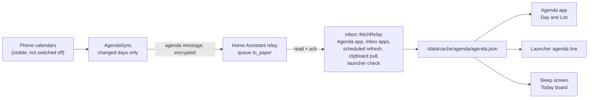

# Agenda

The paired phone's calendar for today and the next 13 days, read only (DECISIONS.md D28). The companion app reads the
calendars the phone shows and sends them end-to-end encrypted through the Home Assistant relay (COMPANION.md 7.1
`agenda`). The Paper keeps them in `/data/cache/agenda/agenda.json` (`core/agenda`) and never changes anything on the
phone.

Launcher tile: `order` 97 (after the games), icon `calendar`.

## Data flow

- Each `agenda` message replaces every day of its run on the Paper (COMPANION.md 7.1 `agenda`).
- The launcher line and the sleep screen read the saved file only (no network).

## Screens

A tab bar at the bottom picks the view; the choice is kept in the app's store (`view`: 0 Day, 1 List). The title bar has
a refresh button.

The status line above the tab bar says "From your phone: 13:34" (when the last `agenda` arrived), or "Saved data" after a
failed read.

### Day

`apps/agenda/day_view`, geometry in `apps/agenda/day_layout` (unit-tested).

**Header and navigation**

- The day: "Today" / "Tomorrow" with the date under it, else "Saturday 17 January", between a previous and a next
  arrow.
- The arrows go from today to today + 13 (without a clock: the first to the last stored day). Swipe left / right does
  the same.
- The shown day survives a refresh.

**All-day events**

- Outlined chips, two at most; then "+N more all day".
- "N events only on your phone" when the phone had to cut the day (more than 12, or the envelope limit).

**Hour grid**

- 08:00 to 20:00 at least, widened to whole hours around the timed events.
- An event that ends after midnight takes the grid to 24:00; one that began the day before starts at the grid's top.
- Hour lines `divider`, labels `secondary`. Every hour is labelled while an hour is at least 36 px, else every 2nd or 3rd.

**Blocks**

| Event | Look |
|---|---|
| still to come | gray(12) with a 6 px ink bar on the left, ink text |
| on now | ink with paper text |
| over (today) | outline in `divider`, `secondary` text |

- A block of 62 px or more shows the title and "09:30 - 10:15 · place"; a smaller one the title with the time on the
  right when it fits. Shortest block 34 px (one line).
- Blocks that overlap on screen share the width in columns.
- Today: an ink line with a dot at the current minute, under the blocks.
- A tap on a block or a chip opens a sheet with the whole title, day, time and place.

### List

- Every event from today on, in days ("Today", "Tomorrow", "Saturday 17 January" above a day's first row on a page).
- Paged by height (`ui::Pager`, at most six rows). Row: title; time and place.
- A cut day ends with "N more events / On your phone".
- A tap opens the same sheet as the day view.

### Empty and error states

| Situation | Shows |
|---|---|
| No pairing (nothing is asked of Home Assistant) | "No phone paired" |
| The relay answers 404 | "Not set up yet" |
| First read failed, nothing saved | "Cannot reach Home Assistant" with Retry |
| Paired, but the phone never sent one ("Share the agenda" is off there) | "No agenda yet" |
| List only, no events | "Nothing planned" |

## Rendering

Measured in the simulator's refresh log, `agenda.script`.

- **A read that brings nothing new pushes nothing.** The app compares the fetched agenda (`Agenda::sameContent`) and its
  states with what is shown and skips the rebuild (a rebuild lays out and redraws the whole screen to push nothing).
  Only the status line can change. UI script: refresh, `expect-state unchanged-reads=1`, `expect-max-pushed 12000` (0
  measured).
- **A day flip is one Text pass** (`Hint::Screen`, the display manager's screen-gray rule: the gray(12) blocks count as
  flat gray), instead of a Fast pass and a settle sweep over the whole grid 0.6 s later. A day without blocks (only lines
  and labels) stays Fast then settle. A due clean lands on a day flip, where change is expected.
- **The now line** moves once a minute (a timer like the status bar clock): `DayView::setNow` redraws the view and the
  diff pushes only the rows that changed. At midnight, or when the clock gets set, the views are rebuilt for the new
  today.
- **Arrow presses**: one 64 x 64 Fast feedback push.

## Elsewhere

- **Launcher**: one ink line under the date with what is on now or next (`agenda::nextLine`), from the saved file only
  (no network); gone when nothing is left. Examples: "Now: Lunch until 14:00", "09:30 Dentist", "Today: Birthday",
  "Tomorrow 22:00 Night train", "Thu 15 Jan: Birthday".
- **Sleep screen**: on the Today board (POWER.md "Today board", P7-16), today's events that are not over and the next
  days', six lines. On the plain screen (board off, or the clock not set) the same line as the launcher's, above the
  unread note. Drawn at power-off and by a scheduled refresh.
- **Reading the relay**: the Agenda app reads `to_paper` on open (stale after a minute) and on refresh. The inbox apps,
  the scheduled refresh and the clipboard pull apply `agenda` messages too (`inbox::fetchRelay`). The Agenda app's read
  also writes the inbox badges, since the read acks the whole queue.

## Phone side

`android/.../AgendaSync.kt` and `proto/Agenda.kt` (JVM tests `AgendaTest`):

- **Switch "Share the agenda"**: asks for `READ_CALENDAR`. Switching off sends the clearing run.
- **Paper > Calendars** (`CalendarsActivity`): one switch per calendar, all on, a new calendar on. The ones switched off
  are left out of the query (`Agenda.selection`).
- **Change detection**: a `ContentObserver` on the calendar provider with a one-minute debounce. Per-day fingerprints in
  `noBackupFilesDir/agenda.json`, so only runs with a changed day go again.
- **Full window**: once a day and after pairing.

## Tests

- **Unit**: `tests/unit/agenda_test.cpp`: dates, runs replacing days, malformed input, store, texts, the next line, the
  grid and its columns, `agenda` envelopes in counter order.
- **UI scripts**: `agenda` (fixture `ha-agenda.example.test`: day view of today with the now line, tomorrow, Saturday, a
  free Monday, a late event, the sheet, the list, the launcher line, the sleep screen), `agenda-none`,
  `agenda-unpaired`.
- **Fixtures**: `tests/fixtures/make-inbox-fixtures.py` (`agenda_msgs`).
