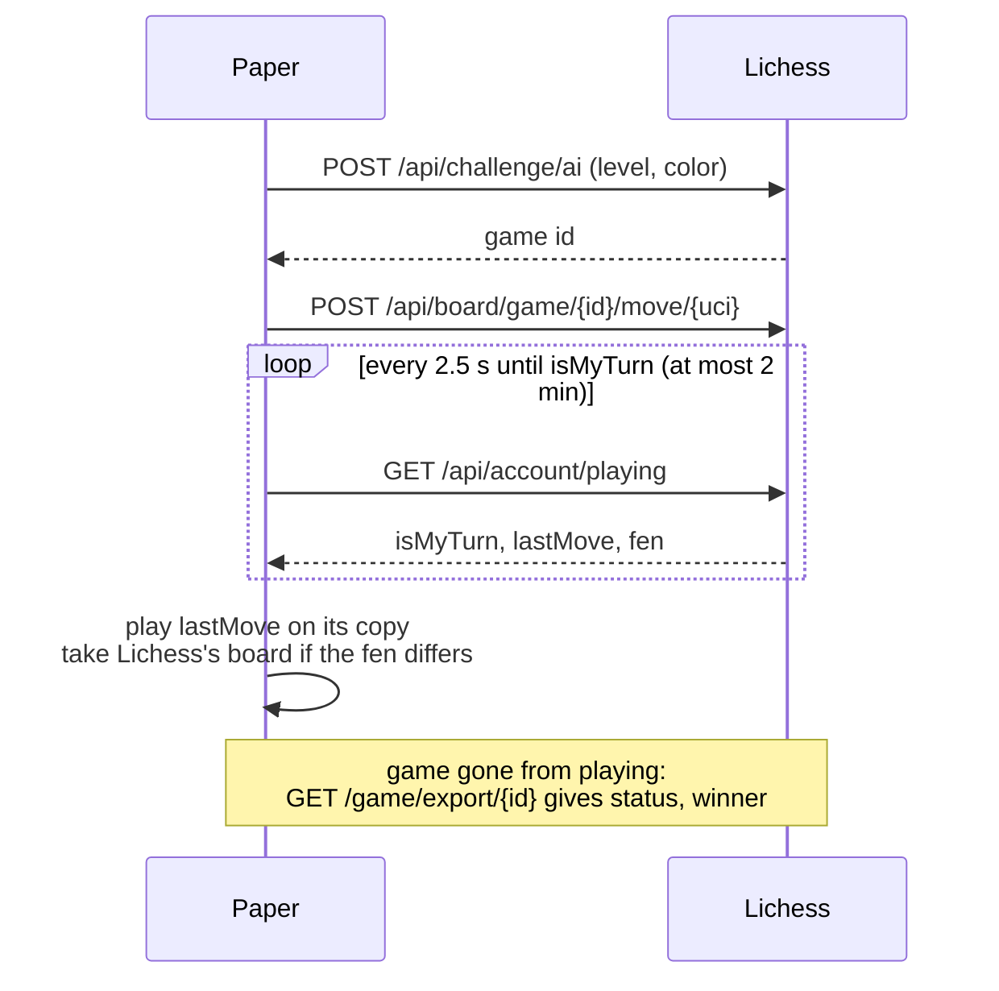

# Schaken

Chess on the panel: against the Lichess computer and offline against the Paper. Task P7-23, D41. App id `chess`, tile
"Schaken" (icon `chess-knight`), after Hacker News.

This doc covers the setup, the board and how it is drawn, the engine on the Paper, the Lichess requests, the saved state
and the tests. Code: `src/apps/chess/` (`chess.h` rules and engine, `lichess.h`, `chess_app.cpp`).

## Setup

| Control | Options | Notes |
|---|---|---|
| **Tegenstander** | Lichess \| De Paper | Lichess is chosen first when the card has `LICHESS_TOKEN`. Without it the setup says what is missing and Begin stays off for Lichess. |
| **Niveau** | 1..8 for Lichess (Stockfish's levels on Lichess), 1..4 against the Paper | |
| **Jouw kleur** | Wit \| Zwart | |
| **Begin** | | Starts a game |
| **Verder met de partij** | | Shown while a game is kept |

## The board

### Drawing

- 60 px squares (480 px), the player's side at the bottom.
- Light squares paper; dark ones a diagonal ink hatch (one line in five pixels, as in a printed diagram).
- The pieces are drawn as shapes (`drawPiece` in `chess_app.cpp`, no font):
  - black pieces solid ink;
  - white ones paper with a 2 px ink outline (the silhouette drawn eight times around, then the piece in paper on it).
- The last move is framed in ink (2 px) in both squares.

### Black and white only

**Every pixel of the board is pure black or white** (render speed, Fast mode). A selection or a move is one Fast push
(`Hint::Feedback`) with no Text settle after it (DISPLAY.md: no settle when the changed pixels are black/white).

- The view is laid out again only when a button comes or goes (Opgeven shows from the start of a game), not on every
  move.
- Only the two lines of text (whose turn, the last move) get a small Text settle.

| Measured on the device | Time |
|---|---|
| Selection, tap to push | 51 ms |
| Move, tap to its last push | 194 ms |
| Each Fast push | 248 ms of waveform; the bands of one move overlap in the driver |

### Moving

- **Tap a piece**, then where it goes. The piece gets a thick ink frame, its squares a dot (a ring for a capture).
- Tap it again, or another of your pieces, to change your mind.
- A pawn that reaches the last rank becomes a queen.

### Text

- **Above the board**: whose turn it is ("Jij bent aan zet.", "Schaak! ...", "Lichess denkt na...", "De Paper denkt
  na...", or the result).
- **Under it**: the last full move in long notation with Dutch letters ("1. e2-e4 Pb8-c6"; K D T L P, a pawn without a
  letter, `x` a capture, `+` check, `#` mate, `O-O`).

### Ending a game

- **Opgeven** asks once ("Tik nog eens om op te geven", 4 s), then ends the game (on Lichess too).
- At the end: **Nieuwe partij** (back to the setup).

## Against the Paper

`chess::bestMove` (`chess.h`), run on the worker (`ctx.async`):

- alpha-beta with quiescence (captures only) over material and piece-square tables;
- iterative deepening to the level's depth (1..4);
- moves ordered captures first (MVV-LVA);
- at most 20,000 nodes, so a move cannot take long on the device (about 0.27 ms a node there: level 4 answers in 2.8-3.1 s
  in the opening, at most ~5.5 s);
- level 1 picks at random among the moves within a pawn and a half of the best.

The game ends by mate, stalemate, the fifty-move rule, threefold repetition or too little material (`Game::result`).

## Against Lichess (`lichess.h`)

The player's personal token, `LICHESS_TOKEN=` in `/sd/paperos_config`: read at boot, scopes "board:play" and
"challenge:write", made at lichess.org/account/oauth/token/create. It goes only into the `Authorization` header.

| Step | Request |
|---|---|
| Begin | `POST /api/challenge/ai` with `level` and `color`: the game id |
| Your move | `POST /api/board/game/{id}/move/{uci}` |
| Its move | `GET /api/account/playing` every 2.5 s until `isMyTurn` |
| The end | the game is no longer in `playing`: `GET /game/export/{id}` (JSON) gives `status` and `winner` |
| Opgeven | `POST /api/board/game/{id}/resign` |

**Its move**:

- `lastMove` is played on the Paper's copy of the game. If the position then differs from Lichess's `fen` (a move made
  on lichess.org), the board is taken from Lichess.
- After two minutes without a move: "Lichess antwoordt niet." and **Opnieuw vragen**.

**Polling, not streaming**: `/api/account/playing` is asked instead of the Board API's game stream. That gives one answer
per request, like every other request on the Paper (`ctx.http`), and Wi-Fi only while a reply is awaited.

**Failures** in words (`lichess::problemText`):

| Cause | Shown |
|---|---|
| No connection | "Geen verbinding met Lichess." |
| 401: a token Lichess does not know | "Lichess kent dit token niet (LICHESS_TOKEN op de kaart)." |
| 403: a token without the scope | "Het token mag dit niet: maak er een met board:play en challenge:write." |
| 429: wait a minute | "Lichess vraagt even te wachten. Probeer het over een minuut." |
| Other | Lichess's own error text ("Lichess: ..."), or "Lichess antwoordde <status>." |

A game that could not be created goes back to the setup with the reason.

## State

The app store (`/data/apps/chess.json`):

| Key | Content |
|---|---|
| `vs` | `lichess` \| `paper` |
| `white` | the player plays white (default true) |
| `level` | the level (default 3) |
| `game` | the Lichess id |
| `start` | the start position, FEN |
| `moves` | UCI, comma separated |
| `over` | the result text |
| `started` | a game was begun and is kept (bool; false again when Lichess could not create it) |

A game left while it was the opponent's turn goes on when the app opens again: the Paper thinks again, or Lichess is
asked again.

## Tests

**Unit**: `tests/unit/chess_test.cpp` covers:

- move generation against the standard perft counts (start position to depth 4, Kiwipete and positions 3, 4, 5);
- FEN, UCI, the panel's notation;
- mate, stalemate, the material and repetition draws;
- the engine: takes a hanging queen, mates in one, keeps to its node limit;
- Lichess's requests (the token only in the header) and answers.

**UI scripts**

| Script | Covers |
|---|---|
| `chess` | against the Paper: setup, a selection with its dots, a move and the answer, resigning, a new game |
| `chess-mate` | a kept game with black: the flipped board, mate in one |
| `chess-lichess` | fixtures and a fake token: creating the game, a move, Lichess's answer, resigning |
