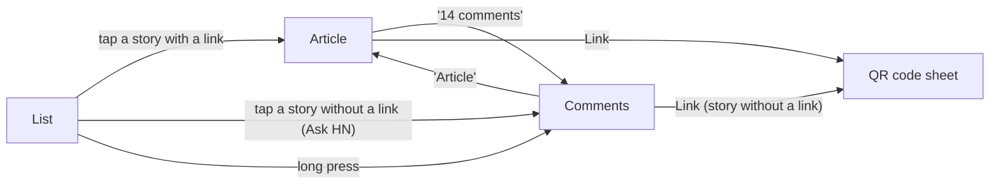
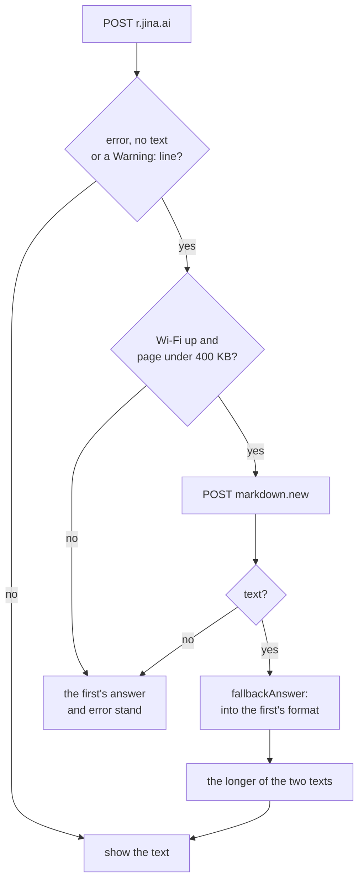
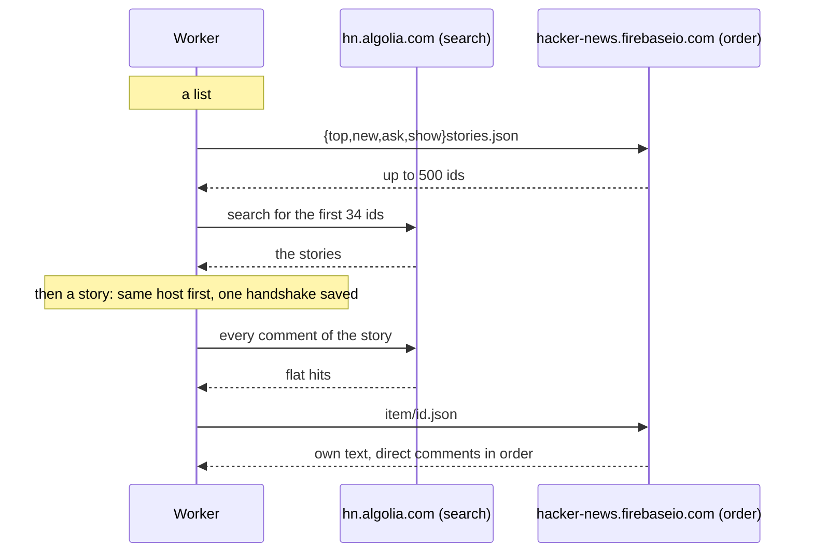

# Hacker News

Y Combinator's Hacker News: the story lists, a story's comments and the article it links to as text (task P7-14, D34,
the article as text through a reader service). Read only: no account, no votes, no replies.

This doc covers the three screens, the reader services behind the article, the APIs, what is saved, and the speed
measured on the device.

- **Code**: `src/apps/hackernews/`.
  - `hackernews_model.*`: the two APIs' answers into stories and a comment tree in reading order, comment HTML into
    text, the thread as paragraphs, the saved copy, the reads. Unit tested in `tests/unit/hackernews_test.cpp`.
  - `hackernews_app.cpp`: the list, the story screen, the article screen.
- **Launcher tile**: "Hacker News", icon `Icon::Hackernews` (drawn: a Y in a filled square, [Icon](#icon)), order 100
  (after Teletekst).

**Contents**

- [Screens](#screens) · [The list](#the-list) · [A story](#a-story) · [The article](#the-article) ·
  [Opened again](#opened-again)
- [Data](#data) · [Saved copies](#saved-copies) · [Memory and threads](#memory-and-threads) · [Icon](#icon)
- [Tests](#tests) · [Speed and flicker](#speed-and-flicker) · [On the device](#on-the-device)

---

## Screens



The screens never pile up: list, article, comments at most, in either order. "14 comments" over an article opened from
the comments goes back to them, and "Article" over comments opened from the article goes back to it.

## The list

```
+--------------------------------------+
| <  Hacker News             [refresh] |  title bar
+--------------------------------------+
| [ Top ][ New ][ Ask ][ Show ]        |  which list
|  1 A file system that fits on a      |
|    postcard                          |  six stories a page, 106 px each:
|    412 points · 14 comments · 3 h ·  |  place, title (up to two lines),
|    example.com                       |  points · comments · age · site
|  ...                                 |
|  <            1 / 5              >   |  pager (also a swipe)
|            Updated 13:34             |  status line
+--------------------------------------+
```

- **Thirty stories** of the chosen list, in the site's order: one page of the site, five pages here. Job adverts are
  left out ([Data](#data)).
- **Top / New / Ask / Show**: the choice is kept (`section` in `/data/apps/hackernews.json`).
- **A tap on a story** opens the page it links to as text ([The article](#the-article)); its comments are a button away
  there. A story without a link (Ask HN) opens its comments.
- **A long press** on a story opens its comments straight away.
- **Refresh** (title bar) reads the list again.
- **Opening the app** shows the saved copy of the chosen list in the first frame, then reads it again unless the copy is
  under a quarter of an hour old. A read moves the rows under the reader's eyes three or four seconds after the list
  appeared; Refresh is there for sooner. Another list: its copy at once, a read if that is old.
- **One region**: what changes together is pushed as one region. A list switch (the switcher, the rows, the status line)
  and the rows of a list that was read again are one pass on the panel, not one per row ([Speed and
  flicker](#speed-and-flicker)).
- **A read that fails**: the copy stays, the status line says "Saved 13:34: No Wi-Fi: ...". Without a copy the reason
  takes the list's place, with Retry (a Wi-Fi sign for no Wi-Fi, a warning sign for an error of the service).

## A story

```
+--------------------------------------+
| <  Hacker News             [refresh] |
+--------------------------------------+
| A file system that fits on a postcard|  title (up to three lines)
| 412 points · by marit · 3 h · exam...|
|--------------------------------------|
| duty_cycle · 2 h · 2 replies         |  a comment: who, how old, replies below it
| We ship something close to this ...  |
|   golden_shot · 2 h · 1 reply        |  a reply: 16 px further right a level,
|   How do you test the rotation ...   |  up to eight levels
| [Article]  Page 1 of 4  [Next thread]|
+--------------------------------------+
```

### The text

- **Order**: the story's own text if it has one (Ask HN), then every comment. Answers to the story in the site's order
  (the best first), replies under what they answer, oldest first.
- **Type**: the interface's font (Inter 22, bylines semibold), about 16 lines a page. A byline never stands last on a
  page.
- **Code blocks** keep their lines and their indent (less the two blanks the site wants before every line of code).
- **Deleted comments**: one that was answered shows as "[deleted]"; one nobody answered is left out.
- **Beyond 1000 comments** the text ends with "The first 1000 of N comments are shown."

### Controls

- **Page turns**: a tap on the right two thirds or a swipe to the left turns the page; a tap on the left third or a swipe
  to the right turns back (`ui::TextBlock`). A new page is `Hint::Page`: one Fast pass, a Quality clean every tenth
  page, like the reader (DISPLAY.md). The page number under it is ink and goes in the same pass.
- **Next thread** goes to the page of the next answer to the story that starts after this page: the way past a long
  exchange of replies. Gray when there is none.
- **Article** goes back to the article when the comments were opened from it, else opens it over them ([The
  article](#the-article)).
- **Link** stands there instead for a story without a link (Ask HN): its page on the site
  (`news.ycombinator.com/item?id=...`) as a QR code for the phone.
- **Refresh** reads the story again; the place in the text stays (by comment, [Opened again](#opened-again)).

### Loading and errors

- **While it loads**, a line of ink stands in the place of the text ("Loading comments..."). Nothing gray, so the
  screen's first pass already shows it as it is.
- **No comments, or the read fails**: a message with a picture (and Retry for a failure). A failure while comments are on
  screen is a toast.
- **The first page does not wait for the page count**: finding where the pages of 700 paragraphs start takes the worker
  1.5 s. The first page needs none of that and is shown as soon as the comments are read. "Page 1 of 116" and "Next
  thread" follow when the count is there (pages turn from then on).

## The article

What a tap on a story with a link opens: the page it links to, as text from a reader service.

The request and the Markdown conversion below are also what the Read app uses for links shared from the phone
(apps/reader.md "Articles", P7-18). They still live in `hackernews_model`; moving them to `apps/common` is a note in
STATUS.md.

```
+--------------------------------------+
| <  example.com             [refresh] |  the site
+--------------------------------------+
| A file system that fits on a postcard|  headings: Inter 28 semibold
| By Marit, January 2026               |
| Most file systems are described in   |  text: Inter 22, **bold** as semibold
| books. This one is described on a    |
| ...                                  |
| [Link]     Page 1 of 4  [14 comments]|
+--------------------------------------+
```

- **"14 comments"** opens the comments over the article; when the article was opened from the comments it goes back to
  them.
- **Type**: set like the comments (Inter 22), headings in Inter 28 semibold; pages turn as in the comments.
- **Link** shows the address as a QR code for the phone, with "Copy link" (the clipboard, so also the phone's when it is
  shared: D23). A link too long for the code (over about 210 characters) gives the story's page on the site.
- **Not kept**: without a network the screen says "Article not loaded" (the comments button still works).

### Reader services

`hackernews::readPage` does both requests, for this app and for Read later.



**First: Jina Reader.** `POST https://r.jina.ai/` with `{"url": "<the link>"}`, no key. Headers:

| Header | Why |
|---|---|
| `X-Retain-Images: none` | no pictures: their addresses are noise here |
| `X-Md-Link-Style: discarded` | a link is its words |
| `Accept: text/plain` | the plain-text answer |
| `Content-Type: application/json` | the body |
| `X-Timeout: 6` | a site that shows the service a CAPTCHA holds it 15 s without it, 6 with it; a slow page still comes whole |

It fetches the page and answers a few lines about it (`Title:`, `URL Source:`, sometimes `Warning:`) and the page as
Markdown.

**Second: markdown.new**, when the first cannot read the page. `POST https://markdown.new/` with the same body
(Cloudflare's Markdown for agents, no key, 500 requests a day per address).

- **Asked when** the first answers an error (a status, its limit of 20 a minute, a time-out), no text, or a `Warning:`
  (the site refused it: "Target URL returned error 403", a CAPTCHA).
- **Not asked** without Wi-Fi, or for a page over 400 KB.
- **Answer**: JSON (`success`, `title`, `content`: a YAML front matter, then the page as Markdown with its links).
  `fallbackAnswer` turns that into the first service's format, so the rest of the code (and a saved Read later file)
  knows one format.
- **Of two texts the longer is shown** (a site that answered the first 401 but sent the page anyway). When the second
  has nothing, the first's answer and error stand.

**The two compared** (30 front-page links, 2026-11-20):

| | r.jina.ai | markdown.new |
|---|---|---|
| links read | 26 | 26, not the same 26 |
| read only by this one | a YouTube page, a blog | a Synology advisory, a WSJ article |
| time | 0.4-12 s | 0.2-1.2 s |
| page furniture | less | more ("Advertisement", "Subscribe now", sometimes a menu) |

Neither reads reuters.com, nytimes.com or tweakers.net (a CAPTCHA, a privacy gate), nor does the Wayback Machine have
more than the sites' refusals. The second is faster but keeps more furniture, so it is the second, not the first.

**Privacy**: what leaves the device is the article's address, to those services (the second only when the first could
not read it), and only when an article is opened. Nothing about the user. D34 says why a third party.

### Markdown to marked text

`articleMarked` turns the Markdown into the reader's marked text:

- **Headings**: `#` and `##` are level 2, deeper ones level 3; also a line underlined with `=` or `-`. A heading without
  words goes.
- **Blocks**: paragraphs; list items with a bullet or their number (a list in a list indented); code blocks and table
  rows as lines that stay lines; `**bold**`.
- **Dropped**: the marks of emphasis, inline code, escapes and horizontal rules. A link is its words and a picture goes
  (`[text](url)`, ``: the second service keeps them).
- **YAML front matter** is skipped; its `title:` is the title when there is no `Title:` line.

For a service's answer only (not a Markdown file of the user's in Read, where a refrain may repeat):

- A lone HTML tag or `{{ template }}` line goes.
- A short paragraph (60 bytes at most) is kept the first time only. A GitHub page through the second service repeats
  "All reactions" and "Sorry, something went wrong." under every comment: 73 pages before, 49 after.
- A short list of furniture lines goes wherever it stands (`furniture`): GitHub's hidden session banner "You signed in
  with another tab or window...", "Skip to content", "Copy link Copy Markdown", the hide-comment menu, "Contributor".
  Result: 39 pages left, the conversation from page 1. GitHub is the site Hacker News links to most, and on 2026-11-20
  Jina Reader answered 403 for it.

**The title** is put first unless the text opens with a heading that is the title (one starts with the other: "Title |
Site" and "Title"; a first heading "Conversation" gets the title above it). A `Warning:` of the service ("Target URL
returned error 403") stands above it.

### Failures

When the second service has nothing either, with Retry:

- the first service's own sentence when it gives one ("Domain 'x' could not be resolved");
- else "The reader answered 503", "No text on the page", "The page is too long" (over 400 KB), or the network's reason.

## Opened again

The app follows the idle return (D38, which superseded D33) and is not exempt: only books and games are. So the story
that was open comes back:

- An app left with a story open (idle return, the launcher, power-off) and opened again within the hour (`kResumeSec`)
  shows what was open, at the page it was left at, with what was under it, without the list in between.
- Back from the top screen gives the one under it, as before the app was left.
- Left from the list: the list, and the four keys are emptied.

Kept in the app's store:

| Key | Holds |
|---|---|
| `open` | the story |
| `stack` | the screens over the list, in order: `a` the article, `t` the comments, so `a`, `at`, `t` or `ta` |
| `article` | the place in the article |
| `at` | the place in the comments, as a comment and how far into it, so it is still right when comments came or the order changed meanwhile |

## Data

Two public services for the site itself, no key, nothing about the user or the device in a request (the article's
reader services are a third and a fourth: [The article](#the-article)).

| What | Request |
|---|---|
| the ids of a list, in the site's order | `GET https://hacker-news.firebaseio.com/v0/{top,new,ask,show}stories.json` (the site's own API; up to 500 ids, 4.5 KB) |
| those stories | `GET https://hn.algolia.com/api/v1/search?tags=(story,poll),(story_<id>,...)&hitsPerPage=<n>&attributesToRetrieve=title,url,author,points,num_comments,created_at_i&attributesToHighlight=none` (the site's search service; 34 ids asked, 8 KB) |
| one story: its own text, its direct comments in the site's order | `GET https://hacker-news.firebaseio.com/v0/item/<id>.json` |
| every comment of a story | `GET https://hn.algolia.com/api/v1/search?tags=comment,story_<id>&hitsPerPage=1000&attributesToRetrieve=author,comment_text,parent_id,created_at_i&attributesToHighlight=none` (flat: `objectID`, `parent_id`; 290 KB for 780 comments) |

**Why two (D34)**: the first knows the order but answers one item a request (thirty stories would be 31 requests, a
thread of 200 comments 201). The second answers many at once but in its own order. So a list is two requests and a story
is two, each pair one job on the worker (`ctx.transport()`), one change of the screen.



- **One handshake a story, not two**: the device keeps one TLS connection, and a request to another host is a new
  handshake (0.9 s). A story's two requests do not need each other's answer, so the first goes to the service the last
  request went to (after a list: the search, so the comments first, then the item).
- **Job adverts** are in the list of ids but unknown to the search: 34 ids are asked so that thirty stories remain.
- **The tree** is made from the flat hits without recursion (`parseComments`): a thread can be fifty replies deep and the
  worker's stack is 16 KB. A comment whose parent is not among the hits is left out.
- **Comment text** is HTML (`<p>`, `<i>`, `<a>`, `<pre><code>`, character references). `markedText` makes it the
  reader's marked text (a paragraph a line), cleaned by `core/text_clean` (only what the fonts can draw, long words cut).
- **Limits**: a list answer over 64 KB or a comment answer over 500 KB is refused ("Unexpected answer"; the device takes
  512 KB at most).

## Saved copies

- **Lists**: each list read is kept in `/data/cache/hackernews/<top|new|ask|show>` (the time, then per story id, title,
  link, author, points, comments, time; about 6 KB), written on the worker.
- **Comments are not kept** (a thread is 20 to 300 KB): without a network a story shows "Comments not loaded" with Retry.
- **Articles are not kept** either ([The article](#the-article)).
- Nothing is read in the background, on a timer or from the launcher.

## Memory and threads

- Parsing, building the tree and the paragraphs, and finding the pages (`ui::paginate` with its own metrics canvas, as the
  reader does) run on the worker. The screen gets the paragraphs and the page starts in one step
  (`TextBlock::setChapter`).
- The JSON document of the comments is freed before the tree is built; the paragraphs move into the text block.

## Icon

`assets/icons-drawn/hackernews.txt`: a Y in a filled square with round corners on a 64 x 64 grid (the site's mark: an
orange square with a white Y). Made by a few lines of Python (a rounded square minus three thick line segments) and kept
as text like the Teletekst logo (UI.md "Icons"). The site's mark: for this private device only.

## Tests

- **Fixtures**: `tests/fixtures/make-hackernews-fixtures.py` writes four lists, the story search answers, four items and
  three comment answers in the services' shapes. **Stories, names and comments are made up**; nothing of the real site is
  in the repository. Times count back from the moment the UI scripts start, so the ages on the screenshots stay.
- **A look at the real site** without the device: `.pio/build/sim/program --app hackernews --fixtures none` (libcurl).

| UI script | Covers |
|---|---|
| `hackernews` | the list and its pages; a story's article and its pages; the link sheet; its comments and their pages; Next thread; back to the article; a long press to the comments and the article over them; a story with its own text; one without comments; one whose article and comments fail; one whose article only the second reader service reads; the other lists |
| `hackernews-offline` | nothing saved, no network |
| `hackernews-saved` | saved lists without Wi-Fi, a story's article and comments without it |
| `hackernews-resume` | the article, the comments over the article, the comments of a long press come back |

**Unit tests**: addresses, ids, stories in the order of the ids, an item, comment HTML, the tree (order, depth, replies,
deleted, orphans, a thousand deep), ages and lines, paragraphs and margins, a place that survives a new read, the saved
copy, the reads through a transport that answers from the fixtures and one that fails, the order of a story's two
requests, Markdown to marked text (links, pictures, a front matter), the reader's answer, request and errors, when the
second reader service is asked and which text wins.

## Speed and flicker

Camera session, 2026-11-18. Measured with the firmware's `[lat]` line (tap to the update handed to the panel driver) and
`tools/cam.py around` (what the panel shows, DISPLAY.md "Camera on the panel"); numbers of one session.

| Tap | First build | Now | What changed |
|---|---|---|---|
| list page turn | 415 ms, three passes (the arrow pressed, the bar, the rows) | **105 ms, one pass** | the pager's pressed look waits like a button's; text is measured from the glyph cache; the ellipsis cut is found by halving |
| another list (Top / New) | 330 ms, three passes (one of them in Text mode: a gray icon) | **120 ms, one pass** | the switcher's highlight waits like a button's; one region; no rebuild of the whole screen |
| open the app | 340 ms | 270 ms (cold glyphs) | measuring |
| open a story | 350 ms to "Loading comments...", its settle visible | 160 ms, settle not visible | a line of ink instead of a gray icon |
| a story's first page of comments | 6.4 s (see below) | **2.1 s** with Wi-Fi up, **4.3 s** with Wi-Fi off (see below) | the first page does not wait for the page count; after a list a story costs one handshake, not two |
| comment / article page turn | 85-100 ms, two passes (page, then the page number with a settle) | **110 ms, one pass**, no settle | the page number is ink and goes with the page |

A story's first page of comments, in parts (not the same stories before and after: the parts are what compare):

| | Comments | Wi-Fi join | Handshakes and requests | Page count | Total |
|---|---|---|---|---|---|
| first build, Wi-Fi off | 237 | 1.9 s | two handshakes and both requests: 3.0 s | 1.5 s | 6.4 s |
| now, Wi-Fi off | 22 and 26 | 1.4 s | one handshake 0.7 s; the requests 0.9 and 1.0 s | not waited for | 4.3 s |
| now, Wi-Fi up | 22 and 26 | | | not waited for | 2.1 s |

All of the time that is left is network.

**On the panel** (camera): a page turn is visible 0.38 s after the tap and finished at 0.51 s (the camera's own delay of
about 0.2 s included). One Fast pass; the white around the text does not darken (under 1 % of contrast). The settle
passes after a list or screen change show no visible change.

### Where the time went in the first build

- **A pressed look in flight**: the pager's arrow (and the switcher's highlight) were drawn on the finger going down.
  The page that followed 60 ms later had to wait for that small waveform: 150 ms. Both now wait `kPressDelayMs` like a
  `Pressable`, so a quick tap goes straight to its result (`ui/list.cpp`, `ui/inputs.cpp`: every paged list and every
  `Segmented` in the system).
- **Measuring text**: wrapping a title measures it a dozen times, and `ui::ellipsize` measured a line that does not fit
  once per character (30 ms for one line under a title). `ui::measureText` now sums the glyph cache's metrics, the same
  sum LovyanGFX makes (every baked character in every face compared in `tests/unit/text_fast_test.cpp`), and the cut
  is found by halving. Row drawing 140 ms -> 35 ms a page.
- **Several regions**: three regions that change together are three pushes that wait for each other (280 ms); as one
  region 70 ms.
- **The network** is what is left of opening a story: Wi-Fi join 1.4-1.7 s when it was off (it is, 20 s after the last
  read: POWER.md), a TLS handshake 0.8-0.9 s a host, the requests 0.8-1.1 s each.

### Inter advance widths

In `ui/textblock` (the gap around a bold word in a line of Inter): LovyanGFX measured a glyph's fractional advance
rounded and drew it cut off, about half a pixel a character. First worked around in the text block (`ui::penAdvance`,
gone again), then fixed for every Inter string by M5GFX patch 5 (P7-15, D24, UI.md "Type"). Inter is now set as wide as
the font means, so the fixture thread is five pages where it was four.

## On the device

Flashed and run with injected taps, frame dumps (`out/dev-hn/`), the log and the camera (2026-11-18):

| Check | Result |
|---|---|
| TLS to the three services | works (all chains end at Google Trust Services roots, among the firmware's 44, D31) |
| the Top list | thirty live stories in the frame dump |
| a story with 236 comments | 710 paragraphs, 116 pages; the item 0.92 s, the comments 1.14 s (0.25 s of it the body) |
| an article | 145 paragraphs, the reader service 1.6 s |
| internal heap | 115 KB free with the story open, lowest 79 KB; 115 KB after leaving (nothing kept) |
| stacks left | UI thread 2.8 KB of 8, worker 10.5 KB of 16 |

Later runs:

| Run | Result |
|---|---|
| the article first (2026-11-19, `out/dev-hn2/`) | a live story opened its article as text (36 pages), "55 comments" the comments, "Article" back to the page it was on |
| a site that refuses the reader service (reuters.com) | "No text on the page" after up to 17 s; the comments button works there too |
| the second reader service (2026-11-20, `out/dev-hn3/`) | a live GitHub pull request, which Jina Reader answered with 403 in 1.5 s, came from markdown.new in 4.0 s (`[hn] reader 403, second reader read it: 23540 bytes of text`): the pull request's title, the conversation from page 1, 39 pages, none of GitHub's furniture |
