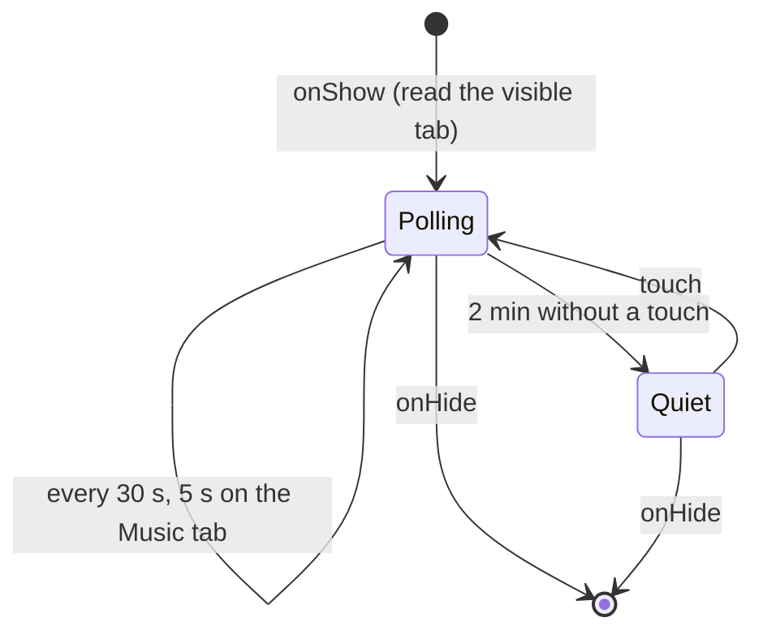
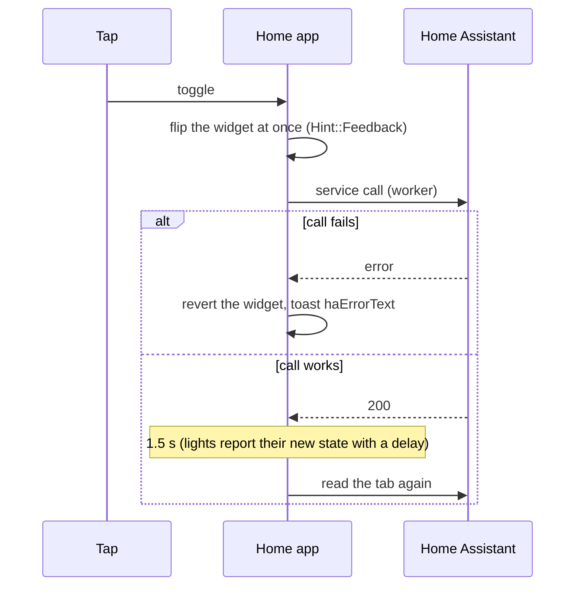

# Home (Home Assistant control)

A remote control for the house: lights, climate, a few switches, music. Much smaller than a Home Assistant dashboard:
what you want from an e-ink remote on the couch or bedside. Which lamps and rooms it shows is a file (`home.json`, see
[Config](#config)); the firmware ships an example house and the owner's own list lives on the card.

Backend details (URL, token, API calls) are in `BACKEND.md`.

**Contents**

- [Code](#code) · [Screens](#screens): [Lights tab](#lights-tab), [Climate tab](#climate-tab), [More tab](#more-tab),
  [Music tab](#music-tab)
- [Behaviour](#behaviour) · [Config](#config) · [Item types (v1)](#item-types-v1) · [Tests](#tests)

---

## Code

| Part | Where |
|---|---|
| Screen, tabs, actions | `apps/home/home_app.cpp` |
| Model and `home.json` parser | `apps/home/home_model` (unit-tested) |
| Default `home.json` | `apps/home/default_config.cpp` |
| Home Assistant client | `core/ha` |
| Music tab | `buildMediaCard` / `applyMedia` / `loadCover` / `openStations` and the actions in `home_app.cpp`; `mediaView` in `home_model` |

## Screens

Tabs in a `TabBar`; what appears on each tab is data, not code (`home.json`, [Config](#config)). The default has four:
**Lights**, **Climate**, **More**, **Music**. A tab's kind follows its items:

| Items on the tab | Shown as |
|---|---|
| `light`, `switch`, `fan`, `sensor` | rows, 5 to a page with a `Pager` |
| `scene` | buttons on top of the tab |
| `climate` | a thermostat card |
| `room` | big tiles, 2 columns |
| `contact` | one line of what is open |
| `media` | the music card |

A status line above the tab bar says "Updated 13:34", "Saved data: No Wi-Fi", "Loading..." or "n not found in Home
Assistant".

### Lights tab

Scene buttons (`Button`, secondary) on top, for entries of type `scene` (for example "Evening"): one tap runs the listed
service calls. Below, one 96 px `ListItem` per light or light group, five to a page:

```
[icon]  Lounge                          [ Toggle ]
        3 of 3 on - 60%
```

- **Toggle**: `light.turn_on` / `light.turn_off` on the entity.
- **Tap on the row text** opens a `Sheet` with:
  - "Brightness" with the value on the right ("60%", "--" when not known; it follows the boxes as they are tapped),
    above a `LevelBar` of ten boxes: `light.turn_on` with `brightness_pct`. Shown only if `dimmable` is not false.
  - the group's member lamps, a toggle each, if `members` is set.
- **Why the LevelBar is in the sheet**, not in the row: a 96 px row with a Toggle keeps five rows on a page; the sheet is
  one tap away.
- **Group toggle**: updates the stand-in, the read-only group and the members at once (the "x of y on" count follows).

### Climate tab

- **Room tiles** (2 columns): room name, temperature in `headline`, humidity in caption.
- **Thermostat card** for `climate` entities: current temperature, target with a `Stepper` (half degrees,
  `climate.set_temperature`, sent 0.8 s after the last tap), mode.
- **Windows and doors**: a list of open ones ("Bedroom window open"), or "Everything closed".

### More tab

Switches and fans as rows with a Toggle (`switch.turn_on/off`, `fan.turn_on/off`), plus plain sensor rows (name + value
+ unit).

### Music tab

P7-24. A media player (`media_player.living_room` in the example; built for a Sonos), laid out after a dashboard's
player sheet:

```
+----------+  Living room music · Playing            (Caption)
|  cover   |  Kings & Queens                        (Title, 3 lines)
| 200x200  |  Ava Max · Heaven & Hell               (Body, secondary, 2 lines)
|          |  Spotify · Fun Road Trip Mix           (Caption: source without "Connect", playlist)
+----------+

 [shuffle]  [prev]  ( PLAY )  [next]  [repeat]       (play: ink disc; shuffle / repeat on: ink ring; repeat one: repeat-1)

Volume                                               ("Volume, muted" when muted)
[mute]  [ -        24%        + ]                    (Stepper, 2 % a tap)
[][][][][][][][][][]                                 (LevelBar: a tap jumps to 10..100 %)
(radio)  Stations                         Spotify    (opens a sheet: TV and the Sonos favourites, two a row)
```

**Cover**

- `entity_picture` (Home Assistant's media proxy, with the bearer token), decoded on the worker into 200 x 200 grays,
  pushed as `Hint::Image` (a Quality pass on the cover only).
- Read again only when the song changes (title, artist, album), not when the proxy's token in the address rotates.
- The address carries an access token: never logged or saved.
- No picture: a framed box with the music icon.

**What plays**

- Nothing playing (idle, off, standby): "Nothing playing" as the title, the rest empty; play/pause stays (Sonos
  resumes).
- Playing without a title (the TV input): the source is the title. The Sonos on its TV input reports `media_title` "TV"
  and `source` "TV": shown once.
- No progress bar or position: it changes while nobody touches the panel.

**Controls**

| Control | Call | On screen |
|---|---|---|
| Play/pause | `media_player.media_play_pause` | button and state flip at once |
| Previous / next | `media_previous_track` / `media_next_track` | the new title comes with the next read |
| Shuffle | `shuffle_set` (`shuffle`) | flips at once |
| Repeat | `repeat_set`, off -> all -> one -> off | flips at once |
| Volume Stepper | `media_player.volume_set` (`volume_level` 0..1), sent 0.6 s after the last tap (one call for a run of taps, as the thermostat) | at once |
| Volume boxes | the same, sent at once | at once |
| Mute | `volume_mute` (`is_volume_muted`) | icon `volume-2` or `volume-x`, caption "Volume, muted" |
| Stations | `select_source` (`source`), closes the sheet | the title shows the station at once |

- **Stations sheet**: `source_list` as Buttons, two a row (eight fit without scrolling), the current `source` a Primary
  button.
- **Unsupported controls** are left out, by `supported_features`: previous 16, next 32, volume set 4, mute 8, select
  source 2048, shuffle 32768, repeat 262144. Without the attribute everything shows.
- **Reads**: the tab is read 1.5 s after a call and every 5 s while it is shown (with the 30 s read a new song or source
  showed late). A read of the one player is ~40 ms on the kept connection, and an unchanged state draws nothing.

## Behaviour

### Reading

- **`onShow`**: draw from the cache `/data/cache/home/states.json` at once, then read fresh states for the visible tab:
  one `GET /api/states/<id>` per entity over a kept-alive connection (BACKEND.md "Reading the Home app's states").
  Another tab is read when it is shown.
- **Only rows whose values changed** are updated.
- **Polling**: every 30 s (5 s on the Music tab) while the app is in the foreground and was touched within the last 2
  minutes (POWER.md). After that, no polling; the next touch starts it again (an action or a tab switch
  also reads at once).
- **Idle**: the app is left when nobody touched it for `power.autoOffMin` (apps/launcher.md "When unused", default 15
  min), so with the default the polling stops first. Set to 1 minute, the app is left before the two minutes are over.
- **Not built**: extending the Wi-Fi linger during the polling window (the net service reconnects on the next poll,
  ~1.3 s fast path).



### Actions

Optimistic: the screen changes first, the call follows, and a failure puts it back.



- The toast is the error's text (`haErrorText`): for example "Home Assistant not reachable", "No Wi-Fi", "Token
  rejected".
- A read that started before a local change, or while its call still runs, does not overwrite that change.
- A failed group toggle puts the stand-in, the group and the members all back.

### Not included

No history, charts, cameras or vacuum control. Media: the [Music tab](#music-tab) (P7-24).

## Config

`/data/home.json`. The default is `src/apps/home/default_config.cpp`: **an example house, not a real one**. Its entity
ids exist in no Home Assistant, so a device shows them as "not found" until the owner's list is on the card.

| Copy | Path | Notes |
|---|---|---|
| Own list | **`/sd/paperos/home.json`** | same format, never in git; always wins, never replaced (simulator: `sim-data/sd/paperos/home.json`) |
| Internal copy | `/data/home.json` | written from the default on first run if missing; belongs to the firmware |
| Pushed | `tools/push.py` over USB | task P4-0 |

- **`"version"`**: the default's is 5. A `/data/home.json` with an older or no version is replaced by the default on the
  next start. **Own edits go in `/sd/paperos/home.json`.**
- The UI tests and their fixtures use the example.

### The example house

Rows in order of importance:

| Page | Rows |
|---|---|
| top | scene buttons **Evening** (seven lamps) and **Dining default** (floor lamp pink, table warm) |
| 1 | **Sofa lamp**, Whole living room, Lounge, Dining area, Reading corner |
| 2 | Kitchen spots, **All downstairs** (one switch for every lamp downstairs, kitchen too), Porch, Driveway, Bedside lamp |

### Keys beyond v1

| Key | Meaning |
|---|---|
| `"version"` | see above |
| `"names"` | entity -> what the house calls the lamp, shown in a group's sheet (Sofa lamp, Coffee table, Entrance, ...) |
| `"also"` (per light) | more stand-ins that get the same on / off. "All downstairs" switches `light.downstairs_relative` and `light.kitchen_spots_relative`; on while any of its `members` is on, "3 of 7 on" with the reading corner and the kitchen counted as one lamp each |

### Notes on the data

- **Stand-ins**: a group row can talk to a stand-in entity (`*_relative` in the example: it moves each lamp relative to
  its own level). The plain group (`light.lounge`, ...) is then **read only**: used for "x of y on" and never written.
  `group` names the read-only group; `entity` is what gets commands.
- **Scenes** list every call they make (the example's "Evening": seven lamps with brightness and colour).
- **Missing entities** read "not found" on their row; nothing else breaks.

## Item types (v1)

| type | Reads | Commands |
|---|---|---|
| `light` | state, `brightness`, (group members' states for "x of y on") | `light.turn_on` (`brightness_pct`), `light.turn_off` |
| `scene` | nothing | each entry in `calls` |
| `switch` | state | `switch.turn_on` / `turn_off` |
| `fan` | state | `fan.turn_on` / `turn_off` |
| `climate` | `current_temperature`, `temperature`, state | `climate.set_temperature` |
| `room` | temperature / humidity sensor states | none |
| `contact` | binary_sensor state (`on` = open) | none |
| `sensor` | state + `unit_of_measurement` | none |
| `media` | state, `media_title`, `media_artist` (or `media_album_artist`), `media_album_name`, `media_playlist`, `source`, `source_list`, `volume_level`, `is_volume_muted`, `shuffle`, `repeat`, `entity_picture`, `supported_features` | `media_player.media_play_pause`, `media_previous_track`, `media_next_track`, `volume_set`, `volume_mute`, `shuffle_set`, `repeat_set`, `select_source` |

An unknown type is skipped; the rest of the file still works. Adding a type: accept it in `knownType` and parse its
fields in `home_model.cpp`, then place and fill it in `buildTab` / `applyAll` in `home_app.cpp`.

## Tests

- **Unit**: parsing `home.json`; mapping a states response to item view models.
- **UI**: `tests/ui/home.script` with fixtures (states response, service call OK, service call failure). Shots: each
  tab, a member sheet, the error toast.
- **Fixtures**: `tests/fixtures/make-ha-fixtures.py` writes one state per default entity and the service answers (fake
  data; the `switch/turn_off` answer is a 500 on purpose). The preset card `tests/ui/data/home/sd/paperos_config` holds
  fake values only.
- **Device check**: time from tap to visible toggle change (target under 0.4 s, it is optimistic); time from opening the
  app with Wi-Fi off to fresh data (target under 4 s).
