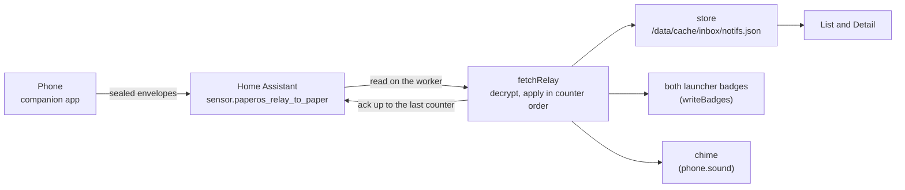
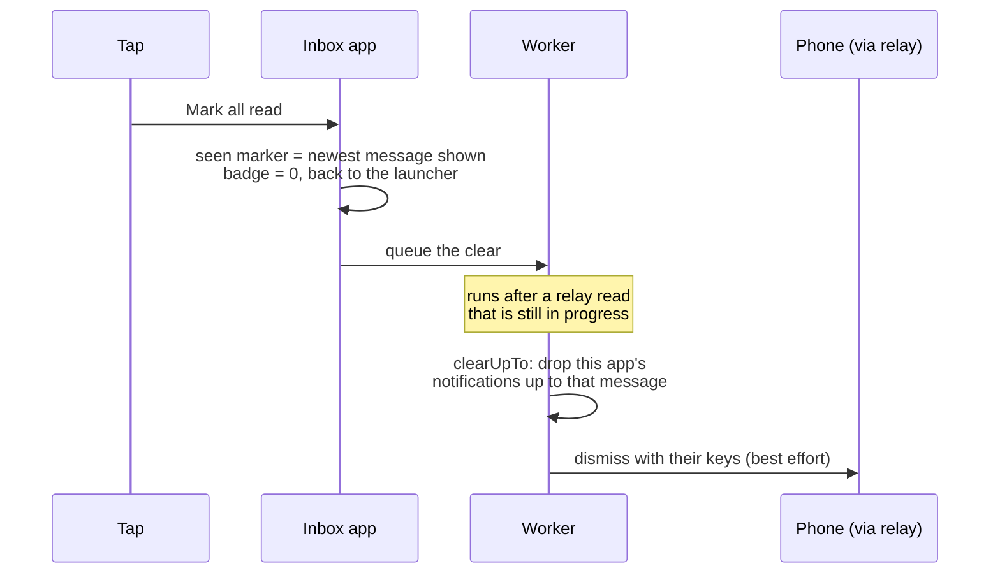
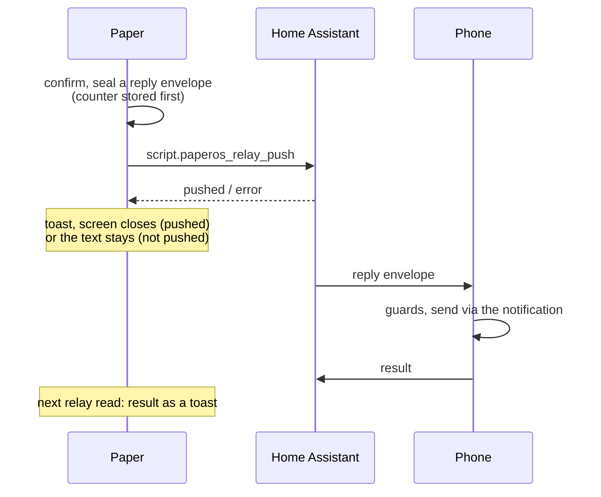

# WhatsApp and Mail (inbox apps)

Two launcher tiles, one implementation (`src/apps/inbox/`): the WhatsApp and Proton Mail notifications of the phone.
This doc covers the screens, replying, how the relay is read, badges, the new-message sound and the tests.

- **Source**: since D22 the notifications come from the companion Android app, which encrypts each one for the Paper.
  Home Assistant only relays ciphertext (`sensor.paperos_relay_to_paper`); the Paper decrypts it. Protocol, relay and
  limits: `docs/COMPANION.md`. The decision and its costs: `DECISIONS.md` D22.
- **WhatsApp** can **reply** to a chat whose notification is still on the phone. There are no new chats.
- **Mail** is read-only and shows what the notification showed (sender, subject, maybe a preview), never the full mail.

| Tile | Source | Icon |
|---|---|---|
| WhatsApp | the relay's `post` envelopes with `app` = `whatsapp` | message-circle |
| Mail | the same queue, `app` = `mail` | mail |

Both are instances of `InboxApp` parameterised by `{id, name, icon, entity, kind}` (`kind` = `Chat` or `Mail`),
registered twice with `POS_REGISTER_APP`.

**Contents**

- [Data flow](#data-flow) · [Screens](#screens) · [Replying](#replying) · [Behaviour](#behaviour)
- [Sound](#sound) · [Feed contract](#feed-contract) · [Tests](#tests)

---

## Data flow

## Screens

### List

- Title: "WhatsApp" / "Mail". Action in the title bar: refresh.
- One row per phone notification (`ListItem`, 96 px), 6 per page with a `Pager`:
  - **WhatsApp**: the **name** (the chat title for a group, "Anna - Family"; the sender for a direct chat), with "(3)"
    for a chat of three messages and a bullet when new; the latest message; the time at the right.
  - **Mail**: the **sender**, the subject, the time.
- Footer caption: "Updated 14:05". Empty: "No new messages" with the app icon.
- The phone's answer to a reply (`result`) shows as a toast when the list fetches it: "Reply to Family sent" / "Reply to
  Family not sent: wait 10 seconds".

| State | Condition | Shows |
|---|---|---|
| No phone paired | no `/data/companion.json` | `EmptyState` "No phone paired" / "Messages come from the PaperOS app on your phone. Pair it in Settings > Home Assistant > Phone." Nothing is requested. |
| Not set up yet | Home Assistant answers 404 for the relay | `EmptyState` "Not set up yet" / "The relay for your phone's messages is missing in Home Assistant."; the badge goes to 0 |
| Cannot reach Home Assistant | first load fails, nothing saved | `EmptyState` with Retry |
| Cannot reach Home Assistant | with saved data | a toast; the saved list stays ("Saved data") |

### Mark all read

The bottom button "Mark all read" asks no confirmation. The notifications stay on the phone.

- The log says `[inbox] mark all read: dismiss for N notification(s) to the phone: pushed`.
- **On the worker, not at the tap.** Opening the list starts a read of the relay (2 to 6 s with the Wi-Fi join). If the
  tap cleared the store directly, that read would save what it had loaded back over it and rewrite the badge. The worker
  runs one job at a time, so the clear comes after that read.
- A message that arrives after what the list showed stays (`clearUpTo`).
- Tests: UI script `inbox-markall-race` (with `wifi slow 3000`), unit test "mark all read drops what the list showed".

### Detail

- **Chat**: the notification's messages (at most 6, what MessagingStyle gave), newest first, as paragraphs: sender
  (groups) and time, then the text. Paginated with `ui::TextBlock` (tap right = next page, left third = back). A "Reply"
  button when the notification has a reply action.
- **Mail**: sender, subject (title), time, the caption "The preview your phone showed", then the preview ("(no preview)"
  if the notification had none).

## Replying

WhatsApp only. **Reply** opens the reply screen (`apps/inbox/compose.cpp`, title "Reply"):

- "To <name>", a six-line text field (900 characters, line feeds kept), a counter, "Paste" and "Send".
- The keyboard is an overlay. A long press on the field gives Paste / Copy all / Clear (UI.md).

### Sending

**Send** always opens a confirmation sheet: "Send to <name>?", the text (seven lines at most), "Your phone sends it from
your WhatsApp account", Send / Cancel.

| Outcome | Shows |
|---|---|
| Pushed | toast "Sent to your phone", the screen closes; the phone's `result` arrives later |
| 400 / 404 | "Not sent: no relay in Home Assistant" |
| Timeout | "No answer: it may still reach your phone" |
| Network error | the error |

- On every failure the text stays.
- The envelope is sealed as in COMPANION.md 5.
- The log says "reply: pushed" / "not pushed", never the text.
- **The guards are on the phone** (length, 10 s, 20 per hour, the notification must still exist): COMPANION.md 7.2.

### API for other apps

`apps/inbox/compose.h`:

| Call | Does |
|---|---|
| `whatsapp::openCompose(ctx, {name, key}, text)` | Opens the reply screen with the text |
| `whatsapp::sendToFavorite(ctx, "Woordle challenge", "Somdoku 12:34")` | A reply to the newest live WhatsApp notification whose chat name is that name |

With no match, `sendToFavorite` shows the toast "No WhatsApp notification from <name> on your phone" (or "No phone
paired: see Settings > Home Assistant"). The config key `inbox.whatsapp.favorites` was removed (D22).

## Behaviour

### Reading the relay

On open, on refresh, and back from a detail older than 60 s:

1. The saved notifications (`/data/cache/inbox/notifs.json`) show at once.
2. The worker reads `sensor.paperos_relay_to_paper` and applies the envelopes in counter order.
3. It saves, and acks up to the last counter (`apps/inbox/relay_fetch.cpp`, `core/companion.cpp`).

| Envelope | Effect |
|---|---|
| `post` | replaces a key |
| `remove`, `sync` | drop keys |
| `result` | becomes a toast |
| `unpair` | forgets the pairing |

- Rejected envelopes are counted in the log, never shown.
- Notifications older than 7 days are dropped on the Paper.
- **No polling**: messages come when the Paper reads the relay (the inbox opened or refreshed, Agenda, a scheduled wake,
  the clipboard menu), always on the worker.

### Seen marker and badges

- **Seen marker**: `ctx.store` key `seen` = newest `ts` shown. The new-message dots use the marker as it was when the
  app started.
- **Badge**: `/data/cache/<id>/badge` = items newer than the marker.
- **Every read writes both badges**: each read of the relay writes both apps' launcher badges (`writeBadges` in
  `fetchRelay`), what is newer than each app's seen marker. Golden `inbox-badges-launcher`.
- The scheduled refresh (P7-5, POWER.md) reads the relay too and writes both badges.
- The launcher reads the relay itself when it comes up and nobody read or tried it for ten minutes
  (`inbox::checkRelay`, apps/launcher.md "Fresh badges").

### Text clean-up

- Each notification is cleaned on the worker, once, when it is stored (`companion::cleanNotif`). The store's file
  carries `"clean": true`; an older file is cleaned when loaded. The inbox shows what the store holds.
- Text goes through `core/text_clean` (links, stray HTML).
- Emoji stay and are drawn from the emoji atlases on the card (UI.md "Emoji"), also in chat and group names.

## Sound

Option: Settings > Home Assistant > Phone > "Sound for new messages" (`phone.sound`, off by default). When on, a read of
the relay that brings new messages plays one chime on the buzzer: two short rising notes, a quarter of a second
(`hal::chime()`, `core/sound.h`), however many messages came.

- **New** = unread (newer than its app's seen marker, as for the badge) and later than the newest message any earlier
  read brought (`heard` in `notifs.json`, set after every read; `inbox::freshMessages`).
  - A notification the phone posts again, or a message that is on the screen in the open app, makes no sound.
  - A store saved before the marker existed starts at its newest message.
- **Whoever reads sounds it** (`fetchRelay`): the launcher's check, an inbox app, Agenda, the clipboard menu, a
  scheduled refresh. So the sound comes when the Paper looks, not when the phone gets the message: the Paper is not on
  Wi-Fi in between (POWER.md). With the scheduled refresh on (Settings > Power, "While off, wake to update the sleep
  screen every", `power.refreshHours`) a switched-off Paper chimes at its next wake.
- **Night**: nothing from 22:00 to 07:00 local time (`sound::quiet`; a scheduled refresh also runs then). A clock that
  was never set counts as day.
- **Preview**: switching the option on plays the chime once (also at night). `>set chime 1` (`tools/device.py set chime
  1`) plays it whatever the setting.
- **Device**: the passive buzzer on GPIO 21 as a square wave from the LEDC timer, on a short-lived task; the pin is
  released afterwards. Light sleep and power-off wait for a playing chime (at most a second): light sleep stops the PWM
  clock.
- **Simulator**: a log line, and a count for the scripts (`expect-chimes N`).
- Not heard on the device yet (STATUS.md "Pending device checks").

## Feed contract

The decrypted notifications are turned into the feed items the list, grouping and badge code use
(`inbox::feedFromNotifs`, BACKEND.md "Inbox feeds"):

| Field | Value |
|---|---|
| `id` | key + "#" + index |
| `from` | sender |
| `chat` | chat name |
| `subject` | subject (mail) |
| `text` | message text |
| `ts` | time, Unix seconds |
| `key` | the notification key |
| `canReply` | a WhatsApp notification with a reply action on the phone |

## Tests

**Unit**

| File | Covers |
|---|---|
| `companion_crypto_test.cpp` | RFC 7748 and the shared vectors of `tests/fixtures/companion/vectors.json`, rejections |
| `companion_test.cpp` | queue order, replay, forgeries, results, unpair, expiry, envelopes to the phone, pairing, the store, what counts as new for the sound |
| `inbox_test.cpp` | grouping, times, `feedFromNotifs` |
| `whatsapp_send_test.cpp` | targets, names, push outcome |
| `sound_test.cpp` | the setting, the night, one chime per read |

**UI scripts**: `inbox`, `inbox-mail`, `inbox-empty`, `inbox-error`, `inbox-wifi`, `inbox-unpaired`, `inbox-gone`,
`inbox-gone-mail`, `whatsapp-send`, `whatsapp-send-missing`, `whatsapp-reply-result`, `phone-pair` (Settings), `somdoku`
(the score as a reply), `inbox-sound` (the option on: one chime for the launcher's read, the switch in Settings).

**Fixtures**: `tests/fixtures/make-inbox-fixtures.py` encrypts fake notifications with pyca/cryptography for hosts `ha`,
`ha-down`, `ha-empty`, `ha-gone` (.example.test) and writes the presets' paired state (`companion.json`). UI scripts run
with `setTestRandom(1)`, so the pairing QR code and its hello are fixed.
