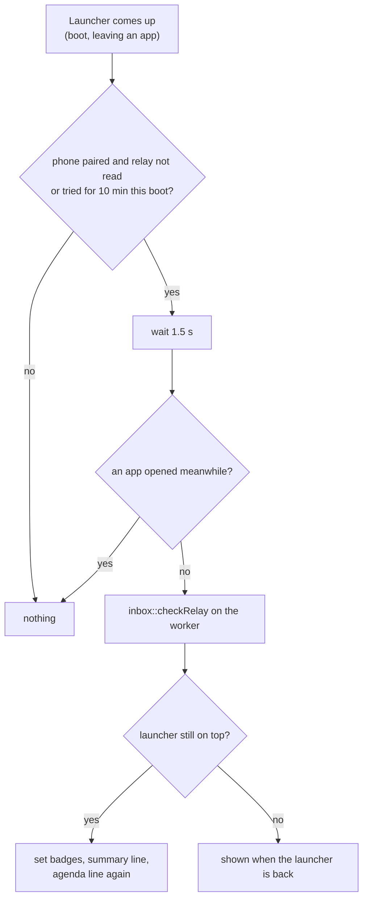
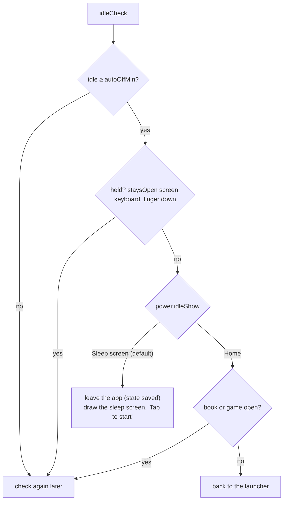
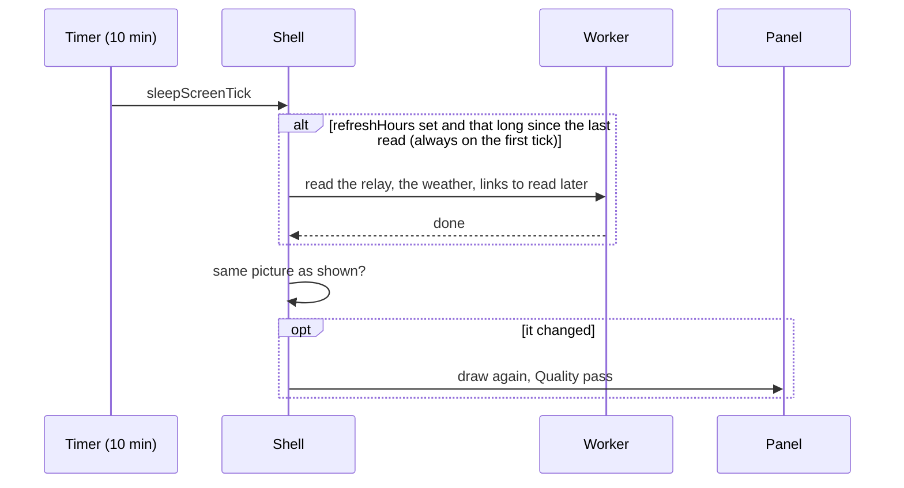

# Launcher

The home screen. Not a registered app: it is the root of navigation and always exists. This doc also covers what the
Shell does when the device is not used (the sleep screen that stays on), the quick panel and the power button.

**Contents**

- [Layout (540x960)](#layout-540x960) · [Twelve apps to a page](#twelve-apps-to-a-page) ·
  [No gray on the launcher](#no-gray-on-the-launcher)
- [Behaviour](#behaviour) · [Power button](#power-button) · [Quick panel](#quick-panel)
- [Fresh badges](#fresh-badges) · [When unused](#when-unused)
- [Files](#files) · [Tests](#tests)

---

## Layout (540x960)

`src/apps/launcher/launcher.{h,cpp}`: the first screen of the Shell (no title bar).

```
StatusBar (56)        12:34                    wifi  battery 87%
Header row (72)       Thursday 15 January                    (power)
Agenda line           Now: Lunch until 14:00              <- body, ink; only when there is something
Summary line          4 unread - Reading: Dune, 42%       <- body, ink; only when there is something
App grid              3 columns x 4 rows of ui::Tile (Small, 153 x 160, gap 16)
                      icon 64 px, no gray well; label below; optional Badge top-right
Pager bar             only with more than 12 apps
```

- **Date**: "Sunday 15 November", or "PaperOS" while the RTC is unset.
- **Grid**: tiles come from the registry; unused cells of the last row are blank tiles (no draw, no touch). The
  `ui::Pager`'s bar is hidden while one page holds every app.

## Twelve apps to a page

The grid is 3 columns x 4 rows of small tiles (`ui::Tile::Size::Small`: 153 x 160, the same 64 px icon as the large
tile, the label in the body size, the badge in the corner), 16 px apart.

- The twelve registered apps fill one page; the page bar comes back with the thirteenth app.
- Four rows end exactly where the page bar starts, also with the agenda line above them.
- Before: 2 x 3 large tiles, the seventh app on a second page. The Home app keeps the large tiles (they hold a value
  line).
- **Tile centres** for scripts and injected taps: x 100 / 270 / 439, y 248 / 424 / 600 / 776 (28 lower when the agenda
  line shows).
- **Goldens**: `launcher`, `launcher-summary`, `agenda-launcher`, `wordgame-launcher`, `inbox-badges-launcher` and the ones
  that show the launcher behind something.

## No gray on the launcher

The small tiles have no gray well behind the icon. With the wells the launcher was a screen with flat gray areas, which
goes out as one Text pass (DISPLAY.md `screen-gray`), and the Text waveform draws in steps.

Camera, Settings to the launcher (`cam.py around tap 36 92`, one session):

| | On the panel |
|---|---|
| with wells, one Text pass (as it was) | three pulses of change over 366 ms: the flicker |
| with wells, Fast then settle (`>set gray-pass off`) | one pulse of 170 ms, then about a second later three more where the wells and edges are |
| **without wells** (Fast then settle by itself: nothing gray) | **one pulse of 144 ms**, then a ripple of about a sixth of it (the anti-aliased edges) |

- Gray(13) read as 0.96-0.98 of white on the panel (DISPLAY.md): the wells were hardly there to the eye.
- The Home app's large tiles lost theirs too: Lights to its Climate tab was one Text pass, visible 397 ms; now a Fast
  pass of 195 ms and a settle the camera does not see.
- `>set gray-pass off` (device only) switches the one-Text-pass rule off for a comparison.

## Behaviour

- **Tiles**: from the app registry sorted by `order`. A tap opens the app (`Shell::requestOpen`, `Hint::Screen`).
- **Badges**: an app may expose `int badge()` in its registration (unread count). The launcher reads the cached value
  from `/data/cache/<id>/badge` in `onShow()`; it never triggers network I/O itself (except the
  [Fresh badges](#fresh-badges) check). The Read tile's badge counts what there is to read later, links that wait and
  articles nobody opened (apps/reader.md "Articles", P7-18).
- **Summary line**: "3 unread - Reading: `<title>`, 42%", read in `onShow()` from the apps' `/data/cache/<id>/badge` files
  and the reader's store (`/data/apps/read.json`, keys `last.title`, `last.percent`). Missing parts are left out, the
  whole line when both are; no network I/O. "N unread" leaves the Read tile's count out (`cachedUnread()`: messages
  only). Goldens `launcher` (without data) and `launcher-summary` (with).
- **Agenda line** (D28): under the date, what the phone's agenda has on now or next (`agenda::nextLine`,
  apps/agenda.md); hidden when there is nothing; from the saved agenda only. Golden `agenda-launcher-line`.
- **Quick panel**: a swipe down from the status bar ([Quick panel](#quick-panel)).
- **Resume**: on boot, if `config.launcher.resumeLastApp` is true (default) and the device was powered off from inside
  an app, the launcher opens that app directly (POWER.md "Resume after power-off").
- **Clock**: the status bar clock updates once per minute with `Hint::Content` on its own rect only.

## Power button

The header is a row: the date, and in the right corner a `ui::IconButton` with the power icon (72 x 72, centre 480, 92).

- **A tap is `Shell::sleepNow()`**, the same as "Sleep now" in the quick panel: state saved, the sleep screen on the
  panel ("Powered off", POWER.md "Sleep screen"), power off. No confirmation: one click on the side button starts the
  device again, on the launcher.
- **Why**: the firmware cannot see the side button, and its double click leaves the last picture on the panel, so off
  looked like on.
- **Geometry**: the row is 72 high where the date took 24 + 36. The date sits 7 px higher, the gap above the grid is 12
  instead of 24 (`kGridGap`), and the grid is where it was.
- **Tests**: unit case `launcher: the power button switches the device off through the sleep screen`;
  `tests/ui/sleep.script` taps it (`expect-off 0`, golden `sleep-launcher-button` equal to `sleep-plain`).

## Quick panel

P7-6, as built. `core/quick_panel.cpp`, opened by `Shell::onGesture` for a **swipe down that started in the status bar** (y < 56), on
every screen that shows the status bar (not the reader's full-screen page, not under an open sheet).

A `Sheet` with:

| Item | Content |
|---|---|
| Wi-Fi | cached state: the network name, or "Off until something needs it" |
| Battery | percent, charging or on battery, volts |
| **Clean screen** | one Quality pass |
| **Sleep now** | `Shell::sleepNow()`: save state, sleep screen, `powerOff(0)`; only the side button starts the device again |

No Wi-Fi switch: the net service switches it on and off itself. Goldens: `quick-panel*` (launcher.script, home.script).

## Fresh badges

The launcher shows what the apps cached; without this check nothing read the phone's relay unless an app was opened.



- **Due**: `inbox::relayCheckDue`, `kLauncherCheckSec` (600 s). A failed try counts as a try: away from the known Wi-Fi a
  try is a scan of several seconds.
- **The read** (`inbox::checkRelay`) is the same as the inbox's: the store, both badges, the agenda and the clipboard
  follow. A link shared for reading later is queued and counts in the Read tile's badge at once; its page is read later
  (apps/reader.md "Articles", P7-18).
- **Drawing**: a tile whose count did not change is not drawn again; only the agenda line appearing or going moves the
  tiles (one pass).
- **Not done**: no timer while the launcher just stays on. A device lying on USB does not check again until an app was
  opened and left.
- **On the device** (boot): Wi-Fi joined in 1.3 s, the read took 1.2 s, the log says `[relay] launcher check: read`, and
  the panel changed only by the Wi-Fi icon (nothing was unread). Leaving Settings a moment later started no second read.
- **Goldens**: `agenda-launcher` (the agenda line and "4 unread" are there before any app was opened),
  `inbox-badges-launcher`.

## When unused

P7-19, D38; replaces the idle return of P7-13, D33. `Shell::idleCheck()`, one timer for the whole Shell; it rechecks at least once a minute. It acts when nobody touched the
device for `power.autoOffMin` minutes (Settings > Power "When unused for": 1 / 5 / 15 / 30 min / Never, default 15;
while the reader is open `autoOffMinReader`, 30).



### Then show: Sleep screen

`power.idleShow`, the default. The open app is left (state saved) and the sleep screen goes on the panel
(`Shell::showSleepScreen`), footer "Tap to start".

- **Power**: the device stays on. On battery the PowerPolicy switches it off at the same moment (POWER.md "Auto-off").
- **Leaving it**: a tap (any gesture that ends) leaves it (`Shell::wake`).
- **Log**: `[shell] not used for 15 min: the sleep screen`, `[shell] sleep screen left by a tap: back to read`.

**A tap on a part of it opens that app there:**

| Tapped part | Opens |
|---|---|
| the weather | the Weather app on its blocks page (first place) |
| an agenda row or day heading | the Agenda's day view on that day |
| the book row (or the plain screen's cover) | the reader |
| an unread count | its app |
| the plain screen's agenda line | the Agenda |
| anywhere else | the launcher, or the book or game that was open |

The draw functions record the parts (`sleepTargets()`, `sleepTargetAt`). The Shell opens the app with
`AppContext::link` ("date=2026-01-16", "page=1"), which an app reads in `onStart` (`ctx.linkValue(key)`) and may
ignore.

**Refresh while it shows:**



- Every 10 minutes it is drawn again if what it shows changed.
- Every `power.refreshHours` it first reads the relay, the weather and links to read later. The first time is at the
  first tick, 10 minutes on: the saved data may be hours old.

### Then show: Home

An app that is no book or game is left for the launcher (`[shell] mail not used for 15 min: back to the launcher`).

### Rules

- **Idle** = the time since the last touch event (`Os::lastInputMs()`, which `Os::keepAwake()` also moves), but never
  longer than the app has been open: an app opened without a touch (the boot that resumes it, `>set screen`) gets its
  whole time.
- **Held**: not while the screen on top says `Screen::staysOpen()` (pairing, Files over Wi-Fi, Update over Wi-Fi, the
  Display lab), the on-screen keyboard shows, or a finger is down.
- **Overlays** close first, each its own way (`ui::Root::closeOverlays()`).
- **Books and games** (`.stayOpen = true`: Read, Somdoku, the word game) are never left with "Home"; with "Sleep screen"
  they come back after the tap.
- **Device check**: `tools/device.py set idle-min N` (minutes until the idle check acts, 0 = never; until the next boot,
  not saved; on battery it also sets the switch-off time).

### Idle tests

- **Unit** cases "idle ..." (`app_test.cpp`: Home, the touch, 0 and the reader's time, stayOpen and staysOpen, a sheet,
  the keyboard, the sleep screen and the tap, the network read every refreshHours); "auto-off ... resumes only a book or a
  game" (`power_policy_test.cpp`); "sleep screen: its parts are tap targets ...".
- **UI script `idle-home`**: goldens `idle-before`, `idle-sleep-screen`, `idle-woken`, `idle-read-sleep`,
  `idle-read-back`, `idle-power-setting`, `idle-home-launcher`.
- **UI script `idle-board`**: the Today board with agenda and weather, "Tap to start"; taps on Friday's row, the weather,
  the WhatsApp count and an empty part: goldens `idle-board-agenda`, `-weather`, `-launcher`.

## Files

- `src/apps/launcher/launcher.cpp`
- `src/ui/chrome.cpp` (StatusBar)
- `src/core/quick_panel.cpp`
- `src/core/shell.cpp` (idle check, sleep screen, wake)

## Tests

`tests/ui/launcher.script`: open an app, back, long press on the back arrow. See also the tests under
[Idle tests](#idle-tests), [Power button](#power-button) and [Fresh badges](#fresh-badges).
