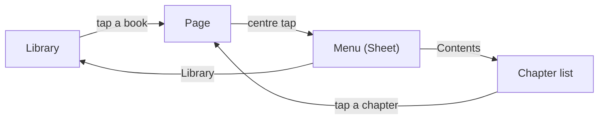
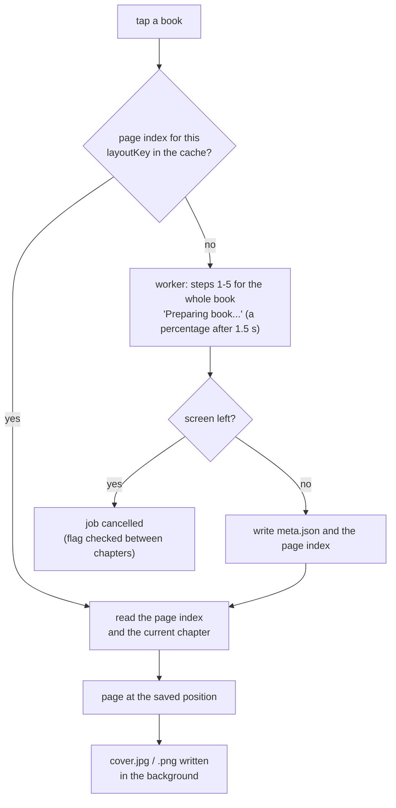
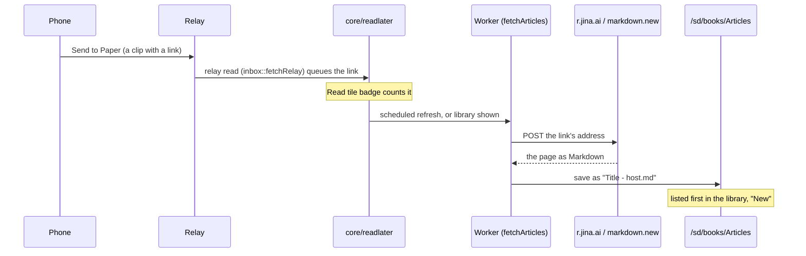

# Read (e-book reader)

Reads EPUB, plain-text and Markdown books from the SD card (`/sd/books/`), and articles shared from the phone to read
later. The most used app: it sets the bar for refresh quality and battery life.

This doc covers the two screens, the formats, how a book is converted and cached, the read-later articles, the tests and
the numbers measured on the device.

**Contents**

- [Screens](#screens): [Library](#library) · [Page](#page) · [Refresh behaviour](#refresh-behaviour)
- [Formats](#formats) · [Pipeline](#pipeline) · [Cache](#cache) · [Books in folders](#books-in-folders)
- [Articles](#articles) · [Tests](#tests) · [On the device](#on-the-device) · [Later (not v1)](#later-not-v1)

---

## Screens



### Library

The app's first screen, titled "Library": the books on the card (`apps/reader/library`).

- **Rows**: `ListItem`, 96 px: title, author, progress ("42%" trailing), sorted by last opened. 7 per page with `Pager`.
  The list shows no covers (gray images are slow).
- **The card**: the most recently opened book is a larger card at the top of page 1, not repeated in the list. No card
  while nothing was opened. It has a cover thumbnail (`Hint::Image`, 120x180; a framed box with a book icon when the book
  has no cover), title, author, progress bar and "Continue". Page 1 then holds 5 rows, the other pages 7.
- **Rebuilt each time it is shown**: the list comes from a scan on the worker, so progress and order are current after
  reading.
- **Title and author** come from the book's cache (`meta.json`, once it was opened) or from the file name
  "Title - Author.ext".
- **Order**: [Articles](#articles) nobody opened come first under the card, the newest on top, with "New" where a book
  has its percent. Then the books nobody opened, by title.
- **Removing**: a long press on an article's row asks "Remove this article?". The card of an article has "Remove" under
  "Continue" (page 1 then holds 4 rows). Books are never removed on the device.
- **Empty state**: "No books yet. Copy .epub or .txt files to the books folder on the SD card."
- **First open of a book**: "Preparing book..." while the worker indexes it ([Pipeline](#pipeline)), then the page.

#### One worker, so order matters

There is one worker thread (P4-6, measured on the device), so what runs on it first decides how soon a book opens:

| Rule | Without it |
|---|---|
| When the app resumes into the open book, the library under it is not scanned until it is shown | the scan and the cover decode held the book's open back: 2.45 s instead of 0.14 s |
| The card's cover is decoded once per book, not on every return | the decode of a 220-270 KB JPEG kept the worker busy for 2 to 3 s; a book tapped meanwhile opened that much later |
| After a first open, the cover is written to the cache after the first page's chapter is loaded | written before it, the page came 1.9 s late and taps were dropped meanwhile |

### Page

The page screen is `fullScreen()` (docs/APPS.md): 540 x 960, no StatusBar, no TitleBar.

```
(no StatusBar, no TitleBar: the whole 540x960 is the page)
margins: 40 px left/right (normal), 48 top, 56 bottom
footer (caption, ink; goes out with the page, Hint::Page):   chapter title ............ 123 / 450      battery icon if < 20%
```

- **Footer**: chapter title, "123 / 450", and a battery icon below 20%. It is ink and goes out with the page
  (`Hint::Page`), so a page turn is one refresh.

Touch zones:

| Zone | Action |
|---|---|
| right 40% of the width, or swipe left | next page |
| left 25%, or swipe right | previous page |
| centre 35% | toggle the menu overlay |

#### Menu

A `Sheet` from the bottom. There is no TitleBar over a full-screen page, so the way out is the "Library" button.

| Item | What it does |
|---|---|
| book title | |
| "Text size" | `Segmented` S/M/L/XL; remembered in `ctx.store` key `font` (0..3) |
| "Go to" | `LevelBar` by 10% (10 20 ... 100 printed under the ten boxes) and a `Stepper` by page ("Page 21 of 34") |
| Contents | a chapter list screen: seven rows per Pager page, "reading now" on the current chapter, the page where each chapter starts; a tap jumps |
| Clean | forces the Quality clean pass |
| Library | back to the library |

Contents, Clean and Library are a row of three buttons.

**Changing the text size** saves the position, paginates the whole book again for the new size and opens on the page that
holds the saved position. That is instant when the index for that size is cached; otherwise "Preparing book..." shows.

### Refresh behaviour

A page turn is `Hint::Page` over the text area, with the footer in the same push:

- one Fast pass at once (~0.5 s on the panel), no settle pass;
- a Quality clean every 10th page turn (`display.pageCleanEvery` in `config.json`, DISPLAY.md "Ghost budget"), done at
  a page turn, never mid-page.

`tests/ui/reader.script` checks `expect-no-quality` across the first five page turns.

## Formats

| Format | Support |
|---|---|
| `.txt` | See below. Task P4-1 (done). |
| `.epub` (2 and 3) | Unencrypted. Text, paragraphs, headings (h1-h3), bold, italic, line breaks, block quotes, lists as indented paragraphs, horizontal rule. Cover image. Task P4-3/4. |
| `.md` | See below. One chapter. |
| not supported in v1 | DRM, images inside chapters, tables, CSS, footnote popups, right-to-left |

**Plain text (`.txt`)**:

- UTF-8, with a Windows-1252/Latin-1 fallback.
- A blank line is a paragraph; hard-wrapped lines are joined.
- `_word_` is italic; a short line starting with CHAPTER / BOOK / PART ... is a heading.
- The Project Gutenberg header and licence are cut.
- One "chapter" (parts of at most 512 KB for huge files).
- Title and author from "Title - Author.txt", else the Gutenberg header.

**Markdown (`.md`)**:

- Headings, paragraphs, lists, **bold**, code blocks and table rows as lines (`hackernews::parseArticle`,
  apps/hackernews.md "The article").
- An article saved for later ([Articles](#articles)) is such a file, as the reader service answered it: "Title: ..."
  lines, "Markdown Content:", then the page. The title comes from that header.
- Any other Markdown file on the card opens too.

**Not supported, in detail**:

- **Images inside chapters** are not built: they leave no placeholder, only real alt text such as a caption stays.
  Inline pictures are a later feature.
- **Tables**: each cell is a line; the lines of a row stay together.

## Pipeline

Code: `core/zip`, `apps/reader/epub` (steps 1-2), `apps/reader/xhtml` (steps 3-4), `apps/reader/book`, `ui::paginate`,
`ui::TextBlock`.

| Step | What | Where |
|---|---|---|
| 1 | zip directory: read the central directory, inflate entries with tinfl | `core/zip` |
| 2 | `META-INF/container.xml` -> OPF: title, author, cover item, spine (chapter order), TOC (nav/ncx) | `apps/reader/epub` |
| 3 | per chapter: XHTML -> token stream (tiny SAX-style tokenizer, entity decoding: `&amp;` `&#8217;` `&nbsp;` ...) | `apps/reader/xhtml` |
| 4 | tokens -> paragraphs with style runs `{text, bold, italic, heading level, indent}` | `apps/reader/xhtml` |
| 5 | paragraphs -> lines -> pages: greedy line breaking on font metrics, no hyphenation in v1 | paginate |
| 6 | draw the page | `ui::TextBlock` |

### Opening a book

Steps 1-5 for the **whole book** run once on the worker when a book is first opened (or its font settings change) and
produce the [Cache](#cache). Opening a cached book reads only the page index and the current chapter.



### The XHTML converter

What `apps/reader/xhtml` does with a chapter:

- **Block elements** (p, div, h1-h6, li, blockquote, table rows, ...) start paragraphs.
- **`<br>`** also starts one, a "soft" paragraph (marked 0x06 in the cache format): no first-line indent and no gap
  above, so verse, addresses and title pages stay together.
- **Styles**: b/strong = bold, i/em/cite = italic. h1 = level 1, h2 = 2, h3-h6 = 3.
- **Lists** get a bullet or "1." prefix; `<hr>` = "* * *".
- **Images and svg** leave nothing. Real alt text stays as text, so a cover page has no text and is dropped.
- **Tables**: each cell is its own soft line.
- **Ignored**: style, script, head. White space collapses.
- **Control bytes** are dropped, so a book cannot forge marks.

### Chapters

- **Chapters follow the table of contents.** A spine document with several contents entries that point at anchors
  (`#id`) inside it is cut at those anchors; the converter records where each `id` / `name` lands. Text before the
  first anchor is a "Beginning" chapter.
- A document with one contents entry (or none) is one chapter.
- A chapter is stored as a byte range of its converted document (`from`, `to` in meta.json).
- **Memory: one chapter at a time.** Documents over 512 KB of text are split at paragraph boundaries into virtual
  chapters "Title (2)", ...
- Chapters with no text are dropped.
- **Footer title**: the contents title of the chapter. Chapters named only from their first heading (no contents entry)
  and the "Beginning" part show the book title.

## Cache

Path: `/sd/books/.paperos/<id>/`. `<id>` = first 12 hex chars of a hash of file name + size + mtime.

| File | Content |
|---|---|
| `meta.json` | title, author, chapter list (title, and for EPUB the source href and part), cover path inside the zip |
| `ch<N>.txt` | **TXT books only**: chapter N in the marked text format below |
| `pages-<layoutKey>.idx` | the page index (format below) |
| `cover.jpg` / `.png` | the cover copied out of the EPUB as it is (decoded by M5GFX when drawn); written in the background after the book is open |
| `progress.json` | `{ "chapter", "para", "byte", "percent", "opened" }`, e.g. `{ "chapter": 3, "para": 41, "byte": 120, "percent": 42, "opened": 1763200000 }` |

**Why EPUB chapters are not cached**: an EPUB's chapters are converted from the EPUB itself each time one is opened
(about 0.1 s) and while paginating. The card writes at only about 90 KB/s, so caching 1 MB of text cost 8 s of a 26 s
first open.

**Marked text** (`ch<N>.txt`, and what `apps/reader/xhtml` produces): one paragraph per line, style marks as control
bytes.

| Byte | Meaning |
|---|---|
| 0x01 / 0x02 | bold on / off |
| 0x03 / 0x04 | italic on / off |
| 0x05 + level | heading |
| 0x06 at the start of a line | continues the previous block after a `<br>` |

**Page index** (`pages-<layoutKey>.idx`): `"PIX1"`, a u32 page count, then per page u16 chapter, u32 paragraph, u32 byte
(little endian). `layoutKey` = face, column width and height, line spacing, indent, paragraph gap.

**Position**: stored as chapter + paragraph + byte offset inside the paragraph (`TextPos`, not a page number), so it
survives font changes. Progress is saved on every 5th page turn and when the page screen is destroyed (back, home,
power-off).

## Books in folders

The library looks into the folders inside `/sd/books`, three levels deep, and shows one flat list (needed for Files over
Wi-Fi, P7-4).

- Names starting with a dot are skipped.
- A book's `file` is its path inside the books folder ("Classics/Alice.epub").
- A book's id comes from its name without the folder (and its size and time). So a book moved into or out of a folder
  keeps its cache and reading position; the cached meta takes the new place when it opens.
- Unit test "books in folders are found ...".

## Articles

Read later (task P7-18, D36): a link shared from the phone waits on the Paper as an article, read like a book.



### Sharing

- "Send to Paper" on the phone's share sheet, as for text (COMPANION.md 7.1 `clip`).
- **A link to read**: a `clip` whose text is one http(s) address, alone or as the last word after a title
  (`readlater::linkFromText`). A note that mentions an address in the middle, or two, stays a note.
- The text still becomes the Paper's clipboard as before. A link counts with the clipboard not shared and however old.
- No change to the phone app or to the protocol's messages.

### Queue

- `core/readlater`, `/data/readlater.json`: up to 20 links (address, the words before it, when, tries) and the files of
  the articles nobody opened yet. One more link pushes the oldest out.
- The relay read queues (`inbox::fetchRelay`, whoever reads).

### Reading the page

- `reader::fetchArticles` (`apps/reader/articles`), on the worker.
- **The request** is the Hacker News app's article (`hackernews::readPage`: `POST r.jina.ai`, and `POST markdown.new`
  when that cannot read the page; D34). The link's address goes to those services, nothing else.
- **The answer is saved as it is** (the second service's in the first one's format) to
  `/sd/books/Articles/<title> - <host>.md`.
- **File name** (`readlater::fileName`): what a FAT name cannot hold is taken out, at most 70 characters, " - " inside
  the title becomes a dash, a name that is taken gets " (2)".

When pages are read:

| When | How |
|---|---|
| scheduled refresh | after the relay and the weather; the links get 25 s of its 45 |
| the library is shown with links waiting | "Reading 2 links..." as a toast, then the list again; once per visit |
| **not** at the launcher's relay check | that only queues: a page takes seconds, and on the one worker an app opened meanwhile would wait for it |

### A link that cannot be read

A link that neither reader service can read:

| Case | Result |
|---|---|
| no text on the page, a page over 400 KB, a 4xx of the service | dropped at once, nothing saved |
| a site that turns the reader service away | dropped at once, nothing saved (see below) |
| no network, a timeout, a 5xx | waits; after six tries it is dropped |

- **A site that refuses the reader**: the service answers 200 with "Warning: Target URL returned error 403" and the site's
  notice as the page: "The site refused the reader (403)". Seen with tweakers.net on the device (DPG Media's firewall;
  the answer took 16.8 s).
- **Where the reason shows**: in the library a toast ("example.com: No text on the page"); elsewhere a log line
  (`[read] article not read: ...`).

### Badge

- **The Read tile's badge is what there is to read**: links that wait plus articles nobody opened
  (`/data/cache/read/badge`, set by `readlater::save`).
- So a shared link shows on the launcher at the next relay read, before its page is read, and the Today board shows the
  book icon with the number.
- Opening an article takes it off (`articleOpened`). Files that are gone from the card are dropped from the list.
- The launcher's and the plain sleep screen's "N unread" count messages only.

### Limits

- Text only (no pictures).
- Only what the service can read: sites behind a firewall or a consent wall that refuse it (DPG Media's: tweakers.net
  and its sister sites) give no article. A paywall that answers 200 gives its notice as the article.
- One chapter.
- No way back to the page (the address is in the file's header).

### Article tests

- `tests/unit/readlater_test.cpp`: the link rule, hosts and names, the queue, reads that answer, never will or find no
  network, opened and removed, the Markdown import, the library's order.
- The `clip` case in `companion_test.cpp`.
- UI script `read-later` (fixture host ha-link.example.test): goldens `read-later-launcher`, `-library`,
  `-remove-sheet`, `-article`, `-article-p2`, `-library-read`, `-launcher-read`, `-removed`.

## Tests

**Unit** (`tests/unit/`):

- **Zip reader** on the small fixture EPUBs. `tests/fixtures/make-epub.py` builds `fixture3.epub` (EPUB 3 with nav,
  cover, deflated chapters, %20 in an href) and `fixture2.epub` (EPUB 2 with NCX, stored chapter).
- **Damaged zips**: cut, bit flips, wrong sizes and CRC, random damage.
- **XHTML tokenizer**: entities, nested tags; malformed input must not crash.
- **Pagination**: no line wider than the column, page offsets strictly increasing, last page ends at chapter end,
  re-pagination keeps position.

**UI scripts** (`tests/ui/`), against **generated** fixture books (`tests/fixtures/make-book-txt.py` into
`tests/ui/data/reader/sd/books/`, committed), so goldens never depend on downloads:

| Script | Covers |
|---|---|
| `reader` | first page, page turns by tap and swipe without a Quality pass, the position after a restart, the last page |
| `library` | nine books none opened, the continue card after reading one, its second page |
| `epub` | an EPUB: chapters, headings, bold and italic, entities, resume |
| `reader-menu` | text sizes, go to, contents, clean, the cover on the library card |
| `sleep-reader` | power-off while reading, the sleep screen, the book again on the next boot |
| `read-later` | [Articles](#articles) |

**Real books** for manual testing: `tools/fetch-books.sh` downloads five public-domain EPUBs and one TXT from Project
Gutenberg into `sim-data/sd/books/` (not committed): Pride and Prejudice, Sherlock Holmes, Frankenstein, Alice in
Wonderland (EPUB3), Max Havelaar (Dutch, accented characters), The Time Machine (TXT). Every one of them must open,
paginate to the end without a crash, and show its title and author (task P4-4 acceptance).

**Getting books onto the device card**: `tools/push.py` over USB (task P4-0), Files over Wi-Fi (P7-4), or take the card
out and copy the files into `/books/` with a computer.

## On the device

P4-6, with the three changes in [One worker, so order matters](#one-worker-so-order-matters). Ghosting: DISPLAY.md
"Reader ghosting".

| Check | Target | Measured |
|---|---|---|
| page turn, tap to the panel driver | under 0.6 s to readable text | 109 ms median of 30; slowest 150 ms (the Quality clean of every 10th page) |
| page turn, on the panel (camera, DISPLAY.md) | | about 0.5 s after the tap |
| cached open | under 1.5 s for a 1 MB EPUB | 30-230 ms; the page's text on screen 0.7-1.4 s after the tap in the library (all six books; the largest is 609 KB, no 1 MB EPUB is on the card) |
| ghosting after 10 turns | | DISPLAY.md "Reader ghosting" |

First open (convert + paginate, "Preparing book..." with a percentage):

| Book | Size | Pages | Time |
|---|---|---|---|
| Pride and Prejudice | 609 KB | 1577 | 12.5 s |
| Frankenstein | 440 KB | 922 | 9.8 s |
| Max Havelaar | 405 KB | 1667 | 15.7 s |
| Sherlock Holmes | 312 KB | 1240 | 9.8 s |

- About 6-9 ms per page, most of it layout (text measuring is 40-55 % of that). A 1 MB EPUB would take 20-25 s once.
- The page's text follows 0.3-0.4 s after the book is ready.

## Later (not v1)

Hyphenation, images in chapters, bookmarks, reading statistics.
