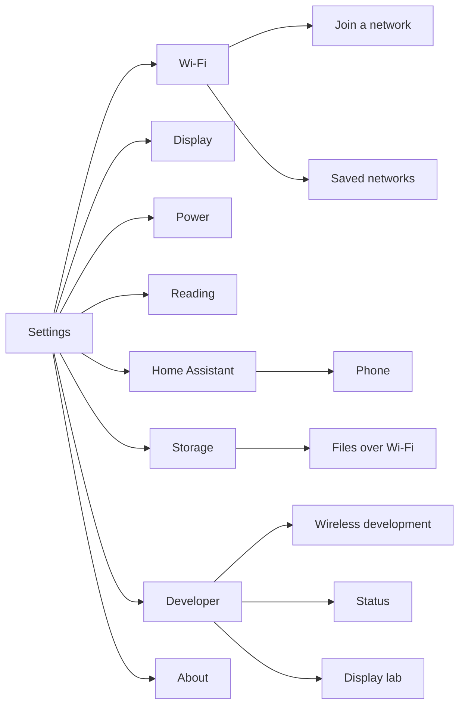
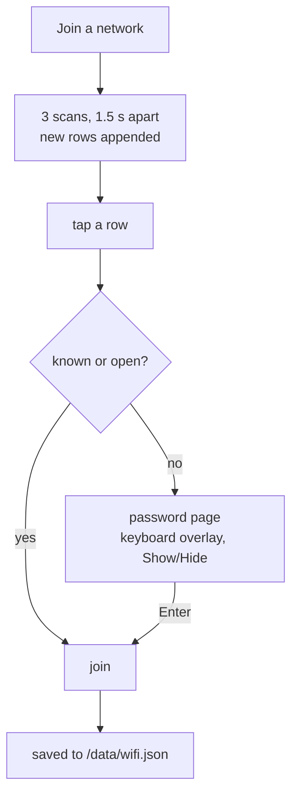
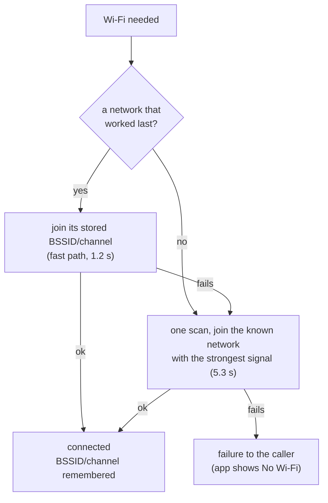
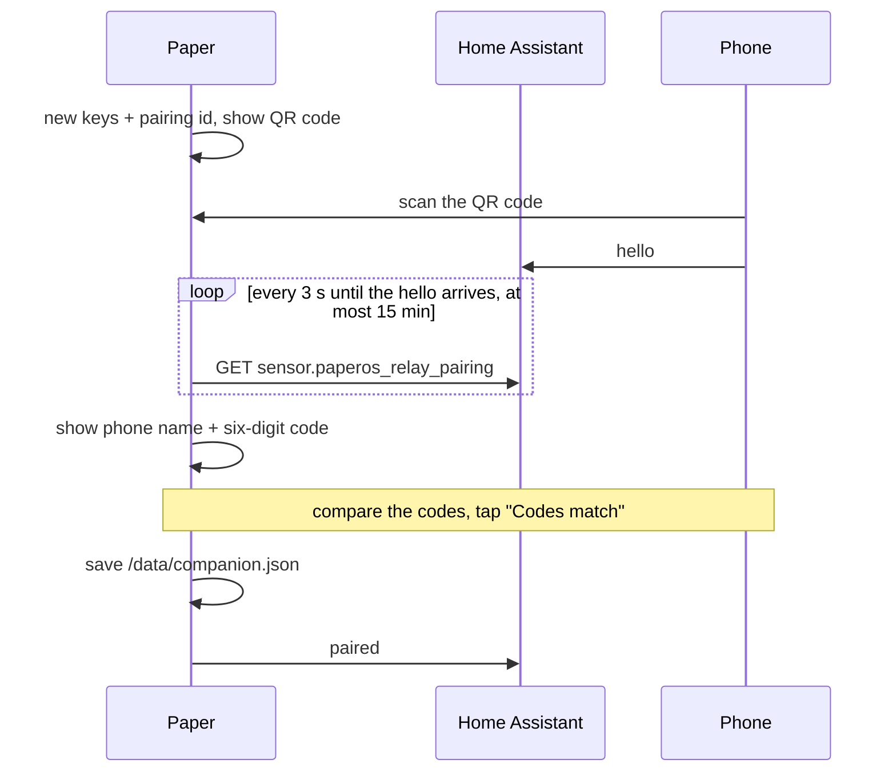
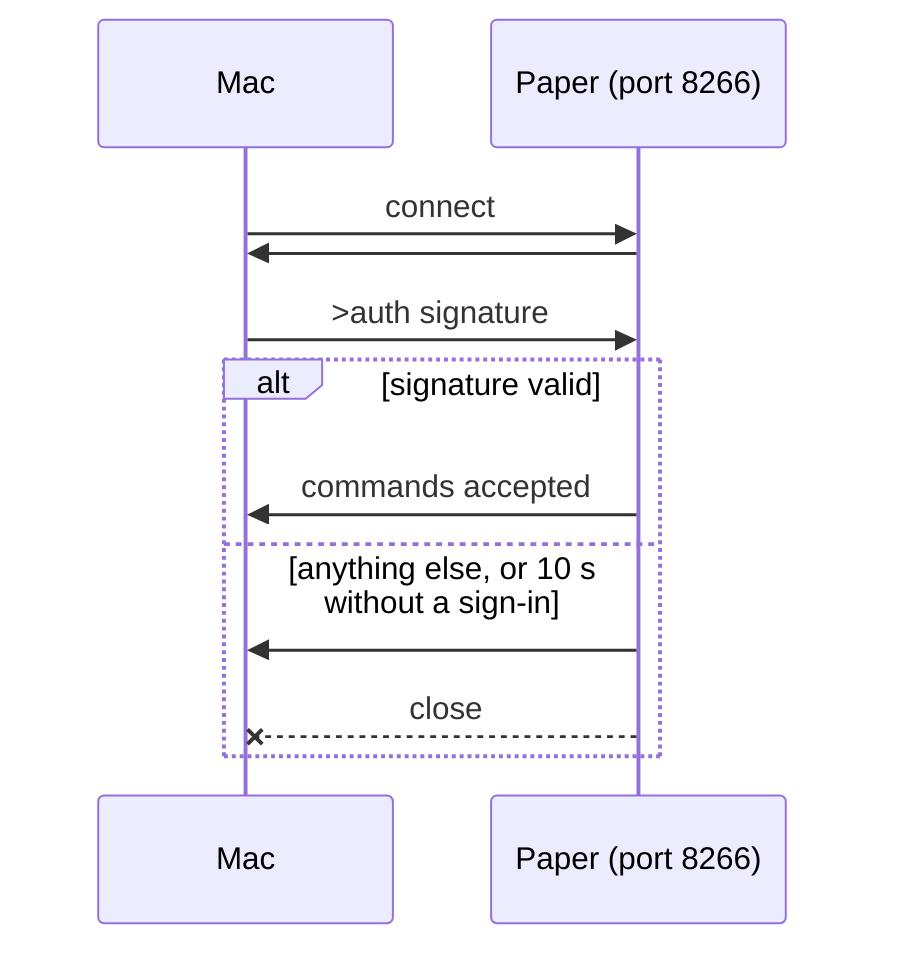

# Settings

System configuration and developer tools: the Settings pages, the config file, the secrets file on the SD card, phone
pairing, the file server and wireless development. Code: `src/apps/settings/settings_app.cpp`.

**Contents**

- [Page tree](#page-tree) · [Screens](#screens) · [Code](#code)
- [Wi-Fi pages](#wi-fi-pages) · [Home Assistant test](#home-assistant-test) · [Config schema](#config-schema)
- [Secrets and provisioning](#secrets-and-provisioning) · [Phone (Settings > Home Assistant > Phone)](#phone-settings--home-assistant--phone)
- [Files over Wi-Fi](#files-over-wi-fi) · [Wireless development](#wireless-development)

---

## Page tree



## Screens

| Screen | Content |
|---|---|
| Settings (list) | Wi-Fi, Display, Power, Reading, Home Assistant, Storage, Developer, About |
| Wi-Fi | Current network and signal. "Join a network" lists networks (name, signal bars, lock); tap one, enter the password on `ui::Keyboard`, connect, save. Saved networks with "Forget". See [Wi-Fi pages](#wi-fi-pages). |
| Display | "Clean screen now"; ghost limit (Stepper 4..16); settle delay (Segmented 300/600/1000 ms) |
| Power | See the table below. |
| Reading | Default font size (S/M/L/XL), margins (narrow/normal/wide), line spacing |
| Home Assistant | Base URL (read-only here), token present yes/no, "Test connection" (GET `/api/`), last error; the Phone page |
| Storage | SD card present/size/free; `/data` used/free; "Clear caches"; Files over Wi-Fi |
| Developer | A menu; nothing on it changes by itself. See the table below. |
| About | Version, build date and build id, board, MAC, licences (fonts, icons, libraries) |

**Power**

| Control | Values | Config key / reference |
|---|---|---|
| "When unused for" | Segmented 1/5/15/30 min/Never: switch-off on battery | `power.autoOffMin` |
| "Then show" | Home \| Sleep screen | `power.idleShow`, apps/launcher.md "When unused", D38 |
| Scheduled refresh of the sleep screen while off | Segmented Off/1/2/4/8 h | `power.refreshHours`, POWER.md |
| "Today on the sleep screen" | Toggle | `power.sleepBoard`, POWER.md "Today board" |
| Stay awake on USB | Toggle | `power.stayAwakeOnUsb` |
| Battery | mV and percent | |

**Developer**

| Entry | What it does |
|---|---|
| Wireless development | Its own page: the switch, address, status, the Mac commands, the phone's Remote control (D39, D40). See [Wireless development](#wireless-development). |
| Status | Memory, refreshes, battery, uptime, power log, log tail; an Update button, no timer |
| Display lab | Test patterns (DISPLAY.md) |
| Sleep test, Power off, HTTP test, Reboot | Buttons. HTTP test is an HTTPS GET of a public page. |

## Code

Built in P2-6 (pages) and P3-7 (Wi-Fi pages, Home Assistant test).

| Part | Role |
|---|---|
| `core/config.{h,cpp}` | Typed structs `display power net reader ha launcher phone developer`. `load()` clamps ranges and ignores wrong types; `save()` writes atomically. |
| `core/secrets.{h,cpp}` | `present`, `keys`, `get`; read-only |
| `core/timefmt` | Time zone from `net.timezone`, used by the status bar and launcher |
| `hal/system.h` | Storage sizes, memory, restart, board, MAC: per-platform hooks |
| `Os::loadConfig()` | Called by the platform mains after the storage is mounted: loads config and secrets, applies the display parameters and the time zone |
| `AppContext` | `config` (read-only) and `secrets`; `os()` is for built-in system apps only |

Page behaviour:

- **Display**: "Clean screen now" is the one Quality refresh. Ghost limit and settle delay are applied to the
  DisplayManager at once and saved.
- **Reading**: font size, margins, line spacing are stored only; the reader app does not read `reader.*` (checked in
  `src/apps/reader/`).
- **Home Assistant**: base URL, token "present" / "not configured", key names. Values are never shown.
- **Simulator**: reports fixed fake storage and memory values, so screenshots are deterministic.
- **Privacy test**: a unit test walks every Settings page with a secrets file holding recognisable values and checks that
  none of them appears in any widget text or in the log.

## Wi-Fi pages

Settings > Wi-Fi has a status row (network, signal, IP; "Off: turns on when an app needs it"), "Join a network", "Saved
networks" and "Connect now".

**Join a network**

- Lists **every** network in range: one row per SSID with the strongest access point, signal and channel, and
  Connected / Saved / Secured / Open. Seven rows to a page (`ui::PagedList`).
- One scan does not see every access point, so the page scans three times in a row (1.5 s apart) and adds what is new
  **at the end**. A listed row never moves under a finger, and a scan that found nothing new redraws nothing
  (`core/wifi.h` `ScanList`).
- The arrows in the title bar start over, in order of signal again.
- A known or open network joins at once. Otherwise a password page opens: the on-screen keyboard as a bottom overlay,
  masked input with a Show/Hide button; Enter joins and saves.



**Saved networks**: card entries are marked; device entries can be forgotten by a tap.

## Home Assistant test

Settings > Home Assistant > "Test connection" sends `GET <base URL>/api/` with the token. The page shows the HTTP
status, the time and the start of the reply. The token and the Authorization header are never shown or logged.

## Config schema

`/data/config.json` holds no secrets. All keys are optional; defaults are in `core/config.h`, reading and clamping in
`core/config.cpp`.

```json
{
  "display":   { "ghostLimit": 8.0, "settleMs": 600, "idleCleanMs": 2000, "pageCleanEvery": 10 },
  "power":     { "autoOffMin": 15, "autoOffMinReader": 30, "idleShow": "sleepScreen", "stayAwakeOnUsb": true,
                 "log": true, "refreshHours": 0, "sleepBoard": true },
  "net":       { "lingerSec": 20, "timezone": "CET-1CEST,M3.5.0,M10.5.0/3" },
  "reader":    { "fontSize": "M", "margins": "normal", "lineSpacing": 1.35 },
  "ha":        { "baseUrl": "http://homeassistant.local:8123" },
  "launcher":  { "resumeLastApp": true },
  "phone":     { "clipboard": true, "sound": false },
  "developer": { "wireless": false }
}
```

- **Removed key**: `inbox.whatsapp.favorites` (D21) went with the direct WhatsApp send (D22). It is not read, and the next
  save of the file drops it. Replies go only to chats with a live notification on the phone (apps/inbox.md "Replying").

## Secrets and provisioning

Secrets live in one text file in the root of the SD card, `/sd/paperos_config`: `KEY=VALUE` per line, `#` comments.

```
# /sd/paperos_config
HA_TOKEN=<long-lived access token>         # present on the card in the device
HA_URL=http://<home assistant LAN ip>:8123 # optional, overrides config.json ha.baseUrl
WIFI_SSID=<network name>                   # optional: lets the device join Wi-Fi before the
WIFI_PASSWORD=<password>                   #   on-screen keyboard exists (task P3-7)
```

### Provisioning

- The file is written by putting the card in a computer. The device reads it at boot (`core/secrets`, task P3-3).
- The device **never writes to it, logs its values, or shows them**. The Settings screens show "token present" and the
  key names only.
- `>status` (and `tools/device.py status`) prints key names and value lengths, Wi-Fi state, heap, and a count of how often
  the first 8 characters of any secret value occur in the last 50 log lines (must be 0).
- The simulator reads the same file from `sim-data/sd/paperos_config` (gitignored). Tests use fixtures and need no token.
- **No SD card**: the device still boots; Home and inbox apps show "No Home Assistant token: put paperos_config on the SD
  card".

### Parsing

- Split at the **first** `=`, trim spaces and carriage returns.
- Ignore blank lines, `#` lines and unknown keys.
- A missing file or key means "not configured", never a crash.

### Several Wi-Fi networks

- `WIFI_SSID` + `WIFI_PASSWORD` for the first network, `WIFI_SSID_2` + `WIFI_PASSWORD_2` ... up to `_8` for more.
- A network without a password key (or with an empty one) is open.
- The value is everything after the first `=` of the line, trimmed, so an SSID may contain `/`, `.`, spaces and `=` (the
  real one on the card has a `/` and a `.`).
- Networks added on the device (Wi-Fi screen) are stored in `/data/wifi.json` (internal flash, never logged), with the
  network that worked last and, per network, the BSSID and channel of the access point.
- **Known networks = card entries + device entries; the card wins on duplicates** (same SSID).

### Connecting

`core/net` joins in at most two attempts. Never a loop: after the scan attempt the failure goes to the caller, and apps
show "No Wi-Fi".



- Times measured on the device.
- The radio is **2.4 GHz only**: a network that exists only on 5 GHz is not found. The scan result (SSIDs, signal,
  channel, no passwords) is logged and shown ("No known network in range"), and nothing is retried.

## Phone (Settings > Home Assistant > Phone)

Pairing with the companion Android app (DECISIONS.md D22, `docs/COMPANION.md` section 2). It sits under Home Assistant
because the Settings list is full (eight rows).

**Not paired**: "Pair phone" makes new keys and a pairing id and shows a QR code (`paperos1:<pid>:<public key>:<HA_URL>`,
`ui/qr.h`).



The pairing in `/data/companion.json` is secret: never shown, logged or readable over USB.

**Paired**: the phone name and these controls.

| Control | Key, default | Effect |
|---|---|---|
| "Share the clipboard" | `phone.clipboard`, on | DECISIONS.md D23: a copy on the Paper goes to the phone; what the phone shares arrives before a paste |
| "Sound for new messages" | `phone.sound`, off | A chime on the buzzer when a read of the relay brings new messages, not from 22:00 to 07:00. Switching it on plays it once. apps/inbox.md "Sound" |
| "Unpair" | | With a confirmation. Sends `unpair` (best effort) and deletes the pairing and the saved notifications. |

UI scripts: `phone-pair`, `inbox-sound`.

## Files over Wi-Fi

Settings > Storage > Files over Wi-Fi (P7-4, D30). The page joins Wi-Fi, starts the file server (`core/file_server` on
`hal::HttpServer`) and shows the address (`http://192.168.1.69`, `:8080` in the simulator) and a new six-digit code.

| Client | How |
|---|---|
| Mac | Finder > Go > Connect to Server, the address, name `paper` (any), password the code |
| Phone or any browser | Open the address |

The browser page:

- lists the books folder, opens folders, makes a folder (New folder);
- uploads with progress;
- downloads a file (Download: saved under its own name; `?download` sends `Content-Disposition: attachment`);
- renames, moves (to a folder by its path, empty for the top) and deletes any file or folder.

Behaviour:

- **Power save**: Wi-Fi power save is off while the page serves and on again when it stops. Downloads run at 250-380 KB/s
  instead of ~30 KB/s; uploads stay ~100 KB/s (the card's write speed).
- **Progress**: below the address, what arrived ("Received Alice.epub", "3 files, 4.1 MB received", "Receiving x, 1.2 MB"
  during an upload).
- **Stop**: Stop (or back) ends it. Ten minutes without a request end it too ("Stopped after 10 minutes without use",
  Start again).
- **Tests**: every action checked in headless Chrome (Playwright) against the simulator, at phone width. Goldens
  `files-storage`, `files-wifi` (UI script `files-wifi`, a fake Wi-Fi network on its test card).

## Wireless development

Settings > Developer > Wireless development (`WirelessPage`; task P7-20, DECISIONS.md D39; replaces the Update over
Wi-Fi page of D37). One switch (`developer.wireless`, default off) enables both remote control and firmware updates, on
port 8266 (`update::kPort`), served by `platform/posix/remote_server` (device and simulator).

### Remote control over Wi-Fi

The commands of `core/remote.h` (frame dump, tap, swipe, log, status, put, ls, rm, set, reboot, ...). From the Mac:

| Command | Does |
|---|---|
| `tools/device.py --wifi shot out.png` | Frame dump (`--host ADDRESS` for another address) |
| `make view ARGS=--wifi` | The live view |
| `tools/push.py`-style uploads | Files |

### Update over Wi-Fi

`make ota` sends the signed package with the remote command `>ota <size>` over the same connection. The device restarts
into it.

- `update::ImageWriter` checks the header before a byte is written, and the SHA-256 before it boots.
- The bootloader's rollback works as in D37.

### Sign-in



The exact lines are `#hello paperos 1 <build> <nonce>` and `>auth <signature>`.

- The signature is the Ed25519 signature of `paperos-remote:<nonce>` with the update key
  (`~/.config/paperos/ota-signing.key` on the Mac).
- One connection at a time; a new one replaces the old.

### While on

- Wi-Fi is kept up (`NetService::keepAlive` every second; joined again every 30 s when it drops, from the boot on), so the
  device does not light-sleep.
- It never switches itself off (no auto-off: `PowerPolicy::idle`). The idle time still brings the sleep screen, with the
  device on.
- What the remote receives counts as use (POWER.md "Auto-off"): no sleep screen during an update, an upload or a live
  view.
- Development only: it costs battery.

### The paired phone

P7-21, D40, COMPANION.md section 10. The companion app's Maintenance (Remote control, Firmware update) signs in with
`>auth-phone` and a key from the pairing.

- It may only take the screen, touch and send a Mac-signed update: `>shot`, `>refresh`, `>tap`, `>long`, `>swipe`, `>ota`.
- When the server starts listening, the Paper sends the phone its address over the relay. The page says so under "On
  your phone".

### Page and host

- The page shows the address with the port and the state: "Joining Wi-Fi...", "Waiting for the Mac or the phone.", "A
  Mac is connected.", "Your phone is connected.", an update's progress. Only that line is checked again, every 2 s, and
  drawn only when it changed.
- The Mac finds the device by `HOST=` / `--host`, `$PAPEROS_HOST` (device.py) or `$OTA_HOST` (ota.py), the address a
  device on USB reports, the last update's, or the saved one (`tools/ota.py host ADDRESS`). Never by a search.

### Measurements and tests

| Measured on the device | Time |
|---|---|
| Frame dump over Wi-Fi, with the sign-in | 0.87 s |
| Update of 2.5 MB | 24.9 s |

- `tests/unit/update_test.cpp`: the writer (every refusal and a whole image in odd pieces), the sign-in (this nonce, this
  key, nothing else), `>ota` parsing.
- UI script `settings` (goldens `settings-developer`, `settings-wireless`, `settings-status`).
- By hand against the simulator: it listens on localhost:8266 with the switch on (`device.py --wifi --host localhost`,
  `ota.py send --sim`).
