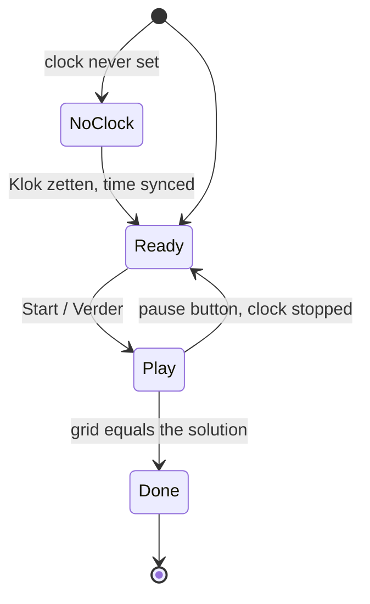

# Somdoku

A daily sum puzzle on the panel, ported from the web game at https://somdoku.nl/. Same puzzle, number, level and share
text as the web game on the same day, so a score from the device can be shared in a WhatsApp group next to scores from
phones. Task P7-8 (games + clipboard, D21).

This doc covers the port and how it is checked, the screens, the clock, the saved state and score squares in text.

## Source of truth

The web game's `src/lib/puzzle.js` and `src/lib/game.js`. The C++ port is `src/apps/somdoku/somdoku.{h,cpp}`
(platform-free). It ports:

- mulberry32, FNV-1a over UTF-16 code units;
- the line-by-line solver and its pass count;
- the generator with the web game's order of random draws;
- `FIRST_DAY` 2026-11-11, `puzzleNumber`, `levelOf`, `dailyPuzzle`;
- streak, clock text;
- the trail (green kept, yellow changed later; a slip fixed before touching another cell does not count) and
  `shareText`.

### Checked against the web code

- `tools/somdoku-vectors.mjs` runs the web game's modules with node and writes `tests/unit/data/somdoku_vectors.json`:
  500 days from 2026-11-11 (day, number, level, passes, attempt, sums, solution), hash and rng values, share texts for
  replayed trails, clock and streak texts.
- `tests/unit/somdoku_test.cpp` compares every value. All 500 days match.
- **If the web game's generator changes, every day's puzzle changes.** Regenerate the vectors and port the change until
  the test passes again:

```bash
node tools/somdoku-vectors.mjs path/to/somdoku > tests/unit/data/somdoku_vectors.json
```

### The day

The day is the device's local date (`net.timezone`). With the clock never set (no Wi-Fi since the battery ran out) the
app shows no puzzle but a button "Klok zetten" (`ctx.syncClock`: joins Wi-Fi once, waits for the time sync, then
today's puzzle).

| Failure | Text |
|---|---|
| No Wi-Fi | "Geen wifi. Probeer het nog eens." |
| Wi-Fi, but no time sync | "Wel wifi, maar geen tijd ontvangen." |

Test: `tests/ui/somdoku-clock.script`.

## Screens (one Screen, three views)



### Ready

Also the pause screen. Shows "Somdoku 6", "maandag 16 november", "Reeks: 3 dagen", Start / Verder, a hint.

The puzzle is generated on the worker (`ctx.async`). It takes at most a few hundred grids, expected well under a second
on the device (not measured yet).

### Play

- **Grid**: 5x5 with the row sums left and the column sums stacked above.
- **Note**: "Nog 22 vakjes leeg.", "Alles ingevuld, maar het klopt nog niet."
- **Keys**: 1 2 3 / 4 Zwart Wis. Tap a cell, then a key. The same value again empties the cell. Tapping the selected cell
  or beside the grid lets it go.
- **The keys never change**: no key shows the selected cell's value, so selecting or filling refreshes only the board.
- **Slip**: the cell filled last changed again before another cell is touched. It does not turn yellow. Letting the cell
  go or pausing does not end it; only selecting another cell does (the web game's `justFilled`; `debugState` shows the
  marks, `marks=ygg;`).
- **Pause**: the title bar's pause button (only while playing) goes back to Ready with the clock stopped.

| Element | Look |
|---|---|
| Filled digit | ink Headline digit |
| Black cell | solid ink |
| Selected cell | thick ink frame (paper on a black cell) |

**Score tally** (`Screen::setTitleAccessory`): left of the pause button, as in the web game's header, the score so far.
Only in Play, not on the pause or ready screen.

| Tile (5 x 5, 11 px, one per cell in the order of filling) | Look |
|---|---|
| kept | solid ink |
| changed later | ink frame with a diagonal |
| not yet | gray(9) frame |

The tally is redrawn only when the marks change, 30 ms after the move, as its own 11 x 11 ink-only push (no settle).
With the cell in one push, the settle would cover the title bar down to the cell.

### Done

- "Opgelost in 3:42", the streak, the timeline as tiles (kept = solid ink, changed = hatched square).
- One button, "Kopieer score" (to `core/clipboard`, toast "Score gekopieerd").
- **No send button**: WhatsApp cannot be sent to directly since the companion relay (D22). To share, paste the score
  into a reply in the inbox (the reply field's long press > Paste; the phone sends it) or on the phone.

As on the web: no checking, no hints, the game ends by itself when the grid equals the solution.

## Clock

The score is the time the puzzle was on screen in the Play view.

- **Runs** from Start / Verder.
- **Stops** at pause, leaving the app (back, home, power-off: `App::onStop`), another screen on top (`onHide`), or the
  solve.
- Light sleep between touches counts (the puzzle stays visible).
- Not shown while playing.

## State

The app store (`/data/apps/somdoku.json`), saved after every move. After a power-off the game comes back paused.

| Key | Content |
|---|---|
| `day` | the puzzle's day |
| `sums` | the puzzle's sums: a saved game of another puzzle is dropped |
| `cells`, `order`, `changed`, `edits` | the grid and the trail |
| `started`, `finished`, `activeMs` | timing |
| `solved` | the solved days, newest 400, for the streak |

## Score squares in text

The share text holds 🟩 (U+1F7E9) and 🟨 (U+1F7E8). The fonts have no emoji, so `ui::drawText` / `measureText` draw
score squares as boxes of the text's height:

| Character | Drawn as |
|---|---|
| 🟩 | solid |
| 🟨 | hatched |
| ⬛ ⬜ 🟥 🟦 🟧 | outlined (Woordle uses ⬛) |

- The text itself keeps the real characters (clipboard, a pasted reply).
- `ui::Label::keepLineBreaks` keeps a score's lines (the inbox send confirmation).

## Not built

- The web game's long-press-and-slide value picker, haptics, the coloured solved grid, the rules page.
- Woordle (woordle.nl) is not rebuilt; PaperOS has its own word game (apps/wordgame.md, D26).
