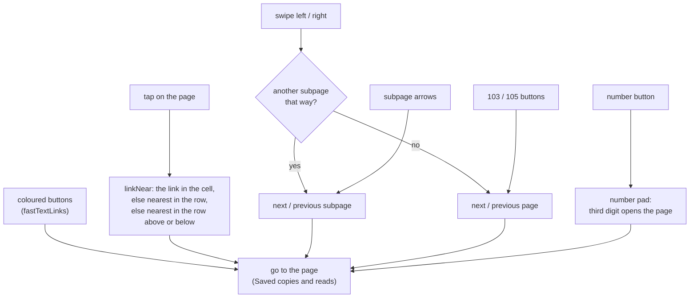
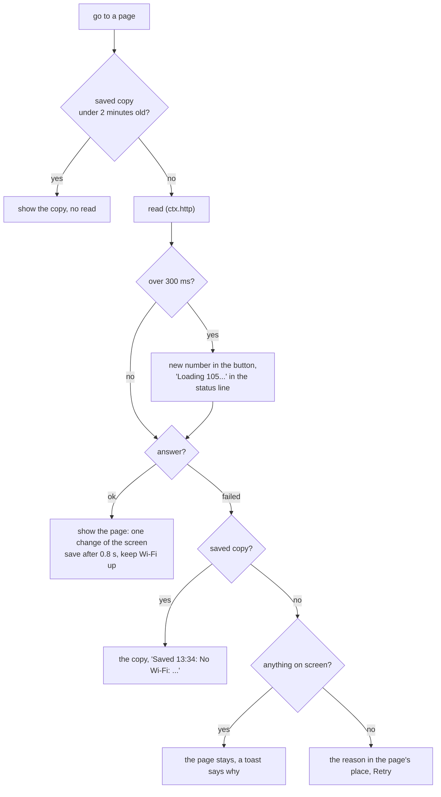
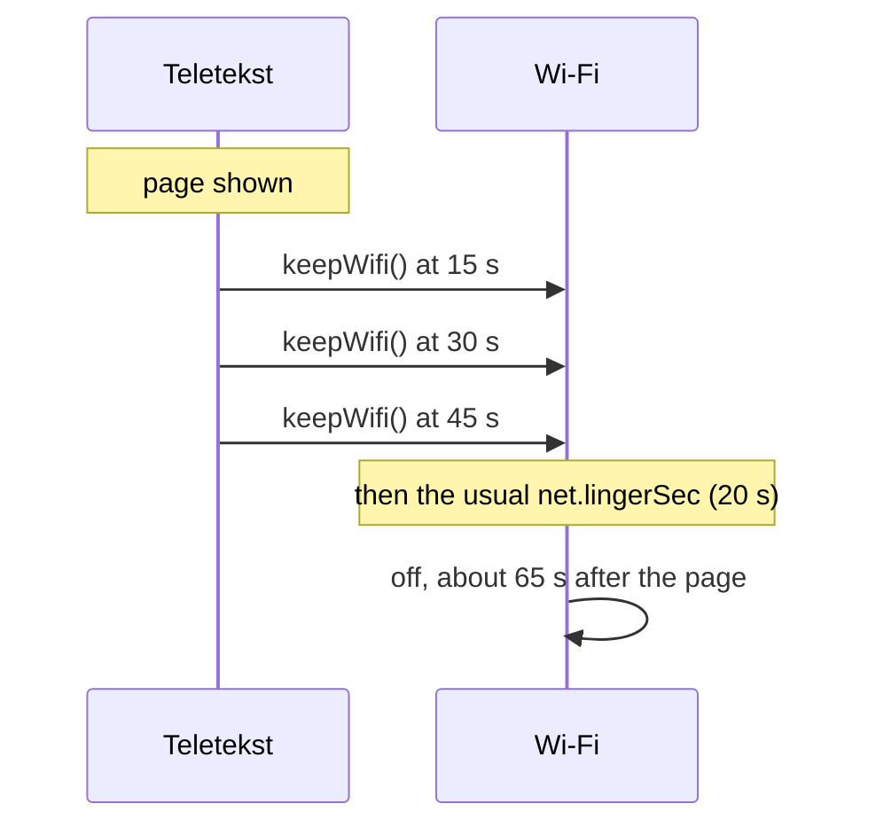

# Teletekst

NOS Teletekst, page by page (task P7-12, D32). Read only; nothing about the user or the device is sent anywhere.

This doc covers the screen and its controls, how the page's colours become ink and paper, the service's JSON, when pages
are read and saved, and the speed measured on the device.

- **Code**: `src/apps/teletekst/`.
  - `teletekst_model.*`: the page JSON into a grid of cells, page references, the link a touch means, the saved copy.
    Unit tested in `tests/unit/teletekst_test.cpp`.
  - `teletekst_app.cpp`: the page view, the buttons, the number pad.
- **Launcher tile**: "Teletekst", icon `Icon::Teletekst` (the logo redrawn as a bitmap, UI.md "Icons"; the loading state
  keeps `tv`), order 99 (after the weather: the tenth tile of page 1).

**Contents**

- [The screen](#the-screen) · [Navigation](#navigation) · [Colours](#colours) · [Data](#data)
- [Saved copies and reads](#saved-copies-and-reads) · [Tests](#tests) · [Memory](#memory)
- [Speed and flicker](#speed-and-flicker) · [On the device](#on-the-device)

---

## The screen

```
+--------------------------------------+
| <  Teletekst               [refresh] |  title bar
+--------------------------------------+
|                     NOS Teletekst 104|
|  the page: 40 x 24 characters,       |  520 x 624 px (13 x 26 a character)
|  10 px left and right                |
|              Updated 13:34           |  status line
| [nieuws] [binnenl.] [buitenl.] [sport]  the page's four coloured links
| [103]   <   [ 104 ]   >   [105]      |  previous page, subpage arrows, number pad, next page
+--------------------------------------+
```

- **The page** is the grid a television shows, rows 0 to 23. Row 24 holds the four coloured links (red, green, yellow,
  cyan on a remote). They are the four buttons below with the same words, so the row is not drawn.
- **The row of four** opens the page's own coloured links (`fastTextLinks`); a page with fewer leaves buttons empty.
- **The bottom row**: the previous and next page by number (empty when there is none). Between them the page on screen as
  a filled button, "702/2" on a subpage; a tap on it opens the number pad.
- **Subpage arrows** beside it: the previous and next subpage. An arrow is there only when that subpage is: none on a
  page without subpages, no left one at the first, no right one at the last.
- **Ink and paper only**: the line under the page and the buttons are ink and paper too (`cutToInk`, like the page's
  characters) and change in the page's own pass ([Speed and flicker](#speed-and-flicker)).
- **Refresh** (title bar) reads the page again.
- **`Screen::sideMargin()`** is 10 px for this screen (the grid needs 520 of the 540 px); every other screen keeps 24.

## Navigation



- **A tap on the page** opens a link: the link in the touched cell, else the link of that row nearest to the finger, else
  the nearest in the row above or below (`linkNear`; a row is 26 px, a finger is not that exact).
  - On an index page a tap anywhere on a headline opens it.
  - A tap where no link is near does nothing.
- **A swipe** left or right over the page: the next or previous subpage while there is one, else the next or previous
  page.
- **Number pad**: a sheet with 0-9, Delete and Cancel. The third digit opens the page. A first digit of 0 or 9 is not
  taken (pages are 100 to 899).

## Colours

The panel has no colour and flat gray costs a second refresh pass (DISPLAY.md "Gray areas cost a flicker"). So the page
is ink and paper only, and the black background of a television is paper:

| On a television | Here |
|---|---|
| text in any colour on black | ink on paper |
| text on a blue, red, magenta or green background (title bars) | paper on an ink bar |
| text on a white, yellow or cyan background | ink on paper |
| text in the colour of its own background (hidden) | nothing |
| mosaic blocks in white, yellow, cyan, blue | solid ink |
| mosaic blocks in red, magenta | two of every three pixel rows ink |
| mosaic blocks in green | every other pixel row ink |
| mosaic blocks on an ink bar | paper |

Green mosaics are Germany and Belgium on the weather map. The Netherlands itself is black there, so paper, inside a cyan
coast line.

- **Characters** are drawn with `Type::Mono` (JetBrains Mono Medium 22, every character 13 px wide; UI.md "Type") and
  then cut to ink or paper at a threshold (`kInkBelow`), like a television's bitmap letters.
- **So the Fast pass shows the page exactly as it is**: nothing is dithered and nothing settles.
- **A new page** is pushed as `Hint::Page`: one Fast pass, a Quality clean every tenth page like the reader.
- **Not drawn**: double height, flashing and separated mosaics are not in the service's JSON.

## Data

`GET https://teletekst-data.nos.nl/json/<page>` or `/json/<page>-<subpage>`: the JSON the NOS Teletekst site itself
reads. Not a documented API, no key (checked on 2026-11-18). No headers of our own, nothing in the address but the page.

| Field | Use |
|---|---|
| `content` | 25 lines of 40 cells (see below) |
| `prevPage`, `nextPage` | the neighbours that exist (`"103"`), `""` if none |
| `prevSubPage`, `nextSubPage` | `"702-2"`, `""` if none; a page with either has subpages |
| `fastTextLinks` | `[{"title":"nieuws","page":"101"}, ...]`, four |

What a line of `content` holds:

| Markup | Meaning |
|---|---|
| plain text | the characters |
| `<span class="yellow bg-blue ">` | text colour, background |
| `<a class="yellow" href="#104">`, `href="#702/2"` | a link, with a subpage |
| `&#xF020;`..`&#xF07f;` | mosaics: the teletext code in the low 7 bits, a bit per block |
| named and numbered character references | the characters they stand for |

- **A page that does not exist** answers 404 with an empty body.
- **The JSON does not name its own page**: the app keeps what it asked for. A page asked without a subpage that turns out
  to have them is subpage 1.

## Saved copies and reads

### Saved copies

- **Where**: every page read is kept in `/data/cache/teletekst/p<page>[-<sub>]`: the time of the read on the first line,
  then the JSON as it came (3-9 KB).
- **How many**: the last 16 pages (`saved` in `/data/apps/teletekst.json`); older files are deleted.
- **When**: 0.8 s after the page arrived (`kSaveAfterMs`), or at once when the screen is left. A flash write while the
  page is drawn holds the drawing up.

### Opening the app

- The page that was open if the app was left less than an hour ago (`page`, `left`), else page 101, the news headlines
  (`kStartPage`; 100 is only an index).
- Its saved copy is drawn in the first frame. It is read again unless the copy is under two minutes old.

### Going to a page



- **A copy under two minutes old** is shown without a read, so back and forth costs no request.
- **Otherwise** the page changes when the answer is there: one change of the screen per tap.
- **"Loading 105..."** shows only for a read that takes longer than 300 ms (`kLoadingAfterMs`: Wi-Fi was off, a slow
  answer). Shown at once, the words flickered in and out before every page and their waveform held the page up ([Speed
  and flicker](#speed-and-flicker)).
- **A read that fails**: the page's saved copy is shown if there is one, with "Saved 13:34: No Wi-Fi: ..." under it.
  Without a copy the page on screen stays and a toast says why ("Page 199 does not exist", "No Wi-Fi: ..."). With
  nothing on screen at all (first open, no network) the reason takes the page's place with a Retry button.
- **No background reads**: nothing is read in the background, on a timer or from the launcher. Wi-Fi comes up for a read
  by itself (`ctx.http`).

### Wi-Fi stays up

Wi-Fi stays up for about a minute after a page is shown (POWER.md "Wi-Fi policy"):



- `ctx.keepWifi()` 15, 30 and 45 s after the page (`kKeepWifiStepMs`, `kKeepWifiSteps`), then the usual
  `net.lingerSec` of 20 s.
- A new page starts the count again; leaving the screen ends it.
- **Why**: the next tap is mostly a read, and 20 s is shorter than reading a page.

| A tap after a pause of 45 s | Time | On the panel |
|---|---|---|
| Wi-Fi gone | 2.4 s (network 1.3 s, a new TLS session 0.74 s) | "Loading", the Wi-Fi icon and the page, one after the other |
| Wi-Fi kept (the service kept the connection) | 0.24 s | one pass |

## Tests

- **Fixtures**: `tests/fixtures/make-teletekst-fixtures.py` writes pages 100, 101, 104, 702 (two subpages) and the 404 of
  199 in the service's shape. **The text is made up**; no page of the real service is in the repository. The map of 702
  is our own drawing of the Netherlands (corner points in the script), coloured as the service colours its map: cyan
  coast line and inland water, green neighbours, red numbers on black land.
- **A look at real pages** without the device: fetch them with curl into a directory outside the repository under the
  fixture names (`GET_teletekst-data.nos.nl_json_702.json`) and run a script with `--fixtures <that directory>`.

| UI script | Covers |
|---|---|
| `teletekst` | the headlines of 101, a headline tap, the number pad, the map with its subpage, a page that does not exist, a coloured link, the index 100 |
| `teletekst-offline` | nothing saved, no network |
| `teletekst-saved` | saved copies without Wi-Fi, the page that was open comes back, page 101 after an hour |

**Unit tests**: references, markup into cells (colours, links, mosaics, character references, too long, broken), the
fixture pages, what is not a page, the saved copy, the mono font's 13 px for every character.

## Memory

- A parsed page (`Page`) is 8 KB: 1000 cells of 8 bytes.
- It lives on the heap (`std::shared_ptr<const Page>`, one on screen and one being parsed at most), never as a local: the
  UI thread's stack on the device is 8 KB (APPS.md "Threads").
- `parsePage` therefore fills its result field by field instead of assigning a fresh `Page{}`.

## Speed and flicker

Camera session, 2026-11-18, with the camera locked (`cam.py around`, 640x480 at 30 fps; times on the panel include the
camera's own ~0.2 s). The firmware before (main at 747deb9) against the changes below. A tap is injected (Down and Up
60 ms apart).

| A tap on "next page" | Before | After |
|---|---|---|
| passes on the panel, page from the network | three, apart: "Loading 105..." and the number (0.2-0.4 s after the tap), the page (0.60-0.80 s), a ripple in the button rows (1.3-1.5 s) | **one** (0.51-0.69 s) |
| pushes in the log | 5 (2 Fast, the page, the strip below it, a Text settle) | 1 Fast (507 x 777) |
| tap to the page handed to the panel driver, network | 440 ms (the page's push call took 170 ms) | **189-295 ms** (the read itself 36-118 ms; push call 65 ms) |
| the same from a saved copy | 133 ms, visible 0.35-0.48 s | 128 ms, visible 0.37-0.58 s |
| drawing the page, network | 92-138 ms | 37-54 ms (saved copy: 33-37 ms) |
| a tap after 45 s of reading | 2.4 s, "Loading", the Wi-Fi icon, then the page | 0.24 s, one pass |

### What changed

- **"Loading 105..." at once.** The words and the new number were pushed on the tap; the answer came 40-160 ms later. The
  words flickered in and out before every page, and their waveform was still running while the page was drawn and
  pushed (PSRAM is several times slower then, DISPLAY.md "Navigation speed"). Now only a read that takes over 300 ms
  says so (`kLoadingAfterMs`).
- **The buttons and the line under the page were a second and third pass.** They changed as `Content`: a Fast pass of
  their own and a Text settle 0.6 s later, three pulses in both button rows after every page. They are now drawn as ink
  or paper (`cutToInk`: the same cut as the page's characters) and invalidate with `Hint::Page`. So the page, the line
  and the buttons are one Fast pass with nothing to settle. The line under the page is ink for that (gray text inside the
  box of a Fast pass comes out as dots), and a subpage arrow that leads nowhere is absent instead of gray.
- **The saved copy was written while the page was drawn.** The worker's flash write holds up everything that reads the
  flash, fonts included: the drawing took 65-99 ms from the network against 33 ms from a copy. The write waits 0.8 s.
- **Wi-Fi went off 20 s after a read**: [Wi-Fi stays up](#wi-fi-stays-up).
- **Around a page, the Fast look stayed.** A page push dropped every pending settle it touched, also the part outside the
  page. After the number pad closed over the page, the line and the buttons kept the rough look of the pad's closing
  pass. Fixed in the DisplayManager for every app (DISPLAY.md "As implemented": a page push and older settles).

### Also measured, nothing to change

| What | Result |
|---|---|
| opening the app from the launcher | one Fast pass, visible 0.41-0.62 s after the tap; its settle 0.6 s later is not visible |
| the number pad | opens in one pass (0.29-0.49 s) |
| a swipe to a subpage | one pass, handed over 229 ms after the gesture |
| ghost after eight page turns over pages with ink bars, against the same page after a Clean | 0.86 % of contrast (p95 4.3 %), 1.5-1.6 % at worst where the lines of earlier pages lie in an empty part of the page: what the reader has (DISPLAY.md); the clean every tenth page stays |
| the weather map (702, live) | letters, map lines and numbers read well in the camera's picture; the striped blocks read as an even gray there (the camera does not resolve 1 px, so whether single rows hold is not known; nothing fills in to black) |
| a read after Wi-Fi was off | still ~2.4 s and three small passes ("Loading", the Wi-Fi icon, the page): the network's time, shown as it is |

Not for the camera: whether the cut letters of the buttons and the line read comfortably. They are the page's own style;
the camera shows them legible.

## On the device

Flashed and run on 2026-11-18 with injected taps, frame dumps and the log:

| Check | Result |
|---|---|
| TLS to the service | works (its chain ends at USERTrust RSA, among the firmware's 44 roots, D31) |
| a read, Wi-Fi up | 0.7 s the first request, 36-190 ms after it on the kept connection |
| render of a page | 37-54 ms from the network, 33-37 ms from a saved copy |
| tap to the page pushed | 189-295 ms from the network, 128 ms from a saved copy |
| internal heap, lowest | 79 KB (idle 83 KB); nothing stays allocated after leaving |
| UI thread stack left | 2.9 KB of 8 |
| frame of page 702 | the simulator's, pixel for pixel (only the time in the status line differs; measured before the buttons changed, the title bar and the button rows again after it: 0 px differ) |

On the panel: [Speed and flicker](#speed-and-flicker).
