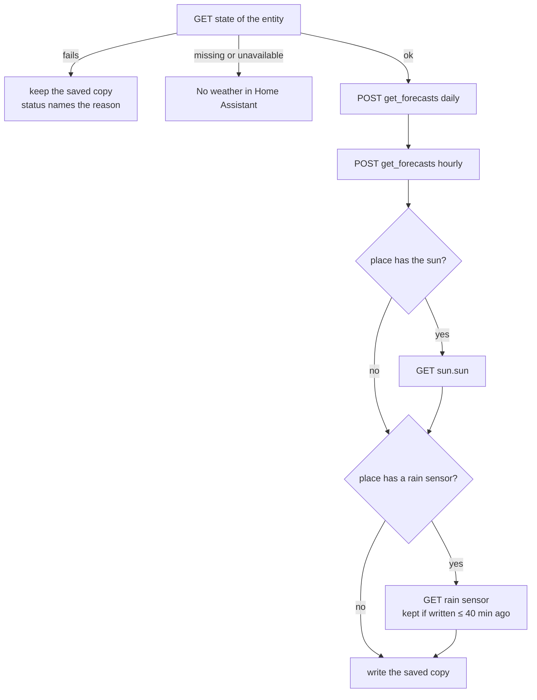

# Weather

The weather from Home Assistant's **Google Weather** integration (task P7-11, D29): now, the next hours in three-hour
blocks, and ten days, for one to four places. Read only: the app never changes anything in Home Assistant.

Launcher tile "Weather", icon `cloud-sun`, order 98 (after the agenda).

**Contents**

- [Code](#code) · [Outside the app](#outside-the-app) · [Places](#places)
- [Calls](#calls) · [Rain sensor](#rain-sensor)
- [Screen](#screen) · [States](#states) · [Stale](#stale) · [Saved copy](#saved-copy) · [Tests](#tests)

---

## Code

`src/apps/weather/`:

| File | Content |
|---|---|
| `weather_model.*` | parsing, the saved copy, texts; unit tested in `tests/unit/weather_test.cpp` |
| `weather_fetch.*` | the read of one place (`fetchPlace`), shared with the scheduled refresh; the sleep screen's weather source |
| `weather_app.cpp` | the screen and its three pages |

## Outside the app

- **Today board**: the first place's saved copy is the weather on the sleep screen's Today board (POWER.md "Today board"):
  today's high and low, the day's condition, the next four blocks (`fillSleepBoard`).
- **Scheduled refresh**: reads the first place while the device is off (`refreshSaved`).

## Places

Each place is a weather entity in Home Assistant (in the Google Weather integration every location is an entity of its
own). Default: **Thuis** (`weather.thuis`) and **Office** (`weather.office`). With more than one place a `Segmented`
switcher stands above the pages.

Settings live in `/data/apps/weather.json` (no Settings row):

| Key | Default | Meaning |
|---|---|---|
| `entity`, `name` | `weather.thuis`, Thuis | the first place |
| `rain` | `sensor.google_neerslag_minuten` (only while `entity` is the default) | the place's minute forecast sensor |
| `entity2`..`entity4`, `name2`..`name4`, `rain2`..`rain4` | place 2: `weather.office`, Office, no rain sensor | the other places; an empty entity leaves a place out, without a name the entity's id is used |
| `sun` | 1 | the number of the place `sun.sun` belongs to; 0: none |
| `place` | | the place shown last (written by the app) |

- **Switching place** shows its saved copy at once and reads it only if that copy is 15 minutes old or more (or
  missing). The page stays.
- **Sunrise and sunset** come from `sun.sun`, the sun at Home Assistant's own location: shown for Thuis only.
- **Adding a place**: in Home Assistant, Settings > Devices & services > Google Weather > "Locatie toevoegen" (name, a pin
  on the map), then put its entity in `entity3`. The office was added this way: name "Office", a pin near the office;
  its entity is `weather.office`. Until such an entity exists the tab says "No weather in Home Assistant" (404).

## Calls

The same for every place, with its entity (Thuis as the example):

| What | Request | Used |
|---|---|---|
| Now | `GET /api/states/weather.thuis` | `state` (condition), `temperature`, `apparent_temperature`, `humidity`, `wind_speed`, `wind_bearing`, units |
| Days | `POST /api/services/weather/get_forecasts?return_response` body `{"entity_id":"weather.thuis","type":"daily"}` | `datetime`, `condition`, `temperature` (high), `templow`, `precipitation`, `precipitation_probability` |
| Hours | the same with `"type":"hourly"` | `datetime`, `condition`, `temperature`, `precipitation`, `precipitation_probability`, `is_daytime` |
| Sun | `GET /api/states/sun.sun` | `next_rising`, `next_setting` |
| Rain, next hours | `GET /api/states/sensor.google_neerslag_minuten` | `attributes.segments[]`: `timeFrame.startTime` / `endTime`, `qpf.quantity` (mm in the segment), `probability`; `last_reported` |

One read of a place (`fetchPlace`), on the worker, one request after the other over one kept-alive connection (BACKEND.md
"Connection"):



- **Five requests** for Thuis, three for a place without the sun and the rain sensor.
- **The state decides**: without it nothing else is asked. A forecast or the sun that fails keeps what was saved.
- **Rain segments** kept: those still ahead and starting within 6 hours, at most 96.
- **Versions**: the forecast attribute on the entity is gone since Home Assistant 2024.3; `weather.get_forecasts` with
  `?return_response` over REST needs 2024.8 or later (the house runs 2026.10).
- **Answer shape**: `{"changed_states":[],"service_response":{"weather.thuis":{"forecast":[...]}}}`.
- **Non-admin**: both calls are in the non-admin subset (D18).
- **Checked against the live instance** on the device: 10 days and 24 hours, every field the app uses is there
  (`is_daytime` too), a read takes about 4 s after the Wi-Fi join. The fixtures follow Home Assistant's weather entity
  model and the Google Weather integration.
- **Entity**: `weather.thuis` is the official Google Weather integration's entity (the Home Assistant config's
  `packages/google_neerslag.yaml` names it); `weather.forecast_thuis_2` in `packages/condens.yaml` is another source.
- **Not used**: UV, pressure, visibility, gusts, dew point.

### Rain sensor

The house's own REST sensor (Home Assistant config, `packages/google_neerslag.yaml`): Google's minute forecast
(`forecast/minutes:lookup`) for the home zone, read every 10 minutes, segments up to 6 hours ahead. The house
dashboard's rain graph uses the same data; the rate, the log scale and the headline follow it.

Only Thuis has one; another place gets one with the key `rain2`..`rain4` in `/data/apps/weather.json`.

## Screen

Three pages in a `ui::Pager` (swipe left or right, or the arrows of the bar); the page stays when a read comes in. With
one place there is no switcher and the pages are 80 px taller (one more day on the first page).

### 1 Now

Goldens `weather`, `weather-office`.

```
| <  Weather                     (refresh) |
| [   Thuis   ][   Office   ]              |   the places
| [64 px icon]  6°            ~ SW 22 km/h |
|               Partly cloudy   o 85%      |
|               Feels like 3°   T 10%      |   T = umbrella: rain chance in the current hour (+ mm if any)
|------------------------------------------|
| Next hours                               |
| Now  15:00 17:00 19:00 ... 03:00         |   8 columns, two hours apart (16 hours): icon, temperature, rain %
|------------------------------------------|
| Next days                                |
| Today     (icon) 80%  1°  [==bar==]  7°  |   4 rows: today + 3 days; rain % and mm, low, range bar, high
| Tomorrow  ...                            |
|  <              1 / 3                 >  |
|               Updated 13:34              |   status line
```

### Rain in the next two hours

On the first page, between "now" and the next hours (goldens `weather`, `weather-dry`). Shown only for a place with a rain
sensor, and only while the read is less than 40 minutes old and Home Assistant wrote the sensor less than 40 minutes
before the read (an older forecast is not shown as one).

```
| Rain from 14:00                 max 4.8 mm/h |   or "Rain until 15:15", "Rain for the next 2 hours"
|          ▂▂▂▄▄▄▆▆▆▄▄▄▂▂▂                     |   one bar per segment, ink; height on a log scale, top 20 mm/h
|-------|---------|---------|---------|--------|
|     14:00     14:30     15:00     15:30      |   a tick at every half hour
```

- A segment counts as rain from 0.05 mm/h; its rate is its amount scaled to an hour.
- No rain in the two hours: one line, "Dry for the next 2 hours", and no graph.
- The graph takes the place of day rows: 2 days below it with the place switcher, 3 below the dry line (4 without
  either).

### 2 Hours

Goldens `weather-hours`, `weather-office-hours`. Today and tomorrow as **blocks of three hours**.

```
| Today                       (sunset) 16:58 |
| [13–15] [15–18] [18–21] [21–24]            |   a block: hours, icon, temperature, rain %, mm
| Tomorrow                   (sunrise) 08:41 |
| [00–03] [03–06] [06–09] [09–12]            |
```

- **Clock-aligned**: blocks start at 00, 03, ... 21 local time, four in a row. A day's first row is the night and
  morning, the second the afternoon and evening, so a column always means the same time of day.
- **Past**: a row that is past is left out; hours that are past are left out of today's first block ("13–15" at 13:34).
- **Block values**: the condition most of its hours have (the earliest of equals), the mean temperature, the highest
  rain chance and the summed amount; the moon when most of its hours are night (`dayBlocks` in `weather_model`, unit
  tested).
- **Forecast end**: a last block the forecast ends inside (one hour of 12–15) is left out. With 24 hours of forecast (what
  Google Weather gives) that is three rows at most; of a fourth row (48 hours or more, read before noon) the last would
  fall off below the switcher and is left out.
- **Sun**: the next rise and set (`sun.sun`) stand in the header of the day they fall on.

### 3 Days

Golden `weather-days`. All days of the daily forecast (ten), rows like on the first page.

- The range bar puts each day's low..high on the scale of the days on that page: track `fill`, range `ink`.

### On every page

- **Rain figures**: rain % is left out under 1 %, the amount under 0.05 mm (no "0.0 mm").
- **Moon**: replaces the sun for `clear-night`, and for hours with `is_daytime: false` (without it: local 19:00-07:00).
- **Hours** start at the hour that holds now: a saved forecast does not show hours that are past.
- **Reads**: when the app opens (if the last read is 15 minutes old or more), every 15 minutes while it stays open, and
  on the title bar's refresh button.
- **Texts** are English like the rest of the system. Conditions: Sunny, Clear, Partly cloudy, Cloudy, Rain, Heavy rain,
  Thunder, Thunderstorm, Snow, Sleet, Fog, Hail, Windy, Windy cloudy, Severe weather.

## States

| Situation | Screen |
|---|---|
| Read worked | the weather; status "Updated 13:34" |
| Read failed, a saved copy exists | the saved weather; status "Saved data from 07:10: `<reason>`" ("Wed 07:10" on another day); see [Stale](#stale) |
| Read failed, nothing saved | `EmptyState` "Cannot reach Home Assistant" + reason + Retry |
| No `HA_URL` / `HA_TOKEN` | `EmptyState` "Not set up yet" |
| Home Assistant answers 401 / 403, nothing saved | `EmptyState` "Home Assistant refused the token" + "Check HA_TOKEN in paperos_config on the SD card." + Retry (with a saved copy: status "Saved data from 07:10: Token rejected") |
| Entity missing or `unavailable` | `EmptyState` "No weather in Home Assistant" + Retry (or the saved copy with that reason) |
| A forecast call failed, the state worked | the new "now" with the saved forecasts; toast "Forecast not available" |

### Stale

When the saved "now" is more than 90 minutes old, the top block shows the forecast for the current hour ("Forecast for
13:00") and leaves out wind and humidity: the forecast for this hour is a better guess than an old reading.

## Saved copy

- One per place: `/data/cache/weather/<entity>.json`, the parsed values, not the raw answers; about 4 KB each.
- The copy from before there were places (`/data/cache/weather/weather.json`) is removed when the app opens.

## Tests

UI scripts (goldens in `tests/ui/golden/`):

| Script | Case | Shots |
|---|---|---|
| `weather` | fixtures, both places | `weather`, `weather-office`, `weather-office-hours`, `weather-hours`, `weather-days` |
| `weather-offline` | no answer, nothing saved | |
| `weather-stale` | a copy saved at 07:10, no answer at 13:34 | `weather-stale`, `weather-stale-hours` |
| `weather-dry` | one place, no switcher, a rain sensor without rain | |
| `weather-unset` | no card config | |
| `weather-denied` | 401 | |
| `weather-missing` | the second place's entity in `/data/apps/weather.json` does not exist: 404, Thuis works | |

Fixtures: `tests/fixtures/make-weather-fixtures.py` writes the HTTP fixtures: both places' entity and two forecasts, sun,
the rain sensor with a shower and one without, the 404 and the 401, the stale script's saved copy, and the first place
once more for `ha-agenda.example.test` (the Today board's host). The two forecast POSTs share a URL, so their fixtures
carry a body hash (SIMULATOR.md "HTTP fixtures").
