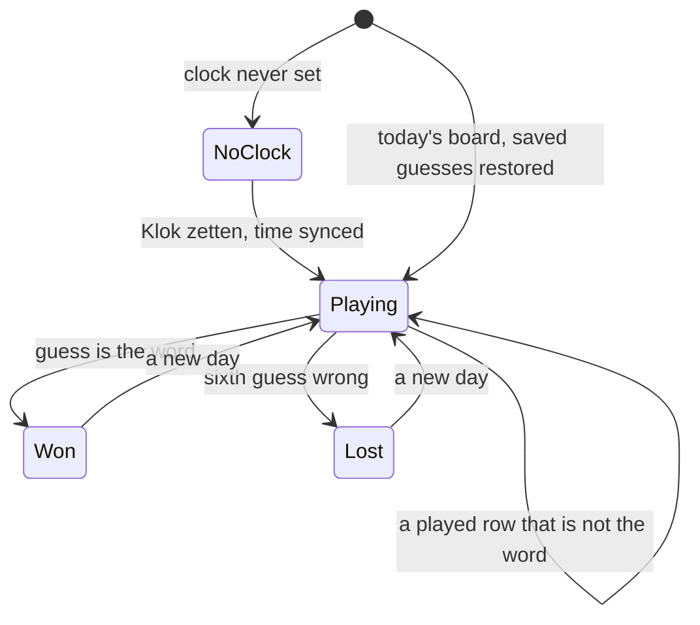
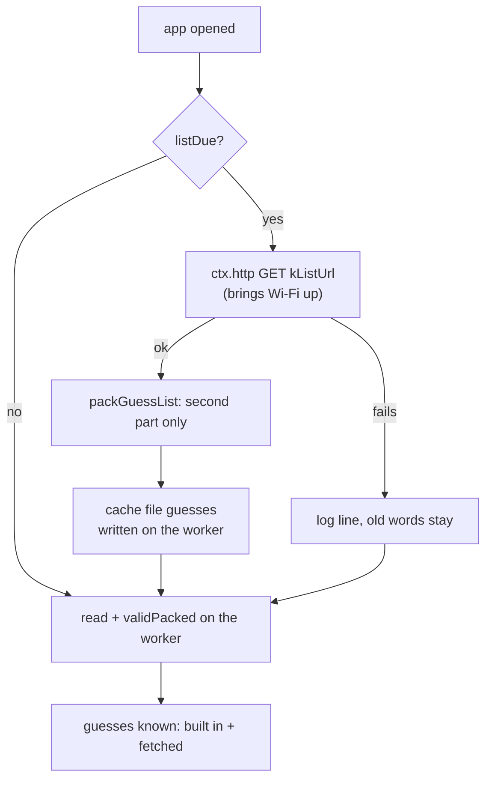

# Word game

A daily five-letter word game in Dutch: one word a day, six tries. PaperOS's own game in the genre of the daily word
puzzles. Task P7-9.

This doc covers what the game is and is not, the rules, the look without colours, the screens, the day, the word lists
(built in and fetched), the saved state and the tests.

**Contents**

- [What it is not (DECISIONS.md D26)](#what-it-is-not-decisionsmd-d26) · [Names](#names) · [Rules](#rules)
- [Look (no colours on this panel)](#look-no-colours-on-this-panel) · [Screens](#screens) · [The day](#the-day)
- [Words](#words) · [Fetched words](#fetched-words) · [State](#state) · [Tests](#tests) · [Not built](#not-built)

---

## What it is not (DECISIONS.md D26)

It is **not woordle.nl**. It keeps the genre and leaves out what belongs to that game: its list of daily words in its
order (so its puzzle of the day and its puzzle number), its texts, its colours.

- The word of the day is **not** the one the web game has that day, and the number in the title is the word game's own.
- A shared score has the genre's shape: `<name> <number> <tries>/6`, an empty line, rows of 🟩 🟨 ⬛.
- The name is one constant, `wordgame::kName`. The title bar, the shared score, the sleep screen and the launcher tile
  follow it; the app id and the store file are `wordgame`.

### Display name

| | Value |
|---|---|
| `wordgame::kName` now | "Woordle" |
| As built | "Vijfje" |
| App id, files, this doc | `wordgame` / "the word game" |

- With the name "Woordle", only the name changed. The words, their order and the puzzle number are the word game's
  own, so it is still not the web game's puzzle of the day.
- A score shared as "Woordle N x/6" carries the word game's number and is about the word game's word.
- With the name "Vijfje" as built, woordscore.nl would not file a shared score under the web game.

## Names

- Directory, files, namespace, app id, tests, goldens and this doc are `wordgame` / "word game".
- What the player reads is Dutch (it is a Dutch game), and the title is `kName`.
- **Old app id** `vijfje`: a device that ran it has `/data/apps/vijfje.json` and `/data/cache/vijfje/`. `adoptOldData()`
  moves them to the new names on the first open (`wordgame-adopt.script`). That function is the one place where the old
  word is left in the code.

## Rules

- Guess the word of five letters in six tries. Type with the keys; Enter plays the row, Backspace removes a letter.
- A guess must be in the word list. Otherwise a toast "Onbekend woord", and the row is not used up. Fewer than five
  letters: "Te weinig letters".
- After each guess every letter gets a mark: right place, in the word at another place, not in the word.
- **Double letters**: a letter that is in the word once is marked once. Right places first, then other places from left
  to right while the word has that letter left (`marksOf`, unit-tested: `label` against `fabel` marks the first L as
  not in the word).
- The keys show the best mark each letter got so far.
- Won on the guess that is the word; lost after the sixth. Then the result, "Kopieer score" and "Statistieken".
- No hard mode, no settings.

An unknown word or too few letters does not use up the row.

## Look (no colours on this panel)

| Mark | Tile | Key |
|---|---|---|
| right place | solid ink, paper letter | solid ink, paper letter |
| another place | hatched ring around a paper middle, ink letter | the same, smaller |
| not in the word | gray(9) frame, gray(5) letter | 1 px gray(10) outline, gray(10) letter |
| typed, not played | 3 px ink frame, ink letter | |
| empty / not tried | 1 px ink frame | 2 px ink outline |

- **Used-up keys fade**: their letter and outline are gray(10) (`kSpentKey`); gray(5) was still too easy to read. The
  tiles keep gray(5), so a played guess stays readable.
- **Empty tile frames are ink, not gray**, on purpose: taking a letter back then changes only black and white pixels and
  is one Fast push. With a gray(9) frame the Fast pass showed no tile at all and the settle pass drew it again 0.6 s
  later (`wordgame-backspace.script` keeps it so).
- A typed letter still gets its settle pass (anti-aliased edges), as all text does.
- **Known leftover**: a letter typed and taken back within 0.6 s leaves the letter's settle pass pending, one Text push
  on the empty tile (DisplayManager, not the app).
- **Score squares**: solid = 🟩, hatched = 🟨, outline = ⬛, the same three looks `ui::drawText` uses for score squares
  in text. All three are ink and paper only, so the Fast pass shows the final look.
- A legend line under the board says what they mean. It never changes, so it is never refreshed.

## Screens

The word list fetch has no screen: see [Fetched words](#fetched-words).

### Game

`GameScreen`. Title "Woordle 431" (`kName` and the puzzle number).

- **Board**: 6 x 5 tiles (72 px), then the legend.
- **Keys**: three rows, QWERTY, Enter and Backspace in the last row as icons; 45 x 72 px keys. A tap in a gap goes to
  the nearer key.
- **Refresh**: a typed letter refreshes its tile only. A played row refreshes the row, and 30 ms later the keys in their
  own push.
- **Game over**: the keys make way for "Geraden in 3 beurten" + the streak, or "Niet geraden" + "Het woord was: SPONS",
  and the buttons "Kopieer score" (to `core/clipboard`, toast "Score gekopieerd") and "Statistieken".
- **Clock never set**: "De klok is nog niet gezet", no board, and a button "Klok zetten" (`ctx.syncClock`: joins Wi-Fi
  once, waits for the time sync, then the day's board). Failures as in Somdoku; `tests/ui/wordgame-clock.script`.

### Statistieken

`StatsScreen`, also the info button in the title bar.

- Played, % guessed, streak, longest streak.
- Games per number of tries as bars (1 to 6 and X for not guessed; today's game is the solid bar).
- The rules in three lines and the legend.
- "Woordenlijst bijwerken" ([Fetched words](#fetched-words)) and the word count line.

## The day

The day is the device's local date (`net.timezone`): a new word at local midnight; nothing comes from a server.

| Function | Result |
|---|---|
| `dayOf(date)` | whole days since 2026-11-16 (day 0, puzzle 1) |
| `answerOf(day)` | the answers list at `day` modulo its length: it wraps after 688 days and works for days before the first |

The screen checks the date again each time it is shown (back from the statistics). An app left open over midnight
keeps yesterday's board until then.

## Words

| File | Words | Role |
|---|---|---|
| `assets/wordgame/answers.txt` | 688 common words | can be the word of the day |
| `assets/wordgame/extra.txt` | 1566 more words | accepted as a guess |

Both are written for PaperOS, not taken from another game or a dictionary file. `tools/gen-wordgame-words.py` checks them
(a-z, five letters, no answer twice) and writes `src/apps/wordgame/words_data.cpp`:

- all 2254 words sorted in one string (binary search, about 11 KB of flash);
- the answers in a fixed shuffled order as indices into it, so the source does not show next week's words to someone
  reading it.

Rules for editing:

- Adding a word to `extra.txt` is always safe.
- **Adding or removing an answer changes which word falls on which day** (the shuffle is over the sorted list), also for
  today's saved game: the saved game is dropped when its word is not today's any more.
- **The built-in list is small**: a real word can get "Onbekend woord" until the fetched words are there (next section).

## Fetched words

More **accepted guesses** come from `https://woordscore.nl/woordlijst.txt` (`wordgame::kListUrl`): plain text, one word
per line, two parts split by one empty line.

- **Only the second part is used**: 5616 accepted words on 2026-11-16, 3381 of them not built in.
- The first part is the web game's words of the day in its order. The parser skips it and it is never stored (D26), so
  the word of the day always comes from the built-in answers.

### When

| Case | Fetch |
|---|---|
| Never fetched, or the list is a week old (`kListMaxAgeS`) | on opening the app |
| After a failed try | not before a day later (`kListRetryS`) |
| Clock not set | only when there is no list yet |

`listDue` decides this (unit-tested). `ctx.http` brings Wi-Fi up by itself. Nothing is shown; a failure is a log line and
the old words stay.

### Kept

- `packGuessList` turns the second part into packed sorted words. Lines that are not five letters a-z are skipped; at
  most 12000 words, the response at most 200 KB.
- Written to the app's cache (`/data/cache/wordgame/guesses`, 28 KB) on the worker.
- On every open the file is read on the worker and checked (`validPacked`: sorted, a-z, whole words). Until it is in,
  only the built-in words count.
- So the game works offline with the last fetched words, and with the built-in ones when nothing was ever fetched.
- A guess is known if it is built in or in the fetched list. Saved guesses are not checked again on reload (the fetched
  list may not be loaded yet).

### By hand

Statistieken > "Woordenlijst bijwerken" fetches the list now. The button text is "Ophalen..." meanwhile; then the toast
"Woordenlijst bijgewerkt" or "Ophalen lukte niet" (the old words stay).

- Both paths share `fetchList`. The game screen loads the new words when it is shown again.
- Also the way to run the fetch on the device for a measurement: info button (tap 504 92), then the button (tap 270
  870). `debugState` of the statistics screen says `list=N; busy=0|1`.

### Store keys and count line

- Store keys: `listTried`, `listFetched` (Unix seconds), `listWords`.
- The statistics screen's last line says "Woorden: 2254 ingebouwd, 5616 opgehaald op 16-11" (or "nog niets
  opgehaald"). Day and month only: with the year it did not fit on the device.

### Measured

| Where | Result |
|---|---|
| Simulator against the live address (`--fixtures none`), 2026-11-16 | 5616 words cached, equal to the file's second part |
| Device (by hand, D27 firmware), same day | 5616 words in about 3 s (TLS 1.5 s, request 1.4 s, body 0.1 s); internal heap lowest 70 KB |

## State

The app store (`/data/apps/wordgame.json`), saved after every guess. The letters typed in a row that was not played are
not kept.

| Key | Content |
|---|---|
| `day`, `answer` | today's game |
| `guesses` | comma-separated |
| `recorded` | today's result is in the statistics |
| `played`, `won`, `streak`, `maxStreak` | statistics |
| `lastWon` | day number |
| `turns` | six counts |
| `listTried`, `listFetched`, `listWords` | the fetched list ([Fetched words](#fetched-words)) |

The streak counts days won in a row: a lost or a missed day ends it (`streakOn`).

## Tests

**Unit**: `tests/unit/wordgame_test.cpp` covers marks (double letters), key marks, days and numbers, the word list
(sorted, a-z, every answer a word, each answer once per round, wrap), the share text byte for byte, statistics and
streak, and the fetched list (only the second part, line ends, an error page, a damaged cache file, when it is due).

**UI scripts**

| Script | Covers |
|---|---|
| `tests/ui/wordgame.script` | a win in three with all marks, unknown word, too few letters, copy, statistics, restart |
| `wordgame-lost.script` | resume after a restart, six wrong guesses |
| `wordgame-launcher.script` | page 2 of the launcher |
| `wordgame-backspace.script` | one push for a backspace |
| `wordgame-list.script` | the list from a fixture, a word that is only in it, then Wi-Fi off and a restart: the cached words still count |

- The first three have preset data with a recent `listTried`, so they fetch nothing.
- The scripts run on 2028-01-20 and -21 (days 430 and 431), so no golden shows a word of the coming year.
- Key positions in a script come from `debugState()` (`keys=q49,708 ...`; `+` is Enter, `-` is Backspace).

## Not built

A countdown to the next word (the panel does not tick), colour themes, high contrast, a large keyboard, hard mode.
